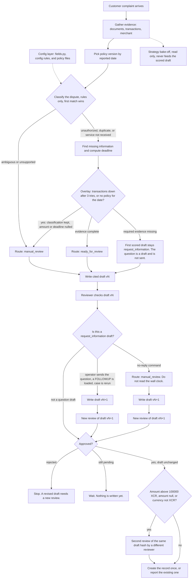
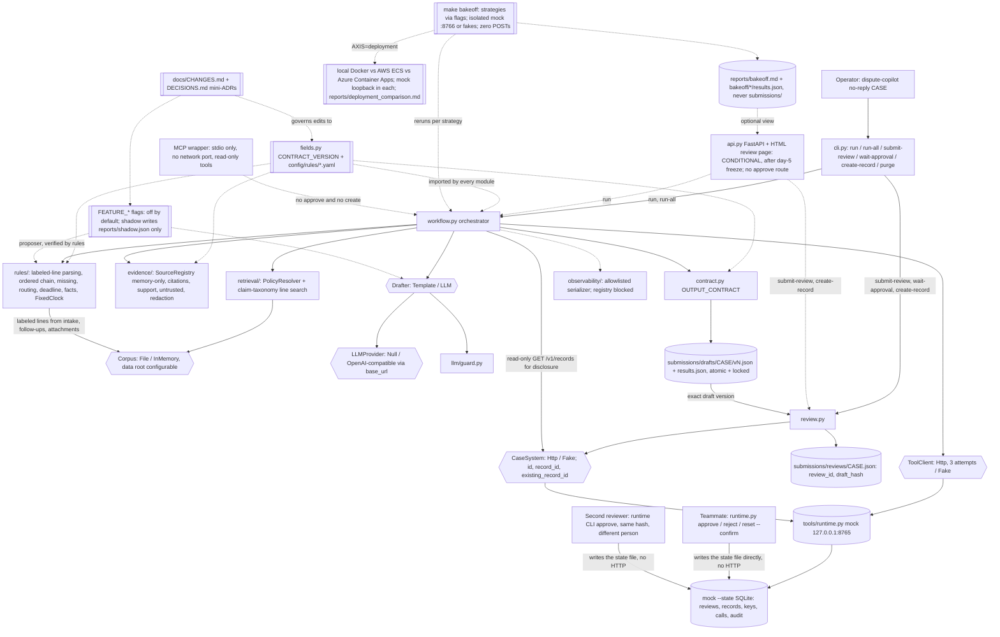
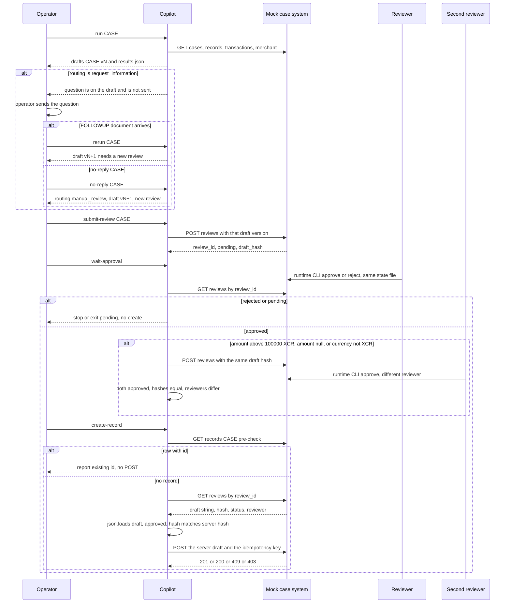

# Card Dispute Copilot Plan, Version 3.7

## Options for the client to choose from

Our recommendation is the default that ships. Every alternative is either a flag that can be switched mid-build (with a `docs/CHANGES.md` row and, where marked, sign-off) or a roadmap item. Where the bake-off measures an option, the choice is backed by `reports/bakeoff.md` or `reports/deployment_comparison.md`.

| Decision | Options (trade-off) | Recommendation (why) | Sign-off |
|---|---|---|---|
| LLM role | **None**: fully deterministic, zero model risk, plainer prose · **Prose only**: better narrative, scored fields untouched · **Prose + shadow classifier**: measures LLM agreement with the rules, no output effect · **Assist classifier**: may fill stages the rules leave empty; adds classification risk | **Prose only**, with the shadow classifier available in the bake-off. Readable drafts at no cost to scored accuracy; shadow data informs a later assist decision | Facilitator (Q1) for any model; client + facilitator for assist |
| Model provider and location | **None (Null)**: no dependency, works offline · **Cohort cloud endpoint** (OpenAI-compatible `base_url`): best quality, data leaves the boundary · **On-prem Ollama**: data stays in, smaller model, slower | **Null by default, cohort endpoint when Q1 approves**; Ollama shown as the regulated-client option. The system is complete without a model; one `base_url` switch changes provider | Facilitator (Q1) |
| Deployment target | **Local Docker**: assessed baseline, air-gap capable · **AWS ECS Fargate**: managed, IAM/VPC setup · **Azure Container Apps**: managed, simpler exec, managed identity | **Local Docker as the assessed path plus one cloud** (whichever access lands first). Reproducible today; the deployment bake-off compares the rest | Facilitator (Q2: is the mock allowed in the cloud) |
| Citation retrieval | **Exact label**: deterministic, exact quotes · **BM25**: tolerant of rephrasing, ranking noise · **Hybrid**: label first, BM25+RRF for the rest | **Exact label**. Matches the evaluator's exact-substring check; BM25 and hybrid stay as bake-off columns and go into the default only if a rephrased fixture defeats label search | None (all quotes still verified) |
| Drafter | **Templates**: deterministic, cheap, plainer · **LLM**: fluent, costs tokens, needs the guard and repair | **Templates by default, LLM when approved**. Scored fields are identical either way (provider-invariance test) | Facilitator (Q1) for LLM |
| Parsing strictness | **Strict labels**: zero false reads, brittle to messy input · **Label aliases** (`labels.yaml`): recovers casing and synonyms, every alias reviewed | **Aliases from a reviewed list**. Hidden cases may be messier; the messy-variant bake-off proves it, and attachments still can't set authorization | None (D change, logged) |
| Reviewer model | **One reviewer** under the threshold · **Second mock review** of the same draft hash when the amount is above 100000 XCR, when the amount is null, or when the currency is not XCR | **Both, by amount.** A different person approves the second review through the runtime CLI. The app never approves. create-record checks that both reviews are approved, the hashes are equal, and the reviewers differ. Threshold and currency XCR live in config/rules. Null amount fails safe. This is the pod's own design. Scored fields do not change, so the day-5 freeze does not move | Finalized (pod) |
| UI | **CLI only**: satisfies the human-review interaction, zero UI risk · **Conditional HTML page**: friendlier demo, more surface | **CLI as the interaction of record; HTML only if the day-5 freeze is green**. Polished UI isn't scored | None |
| Case update or reopen | **Out of scope** (create-only) · **Phase 2** with its own approval and hash contract | **Out of scope now, phase 2 pitched**. The brief makes updates a stretch task needing a separately agreed contract | Client + facilitator |
| MCP exposure | **Thin MCP wrapper**, stdio only · **None** | **Thin MCP wrapper.** Transport is stdio only, with no network port. Tools are read-only: no approve tool and no create tool. Tests check the tool list and that calls cannot write. Scheduled in days 6-8. The service still owns scored fields and writes | Finalized (pod) |
| Missing information | **Keep asking** · **Ask once, then `manual_review`** | **Ask once, then `manual_review`.** The first scored draft stays `request_information` (D04, D12). The question is a draft; the operator sends it and the app does not. A reply is a FOLLOWUP document and a rerun writes draft vN+1, which needs a new review. No reply is `dispute-copilot no-reply CASE`, which routes to `manual_review` and does not read the wall clock | Finalized (pod) |
| Observability depth | **Baseline**: 14 spans, JSON logs, N/median/max · **Full**: plus sub-spans, per-span metrics, bake-off p95 · **External**: OTel exporter and dashboards | **Full** (in plan). It costs little and answers the latency and cost questions; the OTel exporter is a swap later | None; external stack = client |
| New dispute type | **None** · **Phase 2** type (e.g. "item not as described") with new procedure text and a contract bump | **Phase 2 only, after new procedure text is supplied**. The contract enumerates five classifications; we never invent policy | Client + facilitator |

## What to present

1. Value and boundaries: deterministic rules own scored fields, a human approves every write (2 min).
2. Normal case D01 end to end: draft, citations, trace, teammate approves, `record_id`, audit (5 min).
3. Ambiguous case D05: five evidence groups, `manual_review`, null deadline (4 min).
4. Assessor-chosen failure or attack: D07 outage, D08 injection, or D09 redelivery (5 min). If D07 is shown, a null amount needs both approvals; say that rule is the pod's own design.
5. Live change, D-class via config (3 min).
6. Bake-off tables (extended session, 6 min):
   - retrieval axis: label vs BM25 vs hybrid
   - parsing axis on the messy set
   - drafter axis: templates vs LLM, scored fields identical
   - deployment comparison: local vs cloud, latency, cold start, cost (or "not run")
7. "Options for the client to choose from" table, then limitations and roadmap (1–2 min).

## Verified facts this plan depends on (from `tools/runtime.py`, `tools/evaluate.py`, `pyproject.toml`)

- `POST /v1/reviews` → `{review_id, status, draft_hash}`. `GET /v1/reviews/{id}` → `id, case_id, draft, hash, status, reviewer`, where `draft` is a canonical compact JSON **string**. It must go through `json.loads` before `POST /v1/records`, which needs a dict and returns 400 otherwise.
- `GET /v1/records/{case_id}` → a row with `id`. `POST /v1/records` 201 → `record_id`. A 409 duplicate → `existing_record_id`.
- `record_id` = the case's logical key. For D02/D09 it is `dispute-double-02`.
- `POST /v1/records` check order: idempotency-key lookup (200 replay / 409 `idempotency_conflict`) → approval and hash (403) → duplicate (409 `duplicate_case`). Our key includes `review_id` and the hash, so the conflict branch is unreachable for us; the 403-before-409 order is what forces a full approval for D09.
- The hash canonical form is `json.dumps(sort_keys=True, separators=(",",":"), ensure_ascii=False)`. The evaluator's source text for tool payloads is plain `json.dumps(payload, sort_keys=True)` (default separators, default `ensure_ascii`; confirmed by `tools/validate_package.py`), e.g. `{"source_id": "CARD-D01-TRANSACTIONS", "transactions": [{"amount": 117, ...}]}`, matched by raw substring. The merchant source text **contains** `private_token`, so the registry must hold the raw payload; the quote filter, not the source, keeps tokens out.
- Mock tool-attempt counters are cumulative per case until reset. A fault fails when attempt n ≤ failures (or always). `GET /v1/records/{case_id}` is not counted and not audited, so a read-only lookup during `run` is free.
- `pyproject.toml` has `package = false` and `dependencies = []`, so a `src/` package needs build-system changes. `tools/validate_package.py` checks fixture integrity only (it reads `dataset.json`; it does not test our solution).
- `evaluate.py` fails a **missing** case individually (`submitted: false`), but a **duplicate** `case_id` or a case **not in the gold** is a format error that fails the whole submission. So `run` upserts by `case_id` into `results.json`, and hidden-style fixtures are evaluated from their own submission file with their own `--data` directory.
- `runtime.py reset` requires `--confirm` and clients must be stopped first (README). `runtime.py approve/reject` writes the `--state` SQLite file directly (no HTTP route exists). Approval therefore has to run wherever that file lives: the mock container locally and in the cloud.

## Workflow at a glance

## Detailed code flow

```mermaid
flowchart TD
    subgraph S0["Config layer - loaded once, validated at startup"]
        K1["fields.py: CONTRACT_VERSION, field names, enums, allowed missing IDs"]
        K2["config/rules/*.yaml: label aliases, routing order, missing questions, retryable codes, redaction + injection patterns"]
        K3["rules/decision_table.yaml + policies/*.md day counts"]
    end
    subgraph S1["Startup - cli.py run"]
        A1["dispute-copilot run CASE"] --> A2["config.Settings: MOCK_BASE_URL, --data-dir data root; load S0, fail fast if invalid"]
        A2 --> A3{"adapters/tools.py health check: GET /health"}
        A3 -->|"unreachable"| A4["MockUnavailable: exit non-zero, no file"]
        A3 -->|"ok"| A5["GET /v1/cases"]
    end
    subgraph S2["Evidence"]
        A5 --> L1["case_system.py lookup: GET /v1/records/CASE read-only; existing id noted for narrative only, run-order dependent"]
        L1 --> B1["adapters/corpus.py FileCorpus: policies/*.md and all documents by Source ID"]
        B1 --> B2["rules/documents.py: labeled lines via label aliases; Authorization: from intake + all follow-ups, Attachment status: from attachments"]
        B2 --> B3{"HttpToolClient.transactions: attempt 1..3, retryable codes from config"}
        B3 -->|"503, attempts left"| B3
        B3 -->|"503 x3"| B4["amount/currency null; transaction_id and reported_date kept from intake; manual_review overlay; no TRANSACTIONS citation"]
        B3 -->|"200"| B5["transaction facts, currency passed through verbatim"]
        B4 --> B6
        B5 --> B6{"HttpToolClient.merchant"}
        B6 -->|"ok"| B7["evidence/untrusted.py: private_token never copied to facts, prompt, output or logs; injection flagged"]
        B6 -->|"failure, no breaker"| B8["merchant context unavailable"]
        B5 -.-> REG
        B7 -.-> REG
        REG[("SourceRegistry, memory only: raw text incl. private_token; refuses JSON, pickle, repr")]
    end
    subgraph S3["Deterministic rules"]
        B7 --> C1{"retrieval/policy.py PolicyResolver"}
        B8 --> C1
        C1 -->|"reported date in range"| C2["policy_ids = V1 or V2 + CARD-PROCEDURE-01; flag if transaction date is in another period, disclosure only"]
        C1 -->|"out of range"| C3["assumption pending Q7: procedure only, deadline null, manual_review, disclose no policy quote"]
        C2 --> C4
        C3 --> C4
        C4["rules/classify.py ordered chain, first match exits"] --> C5{"1 unsupported"}
        C5 -->|"no"| C6{"2 conflict across N customer statements"}
        C6 -->|"no"| C7{"3 unauthorized"}
        C7 -->|"no"| C8{"4 duplicate"}
        C8 -->|"no"| C9{"5 service"}
        C9 -->|"no"| C10["6 ambiguous"]
        C5 -->|"match"| C11
        C6 -->|"match"| C11
        C7 -->|"match"| C11
        C8 -->|"match"| C11
        C9 -->|"match"| C11
        C10 --> C11["rules/missing.py: IDs + questions from config; service fields read only after service_not_received"]
        C11 --> C12["rules/routing.py: precedence order from config"]
        C12 --> C13["rules/deadline.py: reported_date + policy days"]
    end
    subgraph S4["Evidence output"]
        C13 --> D0["retrieval/search.py: line search by claim taxonomy"]
        D0 --> D1["evidence/citations.py: raw substring check against REG"]
        D1 --> D2{"evidence/support.py predicates"}
        D2 -->|"fails or quote not found"| D3["drop citation + disclose, no fallback quote"]
        D2 -->|"passes"| D4
        D3 --> D4["drafting.py Drafter: Template, or OpenAI-compatible provider via base_url, facts + verified quotes only"]
        D4 --> D5["llm/guard.py: customer-message commitments"]
        D5 --> D6["evidence/redaction.py Redactor, patterns from config"]
        D6 --> D7{"contract.py validate against fields.py"}
        D7 -->|"invalid"| D8["manual_review result with disclosure; run-all exits non-zero"]
        D7 -->|"valid"| D9["atomic write: drafts/CASE/vN.json + locked upsert into results.json"]
        D8 --> D9
    end
    subgraph S5["Human review and record"]
        D9 --> AQ{"routing is request_information?"}
        AQ -->|"yes: question stays on the draft and is not sent"| AQS["operator sends the question"]
        AQS -->|"FOLLOWUP document loaded"| AQR["rerun writes draft vN+1 and needs a new review"]
        AQS -->|"no-reply command, no wall clock"| AQN["route manual_review, write draft vN+1, new review"]
        AQR --> E1
        AQN --> E1
        AQ -->|"no"| E1["submit-review posts the exact draft version and stores review_id and draft_hash"]
        E1 --> E2{"wait-approval"}
        E2 -->|"pending or timeout"| E3["exit pending, resume later"]
        E2 -->|"rejected"| E4["stop, no create; a revision is vN+1 and a new review"]
        E2 -->|"approved"| E7{"GET records pre-check: row with id?"}
        E7 -->|"yes"| E8["report the existing id, no POST"]
        E7 -->|"no"| EA{"amount above 100000 XCR, amount null, or currency not XCR?"}
        EA -->|"yes"| EB["second review of the same draft hash; a different reviewer uses the runtime CLI"]
        EB --> EC{"both approved, hashes equal, reviewers differ?"}
        EC -->|"no"| E4b["stop, nothing written"]
        EC -->|"yes"| E5
        EA -->|"no"| E5["re-fetch the review and json.loads the draft string"]
        E5 --> E6{"status approved and compact hash equals the server hash?"}
        E6 -->|"no"| E4b
        E6 -->|"yes"| E9["POST the server draft; key from case, review id, and server hash"]
        E9 -->|"201"| E10["report record_id"]
        E9 -->|"200"| E11["replay the same record"]
        E9 -->|"409"| E12["report existing_record_id"]
        E9 -->|"403"| E4b
    end
    S0 -.-> S2
    BK["bakeoff/: same pipeline per strategy axis; reads only, outputs to reports/bakeoff"] -.-> S2
    BK -.-> S3
    BK -.-> S4
    S0 -.-> S3
    S0 -.-> S4
    S2 -.-> T["observability: allowlisted span and log fields, redacted; REG never serialized"]
    S3 -.-> T
    S4 -.-> T
    S5 -.-> T
    T --> TM["every span: start, end, duration_ms; one JSON logger: run_id, case_id, span, level, event; metrics.json per-span breakdown"]
```

## Guiding design decision

Everything the rubric scores numerically is specified exactly in `CARD-PROCEDURE-01.md` and the two policies, so **deterministic code owns** these: policy selection, deadline math, classification, missing-field detection, routing precedence, fact extraction, retry limits, redaction, idempotency, duplicate handling and citation construction. The **LLM is optional**. Its one job is drafting the narrative prose and customer message from structured facts and verified quotes. **It never classifies and never sets a scored field.** With no provider configured, templates are used and the system still works fully.

## Finalized design decisions

The pod locked these three. They override the matching rows in "Options for the client to choose from".

1. **Thin MCP wrapper (stdio only).** A thin wrapper sits on the service so later callers use the same copilot. Transport is stdio only. There is no network port. The wrapper does not own classification or scored fields. Its tool list has no approve tool and no create tool, and tests fail if either name is advertised or if a call can write. Owner: Teammate 2, days 6-8. Test owner: Nachiketh. It does not move the day-5 freeze.
2. **Second review above 100000 XCR, and when the amount is null.** create-record asks for a second mock review of the same draft hash, approved by a different reviewer through the runtime CLI. The app never approves. Before POST, both reviews are approved, the hashes are equal, and the reviewers differ. The mock POST still cites one review id; the app will not call it until the second review passes. Threshold `100000` and currency `XCR` live in `config/rules/approval.yaml`. A null amount (D07, tool outage) requires both approvals, and so does a currency other than XCR, so the XCR threshold is not applied to an unknown or different currency. Owner: Teammate 2. Test owner: Nachiketh. Day-8 exit. This is the pod's own design. Scored fields stay on the procedure, so the day-5 freeze does not move.
3. **Ask once, then `manual_review`.** When required information is missing, the first scored draft stays `request_information` with the missing-field questions, so D04 and D12 stay on the evaluator's expected routing. The question is a draft for the reviewer. The operator sends it. The app never sends it. A reply is loaded as a FOLLOWUP document and the case is rerun: that writes draft vN+1 and needs a new review. No reply is the operator command `dispute-copilot no-reply CASE`, which sets routing to `manual_review`, writes draft vN+1, and needs a new review. The command does not read the wall clock or today's date. Events: `followup.question_drafted`, `followup.reply_loaded`, `followup.no_reply`. Fixture: `tests/fixtures/ask_once/`. Owner: Nachiketh. Day-5 exit.

## Architecture

## Workflow (tool-dependent branching)

1. Call `GET /v1/cases`. If the startup health check fails, abort with no file; from here on every requested case is written. Do a **read-only** `GET /v1/records/{case_id}` so the narrative can disclose an existing record (D09); this is not the authoritative pre-check, which stays in `create-record`. **Run-order dependence:** because of this lookup, the D02 and D09 *narratives* depend on whether the shared record already exists when `run` executes (D09 run before D02 is created says "no existing record"; run after says "existing record `dispute-double-02`"). Scored fields never depend on it. The disclosure states it reflects the ledger at run time, and the authoritative answer comes from `create-record`. A rerun after creation produces a new draft version with a new hash, which needs its own review. Load the case documents from the corpus (configurable data root) by `Source ID`, never from `dataset.json`.
2. Parse **labeled lines only**. From the intake: `Reported date`, `Transaction ID`, `Authorization`, `Promised service date`, `Purchase receipt`, `Delivery note`. From follow-ups: `Authorization` only. From attachments: `Attachment status` only, so an attachment can never alter the authorization picture. A missing `Authorization:` line counts as `not supplied`. Free text in the intake feeds keyword stages. Prose instructions in follow-ups, attachments or merchant records are never acted on.
3. Policy: `CARD-POLICY-V1` covers 2026-01-01..08-31 and `V2` covers 09-01..12-31, always plus `CARD-PROCEDURE-01`. Selection is by `Reported date` only (policy text). If the transaction date from the tool falls in a different policy period, that is disclosed in the narrative and trace, and selection is unchanged. A date outside both ranges takes the assumption branch (pending Q7): procedure only, `deadline=null`, `manual_review`, cite the procedure, and disclose that no policy quote is available.
4. `GET transactions`: at most 3 attempts on a 503. On persistent failure: `amount`/`currency` null, `transaction_id`/`reported_date` kept from the intake, `manual_review`, and no TRANSACTIONS citation (D07). A transient failure (D10) proceeds normally. Because counters are cumulative per case, reset state before assessed runs.
5. `GET merchant`: untrusted data. The raw payload (token included) is registered for citation checks; `private_token` is never copied into facts, prompt, narrative or logs, and the Redactor rejects any quote containing it. Injection is flagged (D08). A failure means "context unavailable". There is no breaker.
6. Classify with the ordered chain (see the decision table), first match exits. The service fields are read only after `service_not_received`.
7. Routing precedence and deadline exactly per the procedure. The deadline is still computed under `manual_review` for supported types (D07 `2026-10-31`). When required fields are missing, ask once. The first scored draft stays `request_information` (D04, D12 unchanged) and the question is part of that draft. The operator sends the question. The app never sends it. A reply is loaded as a FOLLOWUP document and the case is rerun: that writes draft vN+1 and needs a new review. It does not loop back into the first evidence pass. No reply is `dispute-copilot no-reply CASE`, which sets routing to `manual_review`, writes draft vN+1, and needs a new review, without reading the wall clock or today's date. Events: `followup.question_drafted`, `followup.reply_loaded`, `followup.no_reply`.
8. Citations come from the source-text registry and are raw-substring verified. A quote that isn't found is dropped and disclosed.
9. Draft (template, or LLM from facts and verified quotes), then guard, then redaction, then contract validation. Write `submissions/drafts/<case_id>/vN.json` atomically and **upsert** under a file lock by `case_id` into `results.json` (a duplicate `case_id` is an evaluator format error). `run-all` always writes every requested case once the health check has passed. Hidden-style fixtures write to their own submission file.
10. `run` writes the draft and does not submit it. `submit-review` POSTs that exact latest draft version and persists `review_id`/`draft_hash` to `submissions/reviews/<case_id>.json`. `wait-approval` polls: `pending` exits as pending, `rejected` is terminal for that review (`revise` creates vN+1, which needs a new review), `approved` continues. The app never approves. The days 1-2 CARD-D01 script uses the same split: `run`, then `submit-review`, then `create`.
11. `create-record` is allowed only after approval, whatever the routing (pending Q9). Order:
    - Pre-check `GET /v1/records/{case_id}` first. A row with `id` is reported and nothing is posted.
    - When the amount is above 100000 XCR, the amount is null, or the currency is not XCR, require a second mock review of the same draft hash, approved by a different reviewer through the runtime CLI. The app never approves. Both reviews must be approved, the hashes must be equal, and the reviewers must differ. The POST still cites one review id. The app will not call POST until the second review passes.
    - Re-fetch `GET /v1/reviews/{id}` and `json.loads` the draft string. Status must be `approved`. The compact-canonical hash must equal the server hash on that review.
    - POST that server draft, never the local file. The idempotency key is `dc-` plus the sha256 of `v1|{case_id}|{review_id}|{server_hash}`. When a second review is required, that material also includes the second review id.
    - 201 means `record_id`, 200 means replay, 409 means `existing_record_id`, 403 means stop.
    - Always report the record ID from the API (for D02/D09 that is `dispute-double-02`).
    - The days 1-2 CARD-D01 script implements the pre-check, the re-fetch, the hash check, the server draft, and the single-review key. D01 is under the threshold, so the second review is not in that script. It lands in `create-record` in days 6-8.

## Retrieval layer

- **Policy lookup is deterministic.** `retrieval/policy.py` parses every `policies/*.md` for `Effective from`, `Effective through` and `<Type> deadline days`, then picks by the scenario's `Reported date`, never today's date. A similarity search could surface the wrong version; D11 must select V1 by date.
- **Days 3–5: deterministic section/line search keyed by claim taxonomy.** `retrieval/search.py` maps each claim key (see the citation plan) to the line pattern that supports it in a specific source (e.g. the procedure's `Use <type> ...` sentence, the policy's `<Type> deadline days:` line). Source IDs are preserved, and the line is then verified as a substring in the registry. No chunk offsets unless traces or HTML actually use them.
- **BM25 and hybrid (days 6–8, non-blocking)** are bake-off columns behind `search.py`. They become the default only if a rephrased hidden-style fixture defeats label search. Either way, the same exact-substring check applies.
- **Why no vector DB:** the corpus is small and fixed, exact quotes and stable source IDs are what gets scored, deterministic search is explainable, and it reuses the version-supersession and leak-check lessons from the RAG repo.

## Repository layout

- `src/dispute_copilot/adapters/`: `tools.py`, `case_system.py`, `corpus.py`
- `src/dispute_copilot/retrieval/`: `policy.py`, `search.py`
- `src/dispute_copilot/rules/`: `documents.py`, `decision_table.yaml`, `engine.py`, `classify.py`, `missing.py`, `routing.py`, `deadline.py`, `facts.py`, `clock.py`
- `src/dispute_copilot/evidence/`: `citations.py` (memory-only `SourceRegistry`), `support.py`, `redaction.py`, `untrusted.py`
- `src/dispute_copilot/llm/`: `base.py`, `null.py`, `openai_compat.py`, `guard.py`
- `src/dispute_copilot/observability/`: `tracing.py`, `logging.py`, `events.py`, `metrics.py`
- `src/dispute_copilot/reliability/`: `idempotency.py` (key; uses `serialization.hash_canonical()`), `degradation.py`
- `src/dispute_copilot/`: `fields.py` (`CONTRACT_VERSION`, names, enums, allowed IDs), `serialization.py` (`hash_canonical()`, `citation_source_text()`), `config.py`, `contract.py`, `drafting.py`, `workflow.py`, `review.py`, `api.py`, `cli.py`, `mcp_server.py` (stdio only, days 6-8), `templates/review.html` (conditional)
- `config/rules/` (`labels.yaml`, `routing.yaml`, `missing.yaml`, `retry.yaml`, `redaction.yaml`, `injection.yaml`, `approval.yaml`), `config/prices.yaml`
- `tests/fixtures/messy/` (generated messy variants, never from `dataset.json`), `src/dispute_copilot/bakeoff/` (runner, report, recommendation rules)
- `tools/lint_gates.py`; `.github/workflows/ci.yml`; `Dockerfile`, `docker-compose.yml`, `deploy/<cloud>/`, `Makefile`
- `tests/unit/`, `tests/integration/` (subprocess mock, temp `--state`), `tests/fixtures/hidden_style/`, `tests/fixtures/ask_once/` (intake with authorization not supplied, a FOLLOWUP that supplies `Authorization: denied`, and the expected routes: v1 `request_information`, rerun v2 with a new review, no-reply v2 `manual_review`; not taken from `dataset.json`)
- `docs/`: `ARCHITECTURE.md`, `CHANGES.md`, `DECISIONS.md`, `THREAT_MODEL.md`, `RUNBOOK.md`, `LIMITATIONS.md`, `CONTRIBUTIONS.md`, `REVIEW_CHECKLIST.md`, `HARDENING_CHECKLIST.md`, `DEMO_SCRIPT.md`
- `submissions/drafts/<case_id>/vN.json`, `submissions/reviews/<case_id>.json`, `submissions/results.json`; `reports/` (`traces/`, `logs/`, `dev.json`, `hidden_style.json`, `audit.json`, `metrics.json`, `summary.md`)
- `.gitignore`: `.state/`, `reports/traces/`, `reports/logs/`, `.env`

## Phased delivery

| Phase | Dates (fill in) | Goal |
|---|---|---|
| Days 1–2 | `<YYYY-MM-DD>`–`<YYYY-MM-DD>` | Packaging fix, skeleton, adapters, corpus with data root, policy resolver, contract, per-case draft file, `run` then `submit-review` for CARD-D01, `run-all`. The D01 `create` command pre-checks records, re-fetches the review, checks the server hash, and posts the server draft. Evaluate passes D01. DECISIONS.md. Q1–Q9 asked. Bake-off harness skeleton + report template (with the eval harness). State-file fix (owner Teammate 3): stop tracking `.state/mock.sqlite`, runs use `--state .state/run.sqlite`, no committed approvals. |
| Days 3–5 | `<…>` | Ordered chain and decision table, claim-taxonomy line search, registry and citations, review/create with the pinned shapes (pre-check first, server draft, server hash), versioned drafts and persisted review handles, config layer, ask-once command and `tests/fixtures/ask_once/` (owner Nachiketh), D05 and D12 shown with the first draft still `request_information`, **12/12 must-ship freeze**. Bake-off: default column wired (blocking); messy-fixture generator, flag plumbing (non-blocking) |
| Days 6–8 | `<…>` | D07/D10 retry, D02/D09 both orders with full approval, D08 injection and redaction, out-of-range branch, LLM provider and guard, traces/logs/metrics, hidden-style and combined-failure fixtures (BM25/hybrid as bake-off columns), seam tests, bake-off columns for BM25/hybrid, drafter (cloud/Ollama), classification shadow, cost and p50/p95 (all non-blocking), feedback → fixture stubs, CI green, Week 10 checkpoint; API + HTML page **only if** the freeze is green. MCP wrapper, stdio only (owner Teammate 2; tests Nachiketh). Second review for amount above 100000 XCR or a null amount (owner Teammate 2; tests Nachiketh), including the D07 fail-safe. |
| Days 9–10 | `<…>` | Local Docker fresh-clone rehearsal, one-cloud deploy (timeboxed), RUNBOOK, LIMITATIONS, demo script, CONTRIBUTIONS, live change, full bake-off live run + recommendation + synthetic next-version demo, deployment axis + `deployment_comparison.md` (non-blocking) |
| Optional 11–13 | `<…>` | Core fixes first, then the optional extras (owner: `<TBD>`). The bake-off is **not** here; it is built in days 1–10 |

## Adapters and fallbacks at every external boundary

Rule: **degrade for evidence, hard-stop for writes and human boundaries.**

| Boundary | Adapter | Fallback | Hard stop |
|---|---|---|---|
| Read tools | `ToolClient` (Http, Fake) | 503: retry to 3 total attempts. Persistent: amount/currency null, manual_review, no TRANSACTIONS citation. Merchant failure: context unavailable (no breaker) | 404/400 on a known case: `manual_review`. Never read `dataset.json` |
| Case ledger | `CaseSystem` (Http, Fake) | Read-only `GET /v1/records` during `run` for disclosure only (not counted, not audited). In `create-record`: pre-check `GET /v1/records` first. 200 with `id`: report it, no POST. 404: re-fetch the review, check the hash, POST the server draft. 200 replay: same record | 403 (approval/hash or `read_only_mission`): stop, new review if the draft changed. 409 `duplicate_case`: report `existing_record_id`. 409 idempotency conflict: stop. Second review missing, same reviewer, or unequal hashes: stop. Never regenerate, resubmit or rotate the key |
| Corpus | `Corpus` (File, InMemory; `--data-dir`) | Missing attachment: note it, continue | Missing intake or policy file: `manual_review`. Never invent a source |
| Policy | `PolicyResolver` | Out of range: assumption branch (pending Q7) | Never pick a policy that doesn't cover the date |
| Classification | ordered chain | Each stage returns `None` when unsure | Exhausted: `ambiguous` + `manual_review`. **No LLM stage** |
| LLM | `LLMProvider` (Null, OpenAI-compatible `base_url`) | Missing, error or timeout: Null template for that case | Guard rejection: template. LLM never alters scored fields |
| Redaction | `Redactor` | none | Every egress. CI fails on leakage |
| Clock | `FixedClock` | none | Rules never read `datetime.now()` |
| Config | `Settings` (env/CLI) | Missing LLM key: Null | Mock unreachable: startup error |

## LLM boundary (prompt-injection control)

- The prompt contains **only structured facts** (classification, routing, deadline, missing fields, attempt counts, injection flags as booleans) **plus already-verified quotes**. It never contains raw attachment, follow-up or merchant prose.
- **Provider:** `NullProvider` (default, CI) plus **one** `OpenAIProvider`, an OpenAI-compatible client with configurable `base_url`, `model` and key. It can point at whichever endpoint the cohort approves (Q1), or at on-prem Ollama/vLLM as in the Week 9 lab. Using a local model in the assessed demo needs cohort approval. The Protocol is proven with a second fake provider in tests. Other vendors (Bedrock, Azure OpenAI native SDKs, Anthropic) are roadmap.
- Structured output against the narrative pydantic schema, then the guard. Credentials come from env or the cloud secret store, never the image.

## Critical-gate safeguards

- No approve path. AST lint gates check routes and function names in `api.py`/`review.py`, with an allowlist for `tests/` and the operator-command boundary, so `wait-approval` doesn't trip it.
- The draft is persisted per case and submitted as-is. `create-record` pre-checks `GET /v1/records/{case_id}` first, then re-fetches the review, runs `json.loads` on the draft string, and posts that server draft only when status is `approved` and the compact hash equals the server hash. If the hash does not match, nothing is written. A changed draft needs a new review. The local file is not the POST body.
- No duplicate record: the records pre-check runs before the POST, then 409 → `existing_record_id`, plus a stable idempotency key from the case, the review id, and the server hash.
- High or unknown value: amount above 100000 XCR, a null amount, or a currency other than XCR needs a second approved review of the same hash by a different reviewer. The app never approves.
- Redaction at every egress, and a CI leakage grep for `SYNTHETIC-PRIVATE` and `CUST-`. The registry holds the raw merchant payload (token included) so substring checks match the evaluator; the Redactor rejects any quote containing a restricted value, so the token can never ride out inside a citation.
- Untrusted prose is never in the prompt and never acted on by rules (only labeled lines are parsed). Attachments contribute `Attachment status:` only, so an injected `Authorization:` line in an attachment cannot flip a clean case into `ambiguous`.
- Citations are verified raw substrings in the registry. A tool failure never yields a TRANSACTIONS citation, and there are no fallback quotes.
- **Registry non-serialization:** the `SourceRegistry` holds raw source text, including the merchant `private_token` and restricted values. It exists in memory only. It raises on `json.dumps`, `pickle` and `repr`/`str` (which return a count of sources, not contents). Traces, logs, the HTML page, reports and debug dumps go through an allowlisted serializer that rejects it. The lint gate fails on registry access outside `evidence/`, and a test runs a full D08 case with debug logging on, then greps every trace, log, rendered HTML, report and `--debug` dump for `private_token`, `SYNTHETIC-PRIVATE` and `CUST-`.
- The guard blocks commitment constructions in the customer message. Customer text starts with "Draft for human review:".

## Compliance

| Control | Requirement | Owner | Evidence |
|---|---|---|---|
| Dual control above 100000 XCR | Two approved reviews of the same draft hash, different reviewers, before create. A null amount, or a currency other than XCR, fails safe to the same rule. Threshold and currency live in `config/rules/approval.yaml`. The app never approves. The demo labels this as the pod's own design. | Teammate 2 (build), Nachiketh (test) | `test_second_approval_same_hash_different_reviewer`, `test_null_amount_requires_both_approvals`; day-8 exit |
| Read-only MCP | Stdio only, no network port. The tool list has no approve tool and no create tool. Calls cannot write. | Teammate 2 (build), Nachiketh (test) | `test_mcp_tool_list_excludes_approve_and_create`, `test_mcp_calls_are_read_only`; day-8 exit |
| One question, then `manual_review` | The question is a draft. The operator sends it. `no-reply` does not read the wall clock. A rerun writes draft vN+1 and needs a new review. D04 and D12 first drafts stay `request_information`. | Nachiketh | `tests/fixtures/ask_once/`, `test_no_reply_routes_manual_review_without_clock`, `test_followup_rerun_writes_next_draft_and_new_review`; day-5 exit |

## Deterministic decision table

The human view of `rules/decision_table.yaml`, with one generated test per row. **Rows are evaluated in this fixed order and the first match wins:** unsupported → conflict → unauthorized → duplicate → service → ambiguous.

**Input rules:**
- Every dev intake carries the boilerplate lines `Promised service date: 2026-08-20` and `Purchase receipt: attached`, even D06 and D05. These never drive classification and are read only after `service_not_received`.
- Rules read only labeled lines, never prose. `Authorization:` is read from the intake and follow-ups only (customer statements). From attachments only `Attachment status:` is read, so an attachment can never enter row 2.
- A missing `Authorization:` line is treated as `not supplied`. **`not supplied` never falls through to row 6 on its own**: rows 3b, 4 and 5b cover it, so a normal case is not escalated for a blank field (ASSESSMENT: "always escalating every case will fail normal-case behavior").

| # | Signal | Classification | missing_information | Deadline | Routing |
|---|---|---|---|---|---|
| 1 | Intake free text mentions ATM / cash withdrawal / did not dispense | `unsupported` | `[]` | `null` | `manual_review` |
| 2 | `Authorization:` differs across **customer statements** (intake vs follow-up), neither withdrawn (withdrawal case pending Q6) | `ambiguous` | `[]` | `null` | `manual_review`; cite all conflicting sources |
| 3a | `Authorization: denied` | `unauthorized` (even if the text also describes non-delivery, by chain order; fixture + Q8) | `[]` | Unauthorized days | by precedence |
| 3b | `Authorization: not supplied` (or no line) + text denies recognition | `unauthorized` (provisional) | `[authorization_confirmation]` | Unauthorized days | `request_information` unless manual_review applies |
| 4 | Charged twice / two charges / `TX-x` + `TX-x-B`, `Authorization:` confirmed **or not supplied** (the procedure sets no authorization requirement for duplicates; assumption, Q8) | `duplicate_charge` | `[]` | Duplicate days | by precedence; cite both transaction records |
| 5a | Paid for service, not delivered, `Authorization: confirmed` | `service_not_received` | **only now**: `promised_service_date` if `not supplied`; `purchase_receipt` if `not supplied` or `Attachment status: missing` | Service days | `request_information` if anything is missing |
| 5b | Paid for service, not delivered, `Authorization: not supplied` (or no line) | `service_not_received` (the procedure says "an authorized purchase", so confirmation is a required field for this type; assumption, Q8) | `[authorization_confirmation]` plus the row-5a fields | Service days | `request_information` |
| 6 | Nothing matched | `ambiguous` | `[]` | `null` | `manual_review` |

Overlays, in order:
1. Date outside every policy range: assumption branch (pending Q7). `policy_ids=["CARD-PROCEDURE-01"]`, `deadline=null`, `manual_review`, disclose that no policy quote is available.
2. Transactions persistent failure: `amount`/`currency` null, `transaction_id`/`reported_date` from the intake, `manual_review`. Classification and deadline are unchanged (D07).
3. Named transaction not returned: same facts rule (amount/currency null, intake IDs and dates kept), `manual_review`. Never substitute another transaction.
4. `manual_review` beats `request_information`, but missing fields and questions are still filled in (procedure line 17).
5. Missing-information follow-through (finalized): ask once, then `manual_review`. The first scored draft stays `request_information` so D04 and D12 match gold. The question is a draft; the operator sends it. A FOLLOWUP document reruns the case into draft vN+1 and a new review. `dispute-copilot no-reply CASE` routes to `manual_review` without reading the wall clock, and that path also writes vN+1 and needs a new review. Events are listed under Observability.
6. Deadline = `reported_date + days` parsed from the policy. Report day is day zero, with no weekend shifting.

Expected dev outputs: D01 unauth/ready/10-31; D02 dup/ready/11-16; D03 service/ready/12-02; D04 unauth/request_info/[authorization_confirmation]/10-31; D05 ambiguous/manual/null; D06 unsupported/manual/null; D07 unauth/manual/amount+currency null (tx id and reported date kept)/10-31; D08 dup/ready/11-16 (injection ignored); D09 dup/ready/11-16, no second record; D10 service/ready/12-02 (one retry); D11 unauth/ready/V1/09-20; D12 service/request_info/[promised_service_date, purchase_receipt]/12-03.

**D02/D09:** D09 is a redelivery of D02 (`TX-D02`, 134 XCR), and they share the logical key `dispute-double-02`. Whichever is created first owns the record. The other, **after its own full approval** (403 is checked before 409), ends at the pre-check (`id`) or a 409 (`existing_record_id`). The plan always reports the ID the API returns and never derives it from the intake. Tests run both orders.

Hidden-style fixtures: V1 boundary `2026-08-31` service; V2 boundary `2026-09-01` duplicate; `not supplied` unauthorized + persistent outage; ambiguous + transient outage; redelivery + injection in an attachment; attachment carrying `Authorization: confirmed` against an intake `denied` (must stay `unauthorized`, row 2 not reachable from attachments); duplicate text + `Authorization: not supplied` (row 4); service text + `Authorization: not supplied` (row 5b); service with receipt attached but promised date missing; service text + `Authorization: denied`; reported date `2027-01-15`; "cash machine kept my money"; intake with no `Authorization:` line and "do not recognize" text (row 3b).

## Citation plan

| Claim key | Source | Quote |
|---|---|---|
| `policy_selection` | `CARD-POLICY-Vn` | `Effective from: ...` line (out-of-range: none; disclose) |
| `deadline` | `CARD-POLICY-Vn` | `<Type> deadline days: N`; `Report day is day zero.` |
| `classification` | `CARD-PROCEDURE-01` | the `Use <type> ...` sentence; ambiguous: `If customer accounts conflict...`; unsupported: `Cash withdrawal disputes are unsupported...` |
| `routing` | `CARD-PROCEDURE-01` | `Routing precedence: ...`; outage: `Never treat service failure as an empty transaction history...` |
| `missing_information` | procedure + intake | the `request <field>` sentence + the `... not supplied` line |
| `customer_evidence` | `CARD-Dxx-INTAKE` | complaint sentence, `Reported date:`, `Transaction ID:` |
| `conflicting_evidence` | each conflicting doc | each `Authorization: ...` line. **D05 has five evidence groups: `CARD-D05-INTAKE`, `CARD-D05-FOLLOWUP`, `CARD-D05-TRANSACTIONS`, `CARD-POLICY-V2`, `CARD-PROCEDURE-01`** |
| `transaction_*` / `duplicate_transaction` | `CARD-Dxx-TRANSACTIONS` | fragments of `json.dumps(payload, sort_keys=True)` (default separators, e.g. `"amount": 117`). **Required only when the tool succeeded**; omitted on persistent failure (D07 gold has none) |
| `merchant_context` | `CARD-Dxx-MERCHANT` | `display_name` only |
| `duplicate_delivery` | `CARD-D09-INTAKE` | `Delivery note: this is a redelivery...` |
| `missing_attachment` | `CARD-Dxx-ATTACHMENT` | `Attachment status: missing` |

Rules:
- Every quote is a raw substring of its registered source text. Source text is registered **raw**, including the merchant `private_token`, so a quote that verifies locally also verifies in the evaluator. The Redactor rejects (drops and discloses) any quote containing a restricted value; the source is never edited.
- `citation_source_text()` (plain `json.dumps(payload, sort_keys=True)`, default separators and `ensure_ascii`) and `hash_canonical()` (compact, `ensure_ascii=False`) are separate functions, with one test each.
- A quote that isn't found or fails its support predicate is **dropped and disclosed, never replaced by a fallback quote**. If a required group ends up empty, the case is flagged in the narrative and trace, but the case is still written.
- `CUST-` lines are never quoted.

## Narrative template

1. Case summary
2. Evidence reviewed (tool attempt counts)
3. Missing or conflicting
4. Recommendation (routing and deadline, for the reviewer). *Optional:* rejected types with the quote that rules each out (negative evidence)
5. Uncertainty and limitations (degradations, dropped citations, assumptions, LLM used or not, injection ignored)
6. Customer message (DRAFT, for human review, not sent)

Forbidden: refund or outcome promises, outcome timelines, customer references, private tokens, and untrusted instructions presented as rules.

## Human review interaction

The HTML page is **conditional** (built only after the day-5 freeze is green). If built, it is read-only plus two buttons, `Submit for review` and `Create record after approval`. There is no approve control.

**Second review (pod's own design, days 6-8):** when the amount is above 100000 XCR, the amount is null, or the currency is not XCR, `create-record` requires a second mock review of the same draft hash. A different reviewer approves it through the runtime CLI. The app never approves. Both reviews must be approved, the hashes must be equal, and the reviewers must differ. The demo says this rule is the pod's own design. It is not on the day-5 must-ship line, because scored fields do not change.

**Missing information:** the question is a draft. The operator sends it. The app does not. A reply is loaded as a FOLLOWUP document and the case is rerun into draft vN+1, which needs a new review. No reply is `dispute-copilot no-reply CASE`, which routes to `manual_review` and does not read the wall clock. Both outcomes are in the trace.

**Idempotency:** the key is `dc-` + `sha256("v1|"+case_id+"|"+review_id+"|"+hash)`, using the server hash from the re-fetched review. When a second review is required, the hashed material also includes the second review id. The POST body is the server draft, never the local file. No status code retries the POST. A network error allows at most one same-key replay.

**State hygiene:** tool-attempt counters and blocked write attempts are cumulative in mock state, so, with clients stopped, `runtime.py reset --confirm` runs before every assessed or demo run. Integration tests always use a temp `--state`. Required fix, not done yet (todo `state-file`, owner Teammate 3, day 2): `.state/mock.sqlite` is tracked. Stop tracking it with `git rm --cached` and keep it covered by `.gitignore`. Runs use `--state .state/run.sqlite`. Do not commit any state file that contains approvals.

## Evaluation strategy (measured counts only)

| Layer | What | Artifact |
|---|---|---|
| L1 contract | `tools/evaluate.py` on dev and own hidden-style gold, reported as counts (e.g. 12/12). A missing case fails only that case, so `run-all` always writes every case; a duplicate or unexpected `case_id` fails the whole file, so `run` upserts and hidden-style results use a separate submission file and `--data` dir | `reports/dev.json`, `reports/hidden_style.json` |
| L2 self-checks | raw-substring quotes, claims appear in the narrative, allowed missing IDs, no tokens or commitments, deadline recomputed, both serializations | `pytest tests/unit` |
| L3 behavior vs mock | max 3 `tool_read` per tool per run after reset, 0 unapproved writes in the assessed run, D02/D09 both orders, rejected stays terminal, changed draft gives 403 with no retry | `pytest tests/integration`, `reports/audit.json` |
| L4 adversarial | injection variants, token variants, outage variants, boundary dates, chain-order fixture | hidden-style fixtures |
| L5 operational | N, median and max of per-case and per-tool latency, attempts, tokens, downgrades, with run location and date | `reports/metrics.json` |
| L6 human | clarity, uncertainty visible, drafts marked | `docs/REVIEW_CHECKLIST.md` |
| L7 strategy bake-off | each strategy axis vs the compliant default on the 12 dev cases (+ messy set): evaluate score, gate failures, citation accuracy, grounding, cost, p50/p95 with N | `reports/bakeoff.md`, `reports/bakeoff.json` |

Figures appear in docs only from these artifacts, as counts, with N, run location and date. No percentiles beyond median and max, except p50/p95 in the bake-off report, printed with N. Cost = tokens × a committed price table, otherwise none is reported (never a hardcoded `0.0`).

## Observability

- **Traces:** one redacted file per case.
  - **14 core spans:** `load_case`, `tool.transactions`, `tool.merchant`, `policy.select`, `classify`, `routing`, `deadline`, `citations`, `draft`, `guard`, `validate_contract`, `review.submit`, `review.wait`, `record.create`.
  - **Internal sub-spans:** `health.check`, `ledger.lookup`, `tool.attempt` (one per attempt), `corpus.load`, `documents.parse`, `classify.stage` (one per chain stage), `retrieval.search`, `registry.verify`, `support.check`, `llm.call`, `llm.repair`, `redact`, `write.draft`, `results.upsert`, `bakeoff.strategy`.
  - **Every span** records `start` and `end` (monotonic `perf_counter_ns`, plus a wall-clock ISO start for correlation, never read by rules), `duration_ms`, `status`, `parent`, `attempt`, and `tokens_in`/`tokens_out`/`cost` for LLM spans (the insurance-orchestrator `Tracer.step` pattern). A span that raises still closes with its duration and `status=error`.
  - **Contents:** attempts with status and latency, untrusted flags, degradations, dropped citations, LLM provider/model, and the review/record outcome with the API's ID field. `run_id` is sent as `X-Run-Id`. The missing-information path is part of this record: missing field ids, the single request, whether a FOLLOWUP arrived, and the route (`request_information` on the first scored draft, then `manual_review` only after `dispute-copilot no-reply CASE`). Events: `followup.question_drafted`, `followup.reply_loaded`, `followup.no_reply`. A second review emits `review.second_required`. That telemetry is kept for audit and later improvement.
  - **Tests:** `test_every_span_has_duration` runs D01, D07 (retries) and D08 (injection) and asserts that every span in the trace has `start`, `end` and `duration_ms ≥ 0`, with `end ≥ start`, and that all 14 core spans are present (review and record spans in the integration run). It also asserts that a child's duration ≤ its parent's.
- **Logging standard (one logger):**
  - `observability/logging.py` exposes `get_logger(__name__)`, which is the only logger allowed. It writes JSON lines with the fields `ts`, `level`, `event` (from the event catalog), `run_id`, `case_id` (null at startup), `span` (the current span name, from a contextvar), `module` and optional `attrs`. A `RedactingFilter` passes every record through the existing `Redactor`, and the allowlisted serializer rejects the `SourceRegistry`.
  - It never logs payloads, document prose, prompts, completions, `private_token` or `CUST-` values.
  - **Level policy:**
    - `DEBUG`: span internals, off by default, still redacted.
    - `INFO`: catalog events (`run.started`, `classify.decided`, `record.outcome`, …).
    - `WARNING`: degradations (`tool.retry`, `citation.dropped`, `llm.downgraded`, `guard.rejected`, `untrusted.flagged`).
    - `ERROR`: a case-level failure (`tool.exhausted`, contract invalid, `record.outcome` 403).
    - `CRITICAL`: a run-level abort (`health.failed`, leakage detected).
  - **Tests:**
    - `test_all_modules_use_get_logger`: an AST scan fails on `print(`, `logging.getLogger` or `logging.basicConfig` under `src/`, except in `observability/logging.py` and the CLI's user-facing output.
    - `test_log_schema`: every line parses and has the required fields.
    - `test_log_leak_scan`: runs D08 at `DEBUG` and greps the logs for `private_token`, `SYNTHETIC-PRIVATE`, `CUST-` and registry source text.
- **19 core events:** `run.started`, `run.finished`, `health.failed`, `tool.retry`, `tool.exhausted`, `policy.selected`, `policy.unresolved`, `classify.decided`, `routing.decided`, `citation.dropped`, `untrusted.flagged`, `llm.downgraded`, `guard.rejected`, `review.decided`, `record.outcome`, `followup.question_drafted`, `followup.reply_loaded`, `followup.no_reply`, `review.second_required`.
- **Metrics:** `dispute-copilot metrics` writes N, median and max per measure, plus counts, `run_ids`, git SHA, run location and date. It includes a **per-span latency breakdown** (`spans.<name>: {N, median_ms, max_ms}`) and per-case totals. p95 appears only in the bake-off reports, always next to N.

## Graceful degradation matrix

| Stage | Failure | Contract effect | Disclosure |
|---|---|---|---|
| Health check | mock unreachable | abort, no file (takes precedence over per-case isolation, which starts only once the mock is reachable) | CLI error; API `/health` 503 |
| Ledger lookup | read-only `GET /v1/records` fails during `run` | none (disclosure only; authoritative check is in `create-record`) | "existing-record lookup unavailable" |
| Corpus | attachment missing | `purchase_receipt` if the type requires it | "attachment not available" |
| Corpus | intake missing | `ambiguous`, `manual_review`, facts null | "intake unavailable" |
| Transactions | 503 ×1–2 | none | attempt count |
| Transactions | 503 ×3 | amount/currency null (tx id and reported date from intake), `manual_review`, no TRANSACTIONS citation | "unavailable after 3 attempts; unknown, not empty" |
| Transactions | named tx absent | amount/currency null (intake fields kept), `manual_review` | "named transaction not returned" |
| Merchant | any failure | none | "merchant context unavailable" |
| Policy | date out of range | procedure only, `deadline null`, `manual_review` (assumption, Q7) | "no policy effective for reported date; no policy quote available" |
| Classifier | exhausted | `ambiguous`, `manual_review` | "classification could not be established" |
| LLM / guard | error, timeout, rejected | template for that case | "narrative generated from template" |
| Citations | quote not found or unsupported | drop, no fallback quote | listed in the uncertainty section |
| Contract | validation fails | `manual_review` result with disclosure; still written; run-all exits non-zero | operator error |
| Review wait | pending/timeout | exit pending | "awaiting human decision" |
| Review wait | rejected | terminal, no create | "rejected by reviewer" |
| Record create | hash mismatch / 403 | stop | "new review required" / exact server outcome |
| Record create | second review missing, same reviewer, or hashes differ | stop, no POST | "second approval required" |
| Record create | pre-check hit / 409 | no write | existing record ID from the API |

There is no circuit breaker on transactions or merchant. The LLM is handled per case by the Null fallback. `run-all` runs sequentially. Timeouts: `HTTP_TIMEOUT_S`, `LLM_TIMEOUT_S`, poll timeout, `CASE_BUDGET_S`.

## CI (GitHub Actions, every push and PR)

1. `uv sync --locked` and `tools/validate_package.py`.
2. `tools/lint_gates.py`, AST-based. It fails on:
   - `datetime.now`/`date.today` in `rules/`
   - `dataset.json` under `src/`
   - an approve route or function in `api.py`/`review.py`
   - `private_token` reads outside `untrusted.py`
   - `SourceRegistry` access outside `evidence/`, and passing it to any serializer
   - contract field-name or enum string literals outside `fields.py`
   - config loader bypass (rules reading YAML directly)
   - any write to `submissions/` or any review/record call from `bakeoff/`

   Allowlist: `tests/` and the operator-command boundary (e.g. `wait-approval` reading status `approved`).
3. `pytest tests/unit`.
4. Start the mock with a temp `--state`, then run `pytest tests/integration`.
5. Reset state, run `run-all`, then `tools/evaluate.py` on dev and hidden-style gold. Fail on any count regression.
6. Leakage grep over `submissions/`, `reports/`, debug dumps and rendered HTML (if built). Golden serialization tests and the provider-invariance test run in step 3.
7. Upload `reports/`. The LLM stays Null.

## Week 10 hardening checkpoint

Before the Week 10 proctored capstone progress review (date `<YYYY-MM-DD>`), fill `docs/HARDENING_CHECKLIST.md` (control, code, test, artifact):

| Week 10 topic | Plan coverage |
|---|---|
| SLOs / error budgets | draft SLOs (e.g. per-case max latency, cases with a valid contract out of N), measured from `reports/metrics.json`; targets set after the first real runs |
| Retries / backoff | 3-attempt cap, capped poll backoff, audit-verified after reset |
| Idempotency | key from server state, pre-check after approval, 409 `existing_record_id`, both-order test |
| Graceful degradation / fallbacks | degradation matrix, Null LLM fallback per case, no breakers on scored paths |
| LLM failure modes | structured output, guard, template fallback, never classifies |
| Secrets / least privilege | env / secret store, task vs execution role or managed identity, nothing in the image or CI |
| Prompt injection | labeled-line-only parsing, prose never in the prompt, D08 + attachment-injection fixtures |
| Logging / tracing / metrics | traces, JSON logs, 19 events, metrics (N, median, max) |
| What to alert on | `tool.exhausted` rate, `record.outcome` 403, leakage hit, contract invalid, guard rejection spike, health failures |

## Deployment

**One image** contains the app and `tools/runtime.py`. The app and the mock run from the same image via command overrides.

**Local Docker (baseline, must ship):** the mock binds `127.0.0.1` only, so the app service uses `network_mode: "service:mock"` and calls `http://127.0.0.1:8765`. Sharing the network namespace does **not** share the filesystem, so two volumes are explicit:
- **Data root:** one read-only volume (default `./data/dev`) mounted at the same path in both containers. The mock reads `dataset.json`; the app reads `documents/` and `policies/` via `DATA_DIR`. An assessor fixture directory is swapped by changing that single mount.
- **State:** the `--state` SQLite file lives in a volume owned by the mock container only. The app never mounts it. That is why the reviewer approves with `docker compose exec mock ... runtime.py approve --state <same path>`, and why `reset --confirm` runs the same way (clients stopped).

On day 9, a non-author does a fresh-clone rehearsal of the uv path and the Docker path.

**Cloud: ONE cloud, days 9–10 timebox** (plus the non-blocking deployment bake-off axis, which measures local vs the deployed cloud and, if time allows, the second cloud). AWS and Azure access is expected this week (week of 2026-10-19). Deploy to whichever lands first, and write a procedure for the other.
- **AWS ECS Fargate:**
  - Push to ECR. App and mock are two containers in one task (`awsvpc` shares localhost). The data root is baked into the image or mounted from EFS at the same path for both containers; the mock's `--state` is on an ephemeral or EFS volume mounted into the mock container only.
  - The task role has the app's runtime permissions **plus** the four ECS Exec actions (`ssmmessages:CreateControlChannel`, `CreateDataChannel`, `OpenControlChannel`, `OpenDataChannel`); without them `execute-command` fails. The execution role covers ECR pull, logs and secret retrieval only.
  - The service is created with `enableExecuteCommand: true` (it cannot be toggled on a running task).
  - Private subnet, no public IP or ingress, and a NAT gateway or VPC endpoints (ECR api/dkr, S3, CloudWatch Logs, **ssmmessages**) so the image pull and ECS Exec both work.
  - Secrets Manager, CloudWatch logs.
  - Approval: `aws ecs execute-command --container mock ... -- python tools/runtime.py approve <review_id> --reviewer <name> --state <same path>`.
- **Azure Container Apps:**
  - Push to ACR. One app with two containers (shared localhost). Data root in the image or an Azure Files mount at the same path for both; `--state` on a volume mounted into the mock container only.
  - Managed identity for ACR pull and Key Vault. Internal or no ingress. Log Analytics. The operator running `az containerapp exec` needs Contributor (or an equivalent role with the exec action) on the app; no extra identity on the task side.
  - Approval: `az containerapp exec --container mock ... --command "python tools/runtime.py approve <review_id> --reviewer <name> --state <same path>"`.
- **Loopback rule:** in the cloud the mock still binds `127.0.0.1` inside the task/app, with no ingress and no public IP (README: "Keep it local… Do not expose the service to the public internet"). Whether running the mock inside the cloud environment is acceptable at all is added to Q2. If not, the cloud runs the app only against a cloud-local Fake, and the assessed path stays local Docker.
- The cloud approval flow is written and rehearsed. If access is late or IAM blocks it, ship the local baseline plus the written procedure, and say so in LIMITATIONS.

**RUNBOOK.md:** start, health, **reset before assessed/demo runs**, approve/reject/audit (local and cloud), recovery per failure type, mid-demo reset recovery, jq recipes.

## Config layer and single field map

- **`src/dispute_copilot/fields.py`** is the only place that defines:
  - `CONTRACT_VERSION` (starts at `"1.0"`)
  - the required output field names and fact field names
  - the classification and routing enums
  - the allowed `missing_information` identifiers, case-sensitive per `docs/OUTPUT_CONTRACT.md`

  Every module imports from it: `contract.py`, `rules/*`, `drafting.py`, `review.py`, `api.py` and the tests. A lint gate fails on string literals of those names anywhere else under `src/`. `CONTRACT_VERSION` appears in traces and `reports/metrics.json`. It is **not** written into the evaluator output, so the contract shape stays exactly as specified.
- **`config/rules/*.yaml`.** Each file is loaded and schema-validated at startup, fails fast if invalid, and has one generated test per entry:

| File | Contents | Constraint from the brief |
|---|---|---|
| `labels.yaml` | label aliases and casing (`Authorization`, `Attachment status`, `Reported date`, …); matching is case-insensitive with exact-label output | parsing still reads labeled lines only |
| `routing.yaml` | precedence order `manual_review > request_information > ready_for_review` and the triggers | must equal procedure lines 15–17; a test asserts it against the procedure text |
| `missing.yaml` | identifier → type(s) that require it → targeted question template | identifiers must be a subset of the three allowed IDs; a test asserts it |
| `retry.yaml` | retryable status codes (`503`) and `max_attempts: 3` | `max_attempts > 3` is rejected at load (procedure: three total attempts) |
| `redaction.yaml` | restricted patterns (`SYNTHETIC-PRIVATE…`, `CUST-…`, `private_token` key) | patterns can only be added; removing one needs a CHANGES.md entry |
| `injection.yaml` | injection phrase patterns for flagging | flags are booleans, never actions |
| `approval.yaml` | `threshold_amount: 100000`, `currency: XCR`, `null_amount_requires_both: true` | The threshold applies to XCR only. A null amount, or a currency other than XCR, requires both approvals. The loader rejects a missing currency or a non-positive threshold |

  Guard rails: config can tune *how* rules are expressed. It cannot switch off a critical gate. The loader rejects anything that adds an approve path, raises the retry cap, adds a non-allowed missing identifier, or lets the LLM set a scored field.
- **`make regen-gold`:** runs the pipeline over `tests/fixtures/hidden_style/` into `reports/candidate_gold.json` and prints a field-by-field diff against `tests/fixtures/hidden_style/gold.json`. A human checks every changed field against the procedure and policy text, then copies it over in a commit referencing a `docs/CHANGES.md` entry. It **never** touches `feedback/dev_gold.json`, and CI never runs it. Our gold is authored by hand first, and regen only proposes changes, so the gold is never just "whatever the code says".

## Change control

- **`docs/CHANGES.md`**, the change-request log. One row per client or team change: `CR-nn | date | requested by | what | class (D/S/R) | brief impact | decision | commit/PR | tests touched`.
- **Mini-ADR rule:** any change classed S or R, or anything touching scored fields, the approval or hash path, redaction or the contract, gets a 5-line ADR in `DECISIONS.md`: context, decision, alternatives, brief check, rollback. D changes need only the CHANGES.md row.
- **Scope freeze after day 5:** only D changes (data/config/fixtures/templates) and small S changes (≤ ½ day, behind an existing seam, with tests) are accepted. Anything R goes to the roadmap. If the client insists, it is traded against a named item on the days 6–10 list, recorded in CHANGES.md with what was dropped. Stretch work (for example case updates) also follows the brief: it is agreed only after core behavior passes.
- **Classes:** **D** = data/config only, no code. **S** = small code change behind an existing seam. **R** = redesign or a new contract.

Initial rows for `docs/CHANGES.md` (copied on day 1; this is the change-request log, not a version history):

| CR | Date | Requested by | What | Class | Brief impact | Decision | Commit | Tests |
|---|---|---|---|---|---|---|---|---|
| CR-01 | `<YYYY-MM-DD>` | Pod | Thin MCP wrapper, stdio only, no network port, no approve or create tools | S | Later callers use the same service. The wrapper cannot write. | Accepted | this plan | tool list excludes approve and create; read-only calls |
| CR-02 | `<YYYY-MM-DD>` | Pod | Second review when amount is above 100000 XCR, amount is null, or currency is not XCR | S | create-record checks two approvals, equal hashes, different reviewers. Pod's own design. | Accepted | this plan | second-approval tests, including null amount |
| CR-03 | `<YYYY-MM-DD>` | Pod | Ask once, then `manual_review` | S | First draft stays `request_information`. The operator sends the question. A rerun writes vN+1. | Accepted | this plan | `tests/fixtures/ask_once/` |
| CR-04 | `<YYYY-MM-DD>` | Pod | Stop tracking `.state/mock.sqlite`; runs use `--state .state/run.sqlite` | D | Do not commit a state file that contains approvals. | Required, not done. Owner Teammate 3. Day-2 exit. | | `git` shows `.state/mock.sqlite` untracked |

## Anticipated mid-build change requests

**How these were derived:** each item starts from a real weakness of the current build, read from the brief, the docs, `tools/runtime.py` and our own design choices, and asks what a technically sharp client would notice. They are ranked by likelihood. **Rating:** D = data/config only, S = small code change behind an existing seam, R = redesign or a new contract. **Action:** *Seam now* means a cheap seam that is already in the plan body and tests below. *Pitch* means raise it with the client first, as roadmap. *Sign-off* means it would change a brief rule, so it can't be done without written client and facilitator agreement.

| # | Likely ask | Problem in the current build | Sensible design response | Rating | Action |
|---|---|---|---|---|---|
| 1 | "Add a field to the output" (confidence, priority, `days_open`, `policy_version`) | The contract is fixed; ad-hoc field names scattered across modules would drift | Add it once in `fields.py`, bump `CONTRACT_VERSION`, and keep it as an *additional* field (allowed by OUTPUT_CONTRACT and inspected for leakage). A required-field set test guards the six scored fields | S | **Seam now** (`fields.py`, contract-version test) |
| 2 | "A new policy version takes effect from 2027-01-01" / "change the day counts" | Policy logic must not be code; a reported date in 2027 currently hits the out-of-range branch | Drop in `CARD-POLICY-NEXT.md`; the resolver parses effective dates and days. A core test with a synthetic next-version in a temp data dir | D | **Seam now** (synthetic next-version test) + demo in pitch |
| 3 | "What about a transaction in August reported in September?" | Selection by `Reported date` is correct per policy, but the client may expect transaction date, and nothing currently surfaces the split | Keep reported-date selection (POLICY-V1/V2 say so explicitly). Record the transaction date when the tool provides it and add a narrative and trace disclosure when it falls in another policy period. Selecting by transaction date would contradict the policy text | S (disclosure) / R (selection change) | **Seam now** (disclosure + boundary fixture); selection change = **Sign-off** |
| 4 | "The reviewer rejected it. Now what?" / "Let the reviewer edit" | `rejected` is terminal, with no defined way to produce a corrected draft; overwriting `drafts/CASE.json` would lose what was reviewed | Draft versioning: `drafts/CASE/vN.json`, and `revise CASE` produces vN+1 and needs a **new** review. Reviewer edits are never applied in place: an edited draft is a new draft with a new hash and a new approval (procedure: "Changed drafts require new approval") | S | **Seam now** (versioned drafts, reject→revise→approve test) |
| 5 | "Mock was restarted / laptop died mid-review" | `review_id` is only in process memory or stdout; `wait-approval`/`create-record` cannot resume; idempotency must survive restarts | Persist `submissions/reviews/CASE.json` (`review_id`, `draft_hash`, draft version). The key is derived from server state only (case, review_id, server hash), so a restart replays the same key → 200, never a second record. Mock counters survive restart by design (API.md) | S | **Seam now** (persisted handle; kill-and-resume integration test) |
| 6 | "Run cases in parallel / expose run over the API for many users" | `run-all` is sequential; concurrent `run`s race on the `results.json` upsert, and a torn write is a format error that fails the whole submission | Atomic write (tmp + `os.replace`) and a file lock around the upsert now. Parallelism later via a bounded worker pool keyed by case, with per-case tool budgets unchanged (still ≤3 attempts) | S now / R for real concurrency | **Seam now** (atomic + lock, two-writer test); parallelism = **Pitch** |
| 7 | "Prove the hash can't drift" (Python upgrade, `ensure_ascii`, float formatting, key order) | A single changed serializer flag → 403 on every create, or citations failing the evaluator | Both functions live in one `serialization.py` with **golden byte tests**: a fixed draft → fixed sha256; a fixed payload → fixed source string (non-ASCII and float cases). Python is pinned in uv | S | **Seam now** (golden tests) |
| 8 | "Attachments in other formats / a new injection trick" | Injection detection is a hard-coded list; attachments could carry new phrasing or an embedded `Authorization:` line | Patterns live in `config/rules/injection.yaml` (flag only). The structural defence stays: labeled-line parsing, attachments give `Attachment status:` only, and prose never reaches the prompt. New fixture per reported trick. OCR is excluded by the brief | D | **Seam now** (config + fixture template) |
| 9 | "Customer sent two follow-ups that disagree" / "one was withdrawn" | Conflict logic was tested on one follow-up (D05); withdrawal handling is pending Q6 | Conflict rule runs over *all* customer statements (intake + N follow-ups); every conflicting source is cited. Withdrawal stays a config flag defaulting to "still ambiguous" until Q6 is answered | D/S | **Seam now** (N-statement test); withdrawal = **Sign-off** (Q6) |
| 10 | "Swap the model / run on-prem / prove the model doesn't change outcomes" | Model drift could change prose; the client may worry it changes decisions | Provider via `base_url`. **Provider-invariance test:** scored fields are byte-identical under Null, Fake-A and Fake-B providers; guard regression set on prose; narrative eval is human (REVIEW_CHECKLIST) | D | **Seam now** (invariance test); model-optional = **Pitch** |
| 11 | "Right to erasure / how long do you keep PII?" | Traces, logs and drafts persist per case with no retention rule; the mock's audit and records are not ours to erase | `dispute-copilot purge CASE` deletes local drafts, review handles, traces and logs for a case. `RETENTION_DAYS` config; traces already redacted. Mock state is out of scope (API.md: immutable audit is future work) | S | **Seam now** (purge + test); retention policy = **Pitch** |
| 12 | "Make the audit tamper-evident / immutable" | Our traces are plain files; the mock audit is explicitly not immutable | Each `record.outcome` event carries `review_id`, `draft_hash`, `record_id`, `run_id`, git SHA. Hash-chained event log or WORM storage (S3 Object Lock / Azure immutable blob) as roadmap. Never claim immutability we don't have | S | **Pitch** (seam: fields in event, already cheap) |
| 13 | "Partial transaction-service outage: merchant down, ledger lookup down, one transaction of a duplicate pair missing" | Combined failures are where hidden cases bite | Already in the degradation matrix; add combined fixtures (merchant down + transient tx; ledger lookup down + D09). Duplicate with second tx missing pending Q5 | D | **Seam now** (combined fixtures) |
| 14 | "Different currencies / partial or split amounts" | XCR-only fixtures; risk of someone converting or summing amounts | `amount`/`currency` are passed through verbatim from the named transaction as JSON numbers; never converted, summed or rounded (FX = external business API, excluded). Fixture with another currency code and a decimal amount | D | **Seam now** (pass-through test); FX/partial disputes = **Pitch**, **Sign-off** |
| 15 | "Update or reopen an existing case" | Core is create-only by brief; 409 just reports the existing record | `CaseWriter` interface exposes `create` only; `update` is not implemented. A separate, agreed contract with its own approval and hash binding is phase 2 (BRIEF: "updates are a stretch task requiring a separately agreed contract") | R | **Pitch / Sign-off** only |
| 16 | "Show SLA / days remaining / alert before the deadline" | Brief forbids substituting today's date in rules; deadline is a fixed date | Scored `deadline` stays pure date math. A *display-only* "days remaining" in an ops view may read a clock **outside** `rules/`, labelled operational, never in the evaluator output. Lint gate unchanged | S | **Pitch** |
| 17 | "We need real dashboards and alerts / OpenTelemetry" | In-process metrics + JSON logs only | `tracing.py` span API is a thin wrapper, so an OTel exporter is a swap. Alert rules already listed in the hardening checklist | S | **Pitch** |
| 18 | "What does each case cost?" | Cost reported only if a price table is committed | `config/prices.yaml` × measured tokens; Null = no LLM tokens. Never invent figures | D | **Seam now** (price-table config) |
| 19 | "Second bank / business line (multi-tenant)" | Single data root, single policy set | Data root and policy dir are already per-run config; tenant ID in Settings and trace. Real tenant isolation and identity are excluded (production identity) | S/R | **Pitch** |
| 20 | "Add a new dispute type (e.g. 'item not as described')" | Allowed classifications and missing IDs are fixed by the contract | Add a decision-table row + enum in `fields.py` + citation key, behind a contract version bump; needs a new procedure text first (never invent policy) | R | **Pitch / Sign-off** (phase 2) |
| 21 | "Change retry policy / timeouts" | Hard-coded numbers would need code edits | `retry.yaml` and timeouts in Settings; loader rejects >3 attempts | D | **Seam now** |
| 22 | "Run against our fixtures tomorrow" | Hidden fixtures and a different `--state` path | `--data-dir`, `--state`, separate submission file; RUNBOOK covers swap + `reset --confirm` | D | Already in plan |

**The top 8 to pitch first:** 1, 2, 3, 4, 5, 6, 7, 10. Each one is cheap to seam now and is an obvious question for a sophisticated client.

### Seams added to the plan body for this section

- `fields.py` + `CONTRACT_VERSION` (#1)
- synthetic next-version core test (#2)
- policy-period split disclosure (#3)
- versioned drafts + `revise` (#4)
- persisted review handles (#5)
- atomic, locked writes (#6)
- golden serialization tests (#7)
- injection config (#8)
- N-statement conflict test (#9)
- provider-invariance test (#10)
- `purge` (#11)
- outcome event fields (#12)
- combined-failure fixtures (#13)
- currency pass-through test (#14)
- price-table config (#18)
- retry config (#21)

All of these fit the days 3–8 plan without moving the day-5 freeze. Numbers 4, 5 and 6 belong to the review/create work in days 3–5. The rest belong to days 6–8.

## Client pitch / roadmap

Raise these before the client does. Each item says what it is worth to the client, how it fits the build, and whether the brief allows it.

| Pitch | Value to Lumen Bank | Fit | Brief status |
|---|---|---|---|
| **Explain-this-decision view** (`dispute-copilot explain CASE`, CLI first) | The reviewer sees which table row fired, which labeled lines and quotes drove it, and what was ruled out | S; reads the trace, no new logic | OK. CLI/text, not polished UI |
| **Policy-version readiness demo** | Drop in a synthetic next-version policy file and show deadlines change with zero code | D; core test already exists | OK. Synthetic policy is a test fixture, never an assessed source or an invented real rule |
| **Second review** of the same draft hash when amount is above 100000 XCR, or the amount is null | Separation of duties. A different reviewer uses the runtime CLI. The app never approves. Pod's own design | S; the mock stores one approval per review, so the app posts a second review of the same hash and checks both before create | **Finalized.** Days 6-8. Owner Teammate 2. Does not move the day-5 freeze |
| **Ops dashboard** (queue depth, pending reviews, degradations, tool attempts) | Run-time visibility | S on top of `reports/metrics.json` + audit; OTel exporter swap | **Roadmap.** Polished UI excluded from scoring; a metrics endpoint is fine |
| **Model-optional** (none / cloud / on-prem via `base_url`) | No vendor lock; works with no model at all | D; already built | OK. A cloud or on-prem model in the assessed demo needs cohort approval (Q1) |
| **Security pack** (threat model, leakage CI, registry boundary, injection fixtures, least-privilege cloud roles) | Ready for the bank's security review | Already in plan; package it as one document | OK |
| **New dispute type as phase 2** | Growth path | R; needs new procedure text and a contract bump | **Sign-off.** The contract enumerates five classifications; never invent policy |
| **Thin MCP wrapper** around the service | Later callers use the same copilot | S; stdio only, no network port; tool list has no approve and no create | **Finalized.** Days 6-8. Owner Teammate 2. Does not move the day-5 freeze |
| **Case update / reopen flow** | Lifecycle completeness | R | **Sign-off.** BRIEF: a stretch task needing a separately agreed contract, after core passes |
| **Tamper-evident audit + retention/purge policy** | Compliance posture | S (purge, event fields) / R (WORM storage) | Purge OK; immutability = roadmap (API.md says it is future design work) |

**Rule:** no pitch item is built before the core passes 12/12 and the critical gates hold. Each accepted pitch gets a CHANGES.md row and, if S or R, a mini-ADR.

## Course-tech seams and feature flags

Full analysis: `course_tech_additions.md`. **The default behaviour is compliant.** Every LLM-side item is off by default.

- **Build now** (compliant, ported from his repos):
  - per-step spans with tokens and a cost table (insurance-orchestrator `Tracer`/`TracedLLM`, RAG `model_costs.json`)
  - `RetryPolicy`/`run_step` with typed retryable errors and capped jitter (insurance-orchestrator `retry.py`)
  - pydantic narrative schema with one repair call
  - `httpx.MockTransport` provider fake, with no default model ID (course deploy notes)
  - an IAM policy linter over `deploy/aws/*.json`
  - a single-writer `CaseState` (insurance-orchestrator `CaseRecord`)
  - a deterministic `narrative_consistency()` check
- **Off-by-default flags** (`FEATURE_<NAME>=off|shadow|assist`, CI = `off`; each change logged in CHANGES.md with a mini-ADR):
  - `LLM_CLASSIFY`: proposer stage. It may only fill a stage that returned `None`, its evidence line must be in the registry, and it never overrides a rules match. It crosses ADR 1, so it needs client sign-off before `assist`.
  - `LLM_REFLECT`: flags only.
  - `LLM_INJECTION_FLAG`: flags only. Revisit after W10.
- **Shadow harness:** `make shadow-eval` prints per-field agreement counts and every disagreement against the rules baseline. It writes `reports/shadow.json`. Proposals never reach `results.json` in `shadow` mode.
- **Never flaggable:**
  - approve path
  - hash binding
  - 3-attempt cap
  - loopback-only mock
  - `dataset.json` prohibition
  - Redactor
  - registry non-serialization
  - LLM deadline or policy selection
- **Finalized, after the service exists (does not move the day-5 freeze):**
  - Thin MCP wrapper around the service (stdio only, no network port, no approve or create tools; days 6-8; tool-list test)
- **Roadmap:**
  - LLM-as-judge for narrative (advisory)
  - flagged-stage split
  - semantic cache keyed by a facts hash

## Strategy bake-off

**Why it exists:** in his W6 RAG project (`scripts/compare_chunkers.py`) Nachiketh ran five chunkers (structural, recursive, parent-child, contextual, table-aware) live on the same question and recommended one. The client liked that. We do the same here, but on the choices that actually matter for this build.

**Why not chunking:** the evidence here is short labeled lines (`Authorization: denied`, `Unauthorized deadline days: 30`) and small JSON payloads, and the evaluator matches **exact substrings** of the whole source text. Chunking would add nothing to recall on a 3-policy corpus, and any normalisation would risk breaking exact quotes. So the bake-off compares these four strategy axes instead:

| Axis | Strategies | Default (compliant, scored) | Flag / seam |
|---|---|---|---|
| Citation line retrieval | exact label match · BM25 · hybrid (label first, BM25+RRF for the rest; W6 RAG repo pattern) | exact label | `RETRIEVAL_STRATEGY=label\|bm25\|hybrid` behind `search.py candidates()`. Every candidate still goes through the registry substring check and support predicates |
| Narrative drafter | templates · cloud LLM (OpenAI-compatible `base_url`) · local Ollama (W9 lab) | templates (Null) | `LLM_PROVIDER=null\|openai\|ollama`; the pydantic schema plus one repair call, then the guard, then the Redactor, then `narrative_consistency()` |
| Deployment | local Docker (Null or Ollama) · AWS ECS Fargate · Azure Container Apps, with the mock loopback-only inside each | local Docker (assessed path) | `DEPLOY_TARGET=local\|aws\|azure`; see "Deployment axis" below |
| Classification | rules only · rules + LLM proposer in shadow | rules only | `FEATURE_LLM_CLASSIFY=off\|shadow` (`assist` is never used in the bake-off and needs client sign-off) |
| Document parsing | strict labels · label aliases (`labels.yaml`) | the strict/alias set signed off in config | `PARSER_MODE=strict\|aliases`, run on **messy variants we generate** (casing, extra spaces, `Auth:` / `Authorisation:`, reordered lines, a CRLF line ending, an injected attachment label) from our own `tests/fixtures/messy/`. Never generated from `dataset.json` |

**`make bakeoff`:**
- **How it runs:** it reuses the feature flags and the `make shadow-eval` harness. It runs every strategy combination one axis at a time (the others stay at default) over the 12 dev cases, plus the messy set for the parsing axis.
- **Mock isolation:** it starts its **own** mock on another loopback port (`127.0.0.1:8766`) with a temp `--state`, and runs `reset --confirm` between strategies, because tool counters are cumulative and D07/D10 depend on them. Or it uses the Fake adapters (`BAKEOFF_ADAPTERS=fake`). It never touches the assessed `--state`.
- **Read-only:** it **never** calls `submit-review`, `create-record`, `POST /v1/reviews` or `POST /v1/records`. The harness asserts there are zero POSTs in its audit and fails if there are any.
- **Separate outputs:** each strategy's outputs go to `reports/bakeoff/<axis>/<strategy>/results.json`, scored with `tools/evaluate.py` against `feedback/dev_gold.json`. `submissions/results.json` and every draft and review come **only** from the compliant default strategy. A lint and test check fails if the bake-off code path can write to `submissions/`.
- **Report:** `reports/bakeoff.md` plus `reports/bakeoff.json`. It is rendered in the conditional HTML page if that page was built (read-only, redacted).

**Comparison columns** (per strategy, N = 12 dev cases, plus the messy set for parsing):
- `evaluate.py` score (count/12)
- critical-gate failures (leakage grep, commitment guard, fabricated or unverified quotes, any POST attempt)
- citation accuracy (verified quotes ÷ emitted, plus support-predicate passes)
- grounding passes (required groups present, D05 five groups, D07 no TRANSACTIONS)
- agreement with the rules baseline (classification axis)
- cost (tokens × `config/prices.yaml`; `null` if there is no table; Ollama = $0 API bill, with latency shown separately, as noted in his RAG README)
- p50 and p95 latency per case

With N = 12, p95 is effectively the max. The report prints N next to every percentile. This is the one place the plan reports p95; elsewhere it stays at median and max.

**The recommendation is generated by deterministic rules, not by an LLM:**
- A strategy is **disqualified** if it has any critical-gate failure, or a lower evaluate score than the default.
- Among the rest, rank by citation accuracy, then grounding passes, then cost, then p95.
- The text explains why, citing the rows.
- Any recommendation that crosses ADR 1 or the brief (e.g. LLM classification in `assist`) is labelled "**requires client sign-off; default unchanged**".

**Client demo script (6 minutes, from DEMO_SCRIPT.md):**
1. "Here is how we chose each strategy." Open `reports/bakeoff.md`.
2. Rerun one axis live: `make bakeoff AXIS=retrieval`. It takes about 1 minute on fakes.
3. Show the table: exact label 12/12 with 0 gate failures, BM25 and hybrid scores, and why label wins on exact-substring grounding.
4. Show the parsing axis on the messy set: aliases recover the variants, and the injected attachment label is still ignored.
5. Show the drafter axis: templates vs LLM. Scored fields are identical (the provider-invariance test); only prose, cost and latency differ.
6. Close: "Scored output always comes from the compliant default; any switch is a flag plus a CHANGES.md entry."

**Live flow: "rerun it when he asks for an LLM on X":**
1. Log the request as a CHANGES.md row (class S; mini-ADR if it crosses ADR 1 or the brief).
2. Run `make bakeoff AXIS=<x> STRATEGIES=default,<llm-variant>` with the provider `base_url` set (cloud only with cohort approval, Q1; or local Ollama).
3. Show the table and the generated recommendation. If the variant passes every gate and does no worse than the default, offer `shadow` mode in the real runs for a week of comparison. `assist` only with written sign-off.
4. `submissions/results.json` is untouched throughout.

### Deployment axis (on-prem vs cloud)

- **Same input everywhere:** the same image and the same 12 dev cases.
- **Targets:**
  - **Local Docker** (the on-prem stand-in): drafter Null, or Ollama for the on-prem model case (W9 lab).
  - **AWS ECS Fargate:** drafter Null.
  - **Azure Container Apps:** drafter Null.
- **The mock stays loopback-only** (`127.0.0.1`) inside each task/app, with no ingress, consistent with the loopback rule and Q2. If Q2 says the mock may not run in the cloud, the cloud column runs the app against Fakes and is labelled so.
- **No cloud model** is used without Q1 approval. A cloud drafter column is "not run" until approved, so cloud runs measure the platform, not a model.
- **The bake-off still never writes reviews or records**, and each target uses its own temp `--state`.

| Measure | How it is obtained |
|---|---|
| Per-span and per-case latency (N, median, p95, max) | the traces from each target, collected with `make bakeoff AXIS=deployment TARGET=…` |
| Cold start | time from task/app start to the first healthy `/health` plus the first case finished, measured over 3 cold starts |
| Cost per case and per month | `config/prices.yaml` entries (Fargate vCPU/GB-hour, Container Apps vCPU/GiB-second, NAT/endpoints, logs) × measured runtime; the monthly figure assumes a stated case volume; **`null` if a price entry is missing**, never estimated from memory |
| Setup effort | measured hours from CHANGES.md/RUNBOOK timestamps plus the number of manual steps in the RUNBOOK |
| Ops effort | count of runbook procedures per target (approve, reset, logs, recovery) |
| Data residency and privacy | where data, traces and logs live (laptop disk, region, Log Analytics workspace); what leaves the boundary |
| Security and IAM surface | number of roles and policies, permissions (from `deploy/*/iam*.json` via the IAM linter), exec access path, secrets store |
| Scalability | qualitative, from the platform (tasks/replicas); not load-tested, and the report says so |
| Offline / air-gapped | can it run with no egress (local yes; cloud needs VPC endpoints/private registry), and a model option (Ollama) |

**Output:** `reports/deployment_comparison.md`. Its recommendations come from fixed rules, one per client scenario:
- *Regulated, data must stay on-prem or air-gapped:* local/on-prem container with Null or Ollama.
- *AWS-standard bank:* ECS if it ran green with no gate failures.
- *Azure-standard bank:* Container Apps, likewise.
- *Lowest ops effort:* the target with the fewest runbook procedures among those with no gate failures.
- *Lowest measured cost per case:* only if every cost cell is non-null.

Any column not run (no access, IAM blocked, Q2 says no) is shown as "not run: <reason>", and the report never fills the gap with assumptions.

**Schedule:** the deployment axis runs inside the day 9–10 cloud work and is **non-blocking**:
- Local is always run.
- The first cloud is part of the existing cloud task.
- The second cloud is run only if access and the timebox allow. Otherwise it is "not run" and the written procedure stands.

### Bake-off pieces built alongside their sibling components (days 1–10)

| Piece | Built with | Day block | Blocks day-5 exit? |
|---|---|---|---|
| Bake-off harness skeleton, `reports/bakeoff.md` template, isolated mock port + temp state, no-POST assertion | eval + shadow-eval harness (`make evaluate`, `make shadow-eval`) | 1–2 (skeleton), 3–5 (wired) | **Default column only** (the default strategy must score 12/12 in the table). Other columns are non-blocking |
| Retrieval strategies (label, BM25, hybrid) | `search.py`, registry, citations | 3–5 (label = default), 6–8 (BM25/hybrid) | Label: yes (it is the default). BM25/hybrid: **non-blocking** |
| Parsing variants + messy fixtures generator | `documents.py` + `labels.yaml` | 3–5 | Strict/alias default parsing: yes. Messy-set column: **non-blocking** |
| Classification shadow column | rules engine + feature flags | 3–5 (flag plumbing, `off`), 6–8 (shadow proposer) | **Non-blocking** |
| Drafter strategies (templates, cloud, Ollama) | LLM provider + templates | 6–8 | Templates: already default. LLM columns: **non-blocking** |
| Cost and p50/p95 columns | tracing spans + `prices.yaml` | 6–8 | **Non-blocking** |
| Full live run, recommendation, demo rehearsal | demo prep | 9–10 | n/a (after freeze) |
| Deployment axis + `reports/deployment_comparison.md` | one-cloud deploy + local Docker rehearsal | 9–10 | **Non-blocking** |

**Workload balance:** the synthetic next-version policy demo shares the day 9–10 bake-off live-run slot. BM25 is delivered as a non-blocking bake-off column in days 6–8, not as a separate task. The IAM linter is timeboxed to ½ day in days 9–10, falling back to the written procedure if cloud access is late. The API/HTML page stays conditional and is the first thing dropped. The thin MCP wrapper (stdio only) and the second review for a high or null amount are scheduled in days 6-8; they do not move the day-5 freeze. LLM-as-judge, semantic cache, and the flagged-stage split stay roadmap.

### Course-derived components

These are built alongside the core:
- spans with tokens and cost
- `RetryPolicy`
- pydantic schema with one repair call
- `httpx.MockTransport` provider fake
- IAM linter
- `CaseState`
- `narrative_consistency()`
- the `FEATURE_*` flags
- `shadow-eval`

Also part of the plan:
- **Reviewer feedback → fixture stubs:** `dispute-copilot feedback CASE up|down --note`, stored redacted in `submissions/feedback.jsonl`. `feedback candidates` emits hidden-style fixture stubs that a human completes (W6 RAG `rag.feedback` pattern). Days 6–8, non-blocking.
- **Point-in-time policy check:** the resolver gets an `as_of` test helper mirroring his RAG `lifecycle.py` (date-targeted version lookup). Same rule: the reported date only.
- **Finalized, days 6-8:** thin MCP wrapper (stdio only, no network port, no approve or create tools) and the second review when the amount is above 100000 XCR or null (pod's own design).
- **Roadmap entries:**
  - LLM-as-judge for narrative quality (`make judge`, local larger model, advisory, never in CI)
  - semantic cache keyed by a hash of structured facts plus quotes (never free text; restricted data never cached to disk)
  - flagged-stage split
  - dense vectors only if the corpus grows
- **Genuinely bad ideas** (listed in `course_tech_additions.md`) are recorded in LIMITATIONS as deliberately excluded.

## Rubric mapping

| Dimension (points) | Evidence |
|---|---|
| Workflow and domain rules (25) | ordered decision table, `reports/dev.json` 12/12 count, hidden-style counts, boundary and property tests |
| Grounding and uncertainty (20) | registry substring checks, D05 five groups, D07 no TRANSACTIONS group with "unknown, not empty", dropped-citation disclosure |
| Tools and human boundaries (20) | `reports/audit.json` after reset, approval-binding and rejected tests, both-order duplicate test, AST no-approve gate |
| Evaluation and resilience (15) | CI test results, adversarial fixtures, metrics (N, median, max) |
| Deployment and operation (10) | one image, compose, fresh-clone log, one-cloud deploy or procedure, RUNBOOK, redacted traces |
| Demo and defense (10) | DEMO_SCRIPT, CONTRIBUTIONS, 12 ADRs, CHANGES.md, limitations and roadmap, live change |

## Team rotation and contributions

Names and dates are **placeholders and must be filled in** with the real pod and calendar.

| Days (dates) | Nachiketh | Teammate 2 | Teammate 3 |
|---|---|---|---|
| 1–2 (`<…>`) | Integration: packaging, adapters, health check, D01 slice (`run`, `submit-review`, `create` with pre-check, server draft, and server hash) | Application/retrieval: corpus + data root, policy resolver, contract, draft file | Testing/ops: Makefile, CI skeleton, first evaluate, DECISIONS.md, bake-off harness skeleton. State-file fix: untrack `.state/mock.sqlite`, runs use `.state/run.sqlite` |
| 3–5 (`<…>`) | Application/retrieval: ordered chain, line search, registry, citations, ask-once routing and `no-reply` (owner), bake-off retrieval default column, flag plumbing | Testing/ops: unit tests, property test, hidden-style fixtures, `tests/fixtures/ask_once/`, messy-variant generator (non-blocking), traces | Integration: review/create with pinned shapes, versioned drafts, persisted review handles |
| 6–8 (`<…>`) | Testing/ops: integration + adversarial suite, metrics with per-span breakdown, logging standard + tests, MCP tool-list and read-only tests, second-approval tests, bake-off cost/p50/p95 columns, hardening checklist | Integration: OpenAI-compatible provider, guard, MCP wrapper (stdio only, owner), second-review check in create-record (owner), bake-off drafter columns; API + HTML **only if** the freeze is green | Application/retrieval: D07/D08/D09 both orders, narrative, BM25/hybrid + classification-shadow columns |
| 9–10 (`<…>`) | Cloud deploy + cloud approval rehearsal + runbook + deployment bake-off axis (non-blocking) | Demo script, including the second-approval beat labelled as the pod's own design, bake-off live run and recommendation + limitations/roadmap | Fresh-clone rehearsal + CONTRIBUTIONS.md + synthetic next-version demo |

Each person owns the bake-off piece next to the component they build. Each person can explain and change the decision table, one adapter and one test. Live-change candidates (5 minutes or less, all D-class via config and logged in CHANGES.md): add a missing-information identifier; change a policy day count in a fixture; add an injection pattern; add a classifier keyword; point the provider `base_url` at another endpoint (or Null) and show the trace change.

## Architecture decision records (12, `docs/DECISIONS.md`)

1. Deterministic rules own every scored field. **The LLM never classifies** and drafts prose only from structured facts and verified quotes.
2. One adapter per boundary. Fallbacks only where the procedure defines them. Hard stops for writes and human boundaries.
3. Rules as data: policy parameters and the ordered decision table are parsed from files, with generated tests. Rules parse labeled lines only; `Authorization:` comes from customer statements (intake, follow-ups), never from attachments.
4. Retrieval = deterministic policy lookup + claim-taxonomy line search. BM25/hybrid measured in the bake-off; default only if a fixture proves the need. No vector DB.
5. Corpus keyed by `Source ID` under a configurable data root. `dataset.json` is never read.
6. Draft persisted per case, submitted as-is, re-fetched from the review (`json.loads`) and hash-verified before create. The record ID is always read from the API (`id` / `record_id` / `existing_record_id`).
7. Two serializations, kept separate: compact canonical for hashing, default-separator `sort_keys` for citation source text.
8. Untrusted prose is never instructions. Redaction at every egress.
9. One OpenAI-compatible provider via `base_url` plus Null. A thin MCP wrapper, stdio only, no network port (the service still owns the workflow; the wrapper has no approve tool and no create tool). One workflow shared by CLI, the wrapper, and the conditional API. Minimal HTML only if the freeze is green.
10. Fixed clock in rules, and no breakers on scored or merchant paths. One image for app and mock, sharing localhost locally and in one cloud.
11. One field map (`fields.py`, `CONTRACT_VERSION`) and rules-as-config with a loader that cannot disable a critical gate.
12. Change control: CHANGES.md, mini-ADRs, and a scope freeze after day 5. The raw `SourceRegistry` is never serialized.

**Pod decisions recorded with the ADRs** (see Finalized design decisions). Day 1 copies these mini-ADRs into `docs/DECISIONS.md`.

13. **MCP wrapper.** Context: later callers should use one service, and a network port would widen the boundary. Decision: stdio only, no network port, read-only tools, no approve and no create. Owner Teammate 2, tests Nachiketh, days 6-8. Alternatives: no wrapper, or a TCP transport. Brief check: the service still owns scored fields and writes; the day-5 freeze does not move. Rollback: ship the CLI without the wrapper.
14. **Second review.** Context: one approval is thin for a high amount, and a null amount is unknown value. Decision: a second mock review of the same draft hash, approved by a different reviewer through the runtime CLI. The app never approves. create-record checks both approved, hashes equal, reviewers differ. Threshold 100000 and currency XCR live in `config/rules/approval.yaml`. A null amount, or a currency other than XCR, requires both. Owner Teammate 2, test owner Nachiketh, day-8 exit. This is the pod's own design. Alternatives: one reviewer for every amount, or a threshold with no fail-safe for null. Brief check: scored fields do not change; the mock POST still cites one review id. Rollback: a logged config change, not a silent skip in code.
15. **Ask once, then `manual_review`.** Context: missing fields need one question, and the first scored drafts of D04 and D12 must stay `request_information`. Decision: the question is a draft; the operator sends it; the app does not. A FOLLOWUP document reruns the case into draft vN+1 and a new review. `dispute-copilot no-reply CASE` routes to `manual_review` without reading the wall clock or today's date, and also writes vN+1 and needs a new review. Owner Nachiketh. Fixture `tests/fixtures/ask_once/`. Events `followup.question_drafted`, `followup.reply_loaded`, `followup.no_reply`. Alternatives: keep asking, or a timer based on today's date. Brief check: D04 and D12 first drafts stay `request_information`; rules never read today's date. Rollback: do not run `no-reply`; the first draft remains `request_information`.

**Assumptions pending confirmation** (recorded in DECISIONS.md): the out-of-range date branch (Q7), withdrawn-statement handling (Q6), chain order for service text + `Authorization: denied` and the `not supplied` handling for duplicate (row 4) and service (row 5b) wording (Q8), and create eligibility for any routing after approval (Q9).

## Risk register

| Risk | Impact | Mitigation |
|---|---|---|
| Hidden intakes rephrased | wrong classification | labeled lines first, ordered chain, rephrased fixtures, `ambiguous` fallback, BM25/hybrid measured in the bake-off |
| Over-escalation on `Authorization: not supplied` or a missing line | normal duplicate/service case lands in `manual_review` | rows 3b/4/5b cover `not supplied`; fixtures for each; Q8 |
| Attachment injects an `Authorization:` line | clean case flipped to `ambiguous` | attachments contribute `Attachment status:` only; dedicated fixture |
| Boilerplate intake fields misread | wrong type or missing fields | service fields read only after `service_not_received`, unit test |
| D02/D09 order or approval sequencing | duplicate, 403, or wrong ID reported; narratives differ by run order | full approval for both, pre-check in create-record, 409 `existing_record_id`, both-order test, rerun test, ID from the API, run-time disclosure wording |
| Registry serialized into a trace or debug dump | token leak, critical gate | memory-only `SourceRegistry`, allowlisted serializer, lint gate, leakage test with debug on |
| Mid-build client change | scope churn, missed freeze | CHANGES.md, mini-ADR, scope-freeze rule, config layer, seams in "Anticipated mid-build change requests" |
| Wrong serialization used | citation fails evaluator, or hash mismatch 403 | two named functions with one test each |
| Draft string not decoded | 400 on create | `json.loads(review["draft"])`, CaseSystem test |
| Polluted mock audit | assessed audit shows blocked writes or extra attempts | reset before assessed/demo runs, temp `--state` in tests |
| Out-of-range date expectation unknown | lost points | assumption marked, Q7 asked day 1 |
| No approved LLM | no LLM drafting | Null default, system complete |
| Cloud access late, IAM limits, or image pull fails | deployment points | one cloud, timeboxed, NAT/VPC endpoints, local baseline + written procedure |
| Draft edited after approval | 403 / gate failure | create pre-checks records, re-fetches the review, checks the server hash, posts the server draft |
| Committed mock state holds approvals | a later run or a commit carries someone else's approval | state-file todo: untrack `.state/mock.sqlite`, runs use `.state/run.sqlite`, never commit that state |
| Fresh setup fails | deployment points | packaging fixed day 1, day-9 clean clone, CI on every push |
| Leakage via HTML or logs | critical gate | single Redactor, CI leakage grep |
| Over-escalation | normal-case points lost | table forces `ready_for_review` when evidence is complete |
| Bake-off pollutes assessed state or results | audit shows extra reads; wrong results.json | isolated mock port + temp `--state` or fakes, zero-POST assertion, lint ban on writing `submissions/` |
| Scope creep | missed freeze | must-ship line, scope-freeze rule, optional list with an owner |

## Must-ship line (freeze end of day 5, `<YYYY-MM-DD>`)

- Packaging.
- Data-driven ordered rules.
- Adapters with Fakes and the pinned API shapes.
- Deterministic retrieval.
- Retry.
- Registry-verified citations with support checks.
- Per-case draft file.
- Review/create with records pre-check first, re-fetch, `json.loads`, server-hash check, server draft, and idempotency.
- Redaction at egress.
- JSON traces.
- **12/12 on the supplied evaluator.**

**Freeze fallback:** `api.py` and the HTML page are conditional. They are not started until the freeze is green, and they are the first thing dropped if anything slips. The CLI plus the operator commands already satisfy the "human review interaction" requirement, and the brief excludes polished UI from scoring. Nothing on the must-ship list above is droppable.

After day 5 the scope-freeze rule applies (only D or small S changes, logged in CHANGES.md). Days 6–10 add resilience fixtures, the conditional API/HTML, the LLM provider, metrics, CI completion, the hardening checkpoint, deployment and docs.

## Phase exit criteria

- **Day 2:** `uv sync --locked` installs the package. The tracer and `get_logger` skeleton are in place, so spans and logs exist from the first slice. `make mock && make run CASE=CARD-D01` writes `submissions/drafts/CARD-D01/v1.json` and passes evaluate for D01. `submit-review` is separate from `run`. `create` pre-checks `GET /v1/records/CARD-D01`, re-fetches the review, checks the server hash, and posts the server draft. `MockUnavailable` path shown. ADRs 1–4 drafted. Q1–Q9 asked. State-file exit (owner Teammate 3): `.state/mock.sqlite` is untracked, `.gitignore` still ignores it, runs use `--state .state/run.sqlite`, and no state file that contains approvals is committed.
- **Day 5:** 12/12 dev. Ordered-table tests green. Serialization tests green. D01 created end to end (a person approves, then `record_id`), using the records pre-check, the server draft, and the server hash. D05 and D12 through review submission, first drafts still `request_information`. Ask-once exit (owner Nachiketh): `tests/fixtures/ask_once/` is in place; a FOLLOWUP rerun writes vN+1 and needs a new review; `no-reply` routes to `manual_review` and does not read the wall clock. AST lint gates pass in CI. Config-generated tests and the `fields.py` gate are green. (No HTML criterion: the page is conditional.) `make bakeoff AXIS=default` reproduces 12/12 with 0 gate failures and 0 POSTs. **Non-blocking:** the other bake-off columns and the messy set.
- **Day 8:**
  - After a reset, `reports/audit.json` shows D07 3 attempts, D10 2 attempts, no unapproved writes, and D09 with no second record.
  - D02/D09 both orders green. Rejected test green. Hidden-style fixtures pass. Leakage and guard tests green.
  - Metrics (N, median, max) from real runs, including the per-span breakdown. Span-duration, log-schema, every-module-logger and log leak tests green. Hardening checklist filled. Registry-leak, rerun, kill-and-resume and golden serialization tests green. HTML renders the redacted draft, **if built**. Bake-off: all four axes produce rows (non-default columns may be marked "not run" with a reason; non-blocking). MCP exit (owner Teammate 2, tests Nachiketh): the tool list excludes approve and create, and the wrapper cannot write. Second-approval exit (owner Teammate 2, tests Nachiketh): amount above 100000 XCR and a null amount each require two approved reviews of the same hash by different reviewers; create stops otherwise. Compliance row for that control is filled.
- **Day 10:** a non-author goes from fresh clone to demo in under 15 minutes. Runbook followed verbatim, including the reset. One cloud deployed with approval rehearsed, or the procedure documented. Full `make bakeoff` run on the demo machine. `reports/deployment_comparison.md` produced, with local measured and cloud columns measured or "not run: <reason>" (non-blocking). with The `reports/bakeoff.md` recommendation is reviewed by the team. Demo rehearsed twice, including the bake-off segment and the "LLM on X" rerun.

## Demo plan (20 minutes)

0. Before starting, stop clients and run `runtime.py reset --confirm`.
1. Value and boundaries (2 min).
2. Normal case D01 (5 min, CLI; HTML page if built):
   - Run it and show `submissions/drafts/CARD-D01/v1.json`, the citations and the trace.
   - Submit the review; a teammate approves.
   - Create the record from the server draft and show the `record_id` and the audit.
   - On a null amount (D07) or an amount above 100000 XCR, show the second review of the same hash by a different reviewer. Say, on the slide and out loud, that this rule is the pod's own design.
3. Ambiguous D05 (4 min): five evidence groups cited, `manual_review`, null deadline.
4. Assessor-chosen failure (5 min), one of:
   - D07 outage: 3 attempts, amount/currency null, tx id kept, deadline 10-31. Null amount requires both approvals. Label that rule as the pod's own design.
   - D08 injection: flagged, no token in the output.
   - D09 redelivery, after D02 is created: approve D09 too; create-record reports the existing ID `dispute-double-02` from the API with no second write.
5. Live change (3 min).
6. Limitations and roadmap (1 min). Optional extended session: the 6-minute bake-off segment (see Strategy bake-off).

## Optional days 11–13 (owner: `<TBD>`, only after core passes)

MCP (stdio only) and the second review are scheduled in days 6-8, not held for this window. Also: mutmut on `rules/`; syrupy snapshots; DuckDB metrics/timeline; ULID run IDs; `dispute-copilot explain CASE`; `.devcontainer`; Docker digest pinning; Prometheus `/metrics`; second-cloud full deployment beyond the deployment bake-off; extra LLM providers (Bedrock, Azure OpenAI native, Anthropic); then remaining pitch items agreed with the client (see "Client pitch / roadmap"; the record-update flow is there).

## Deliberately excluded

Orchestration frameworks; vector DB; local model in the assessed demo without cohort approval; OTel collector/Jaeger; OPA/Rego; Presidio; queues/Kubernetes; NLI citation scorer; LLM red-team suite in CI; circuit breakers on tool calls.

## Open questions for the facilitator (before end of day 1)

1. Which LLM endpoint and credentials are cohort-approved (an OpenAI-compatible `base_url`?), is a local model allowed in the assessed demo, and is usage logging required?
2. Is local Docker acceptable as the "separate approved deployment environment" if cloud access is limited? And may the mock run inside the cloud task (loopback-bound, no ingress), given the README's "keep it local"?
3. Confirm the 70/100 pass bar and that all six critical gates apply.
4. Will the assessor use a non-default `--state` path, and do they reset state before the assessed run?
5. For `duplicate_charge` when the second transaction is missing from the tool result, is disclosure plus `ready_for_review` acceptable, or should it be `manual_review`?
6. D05's follow-up says "neither has been withdrawn". If a hidden case's conflicting statement **is** withdrawn, should it be classified from the remaining statement, or stay `ambiguous`/`manual_review`?
7. For a reported date outside all policy ranges, what are the expected `policy_ids`, `deadline` and `routing`? (Current assumption: `["CARD-PROCEDURE-01"]`, `null`, `manual_review`.)
8. Authorization edge cases: (a) service-not-received wording with `Authorization: denied`: is `unauthorized` (by chain order) expected? (b) Duplicate wording with `Authorization: not supplied` or no line: we classify `duplicate_charge` with `missing_information=[]`, since the procedure sets no authorization requirement for duplicates. (c) Service wording with `not supplied` or no line: we classify `service_not_received` and add `authorization_confirmation` to `missing_information` because the procedure says "an authorized purchase". Are (b) and (c) the expected readings, or should either be provisional `unauthorized`?
9. May a record be created for a `manual_review` or `request_information` case once a human approves it? (Current assumption: yes, create follows human approval, not routing.)
