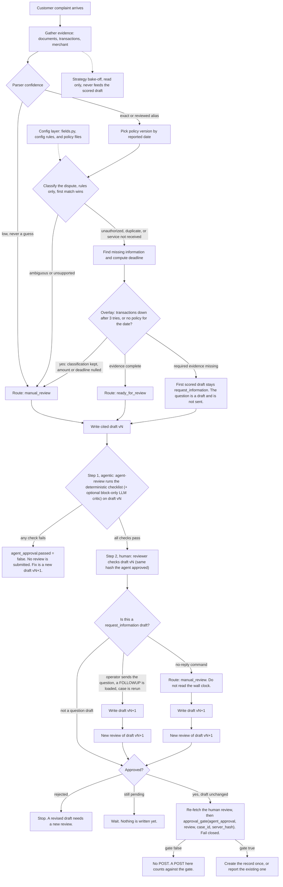
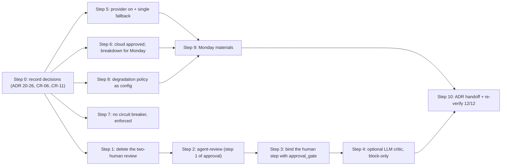
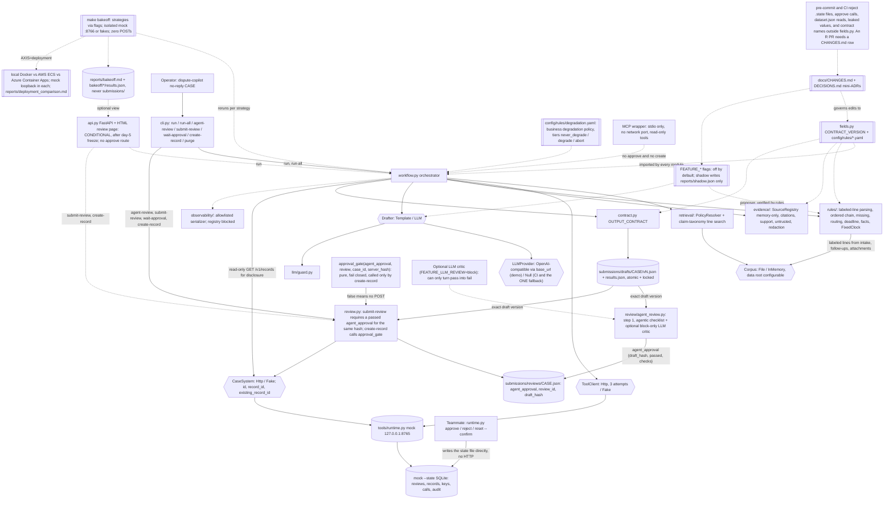

# Card Dispute Copilot Plan, Version 3.9

## What changed in v3.9 (client and SME meeting, 2026-10-22)

This version keeps the whole of v3.8 and integrates the six points agreed with the client and the SME. Where a v3.8 paragraph is replaced, the old text stays in place marked **v3.8 (superseded)** so the reasoning trail is visible. The detailed, step-by-step integration with the reasoning for each step is in the section **"v3.9 integration: step-by-step approach and reasoning"** below.

| # | Agreed on 2026-10-22 | Effect on the plan | Where it lands |
|---|---|---|---|
| 1 | Two-step approval: step 1 agentic, step 2 human | Replaces the v3.8 "second human review above 100000 XCR". New command `dispute-copilot agent-review CASE`, new pure function `approval_gate(agent_approval, review, case_id, server_hash)`. The agent never runs `runtime.py approve`; the human still does. `approvals_satisfied` and the amount threshold are deleted | Finalized decision 2, Workflow steps 10-11, review sequence, compliance, CI, tests, ADR 14 and ADR 20 |
| 2 | No data-restriction policy: third-party LLM providers and cloud deployment allowed; breakdown Monday 2026-10-26 11:30 EST. Model used only at the last step; the flow is deterministic | Q1 and Q2 are answered. The provider is on in the demo (chosen Monday), Null stays the CI default. Cloud is approved; the mock stays loopback inside the task. The LLM still only drafts prose (last step) and optionally criticises in step 1; it never sets a scored field | Options table, LLM boundary, Deployment, ADRs 16, 17, 21, 22, `docs/MODEL_CHOICE.md`, `docs/CLOUD_BREAKDOWN.md` |
| 3 | One fallback for the model; decision and breakdown presented Monday | `FallbackPolicy`: primary provider -> templates (`NullProvider`), exactly one hop, no second model. Breakdown in `docs/MODEL_CHOICE.md` | LLM boundary, degradation matrix, ADR 23 |
| 4 | No circuit breaker for this scope | Already the v3.8 design; now a client decision, not a pod choice. Schema forbids breaker keys; test asserts no breaker kind | Degradation, CI, ADR 24 |
| 5 | Degrade a part of the service on an outage, decided by business use case | Degradation policy becomes config (`config/rules/degradation.yaml`) with tiers never_degrade / degrade / abort; the business wording is confirmed Monday and lands as D-class rows | Graceful degradation matrix, Config layer, ADR 25 |
| 6 | ADRs maintained and shared with the team before handoff | ADR status/date/owner per entry, `make adr-check`, share points (before Monday, after Monday, at handoff) | Architecture decision records, CI, todo `adr-handoff` |

**Interpretation recorded as an assumption, to confirm Monday:** "we are using the model only at the last step" is read as: the LLM drafts the narrative and the customer message (the last step of the per-case pipeline) and may act as the optional, block-only critic in step 1 of approval. All scored fields (classification, routing, policy_ids, facts, missing_information, deadline, citations) stay deterministic. If the client meant that the model is the step-1 approver itself, the same design holds: the critic runs in `block` mode and still cannot pass a draft the deterministic checklist failed.

## Options for the client to choose from

Our recommendation is the default that ships. Every alternative is either a flag that can be switched mid-build (with a `docs/CHANGES.md` row and, where marked, sign-off) or a roadmap item. Where the bake-off measures an option, the choice is backed by `reports/bakeoff.md` or `reports/deployment_comparison.md`.

| Decision | Options (trade-off) | Recommendation (why) | Sign-off |
|---|---|---|---|
| LLM role | **None**: fully deterministic, zero model risk, plainer prose · **Prose only**: better narrative, scored fields untouched · **Prose + shadow classifier**: measures LLM agreement with the rules, no output effect · **Assist classifier**: may fill stages the rules leave empty; adds classification risk | **Prose only** (model at the last step), with the shadow classifier available in the bake-off and the optional block-only critic in approval step 1. Readable drafts at no cost to scored accuracy | **Decided 2026-10-22:** model allowed; prose-only confirmed by "the flow is deterministic". Assist still needs client + facilitator |
| Model provider and location | **None (Null)**: no dependency, works offline · **Third-party provider** (OpenAI-compatible `base_url`): best quality, data leaves the boundary · **On-prem Ollama**: data stays in, smaller model, slower | **v3.9: third-party provider on in the demo (named Monday 2026-10-26), Null is the CI default and the one fallback.** No data-restriction policy at Lumen Bank, so data leaving the boundary is accepted by the client. One `base_url` switch changes provider. *v3.8 (superseded): Null by default, cohort endpoint when Q1 approves* | **Decided 2026-10-22** (provider name Monday) |
| Deployment target | **Local Docker**: assessed baseline, air-gap capable · **AWS ECS Fargate**: managed, IAM/VPC setup · **Azure Container Apps**: managed, simpler exec, managed identity | **Local Docker as the assessed baseline plus one cloud** (whichever access lands first). v3.9: cloud approved by the client; the mock stays loopback-bound inside the task. Breakdown Monday in `docs/CLOUD_BREAKDOWN.md` | **Decided 2026-10-22** (cloud allowed); facilitator still asked in writing about the mock inside the task |
| Citation retrieval | **Exact label**: deterministic, exact quotes · **BM25**: tolerant of rephrasing, ranking noise · **Hybrid**: label first, BM25+RRF for the rest | **Exact label**. Matches the evaluator's exact-substring check; BM25 and hybrid stay as bake-off columns and go into the default only if a rephrased fixture defeats label search | None (all quotes still verified) |
| Drafter | **Templates**: deterministic, cheap, plainer · **LLM**: fluent, costs tokens, needs the guard and repair | **v3.9: LLM in the demo, templates as the single fallback and the CI default.** Scored fields are identical either way (provider-invariance test). *v3.8 (superseded): templates by default, LLM when approved* | **Decided 2026-10-22** |
| Model fallback | **None**: provider down means no narrative · **One hop**: provider -> templates · **Chain**: provider A -> provider B -> templates | **One hop to templates.** Deterministic, no second credential, no second price table, provider-invariance already proven. A chain adds a second vendor dependency for prose that is not scored | **Decided 2026-10-22** (breakdown Monday) |
| Circuit breaker on tool calls | **None**: 3 attempts then degrade, per the procedure · **Breaker**: trips after N failures across cases | **None.** The procedure fixes 3 attempts per case; a breaker would skip attempts the audit expects to see | **Decided 2026-10-22** |
| Degradation policy | **Hard-coded**: in `degradation.py` · **Config**: `config/rules/degradation.yaml` with tiers | **Config with tiers** (never_degrade / degrade / abort). The business decides the wording per outage; the loader refuses to degrade a critical control | **Decided 2026-10-22** (wording Monday) |
| Parsing strictness | **Strict labels**: zero false reads, brittle to messy input · **Label aliases** (`labels.yaml`): recovers casing and synonyms, every alias reviewed, and low confidence routes to `manual_review` | **Aliases from a reviewed list, and never a guess.** Low parser confidence routes to `manual_review`. A mutation generator varies the dev documents. Each alias has a reason in config and a CHANGES.md row. Attachments still cannot set authorization | None (D change, logged) |
| Reviewer model | **Human only**: one `runtime.py approve` · **Two-step**: step 1 agentic checklist (optionally with an LLM critic that can only block), step 2 human approval of the same hash · *v3.8 (superseded): second human review above 100000 XCR or on a null amount* | **v3.9: Two-step, client decision 1.** `agent-review` records a passed checklist for the exact draft hash; `submit-review` refuses without it; a human approves through the runtime CLI; `create-record` calls the pure `approval_gate(agent_approval, review, case_id, server_hash)`, which fails closed. The app never approves. The mock sees one review per draft, exactly as today. Scored fields do not change, so the day-5 freeze does not move | **Decided 2026-10-22** (client + SME) |
| UI | **CLI only**: satisfies the human-review interaction, zero UI risk · **Conditional HTML page**: friendlier demo, more surface | **CLI as the interaction of record; HTML only if the day-5 freeze is green**. Polished UI isn't scored | None |
| Case update or reopen | **Out of scope** (create-only) · **Phase 2** with its own approval and hash contract | **Out of scope now, phase 2 pitched**. The brief makes updates a stretch task needing a separately agreed contract | Client + facilitator |
| MCP exposure | **Thin MCP wrapper**, stdio only · **None** | **Thin MCP wrapper.** Transport is stdio only, with no network port. Tools are read-only: no approve tool and no create tool. Tests check the tool list and that calls cannot write. Scheduled in days 6-8. The service still owns scored fields and writes | Finalized (pod) |
| Missing information | **Keep asking** · **Ask once, then `manual_review`** | **Ask once, then `manual_review`.** The first scored draft stays `request_information` (D04, D12). The question is a draft; the operator sends it and the app does not. A reply is a FOLLOWUP document and a rerun writes draft vN+1, which needs a new review. No reply is `dispute-copilot no-reply CASE`, which routes to `manual_review` and does not read the wall clock | Finalized (pod) |
| Observability depth | **Baseline**: 14 spans, JSON logs, N/median/max · **Full**: plus sub-spans, per-span metrics, bake-off p95 · **External**: OTel exporter and dashboards | **Full** (in plan). It costs little and answers the latency and cost questions; the OTel exporter is a swap later | None; external stack = client |
| New dispute type | **None** · **Phase 2** type (e.g. "item not as described") with new procedure text and a contract bump | **Phase 2 only, after new procedure text is supplied**. The contract enumerates five classifications; we never invent policy | Client + facilitator |

## What to present

1. Value and boundaries: deterministic rules own scored fields, a human approves every write (2 min).
2. Normal case D01 end to end: draft, citations, trace, teammate approves, `record_id`, audit (5 min).
3. Ambiguous case D05: five evidence groups, `manual_review`, null deadline (4 min).
4. Assessor-chosen failure or attack: D07 outage, D08 injection, or D09 redelivery (5 min). Whatever is shown, the create path is the same two steps: `agent-review` passes (or blocks, e.g. on a dropped citation), then a teammate approves, then `create-record`. Say that step 1 is the pod's agentic gate, step 2 is the human boundary required by the brief, and the agent never runs the approve command. *v3.8 (superseded): if D07 is shown, a null amount needs both approvals.*
5. Live change, D-class via config (3 min).
6. Bake-off tables (extended session, 6 min):
   - retrieval axis: label vs BM25 vs hybrid
   - parsing axis on the messy set
   - drafter axis: templates vs LLM, scored fields identical
   - deployment comparison: local vs cloud, latency, cold start, cost (or "not run")
7. "Options for the client to choose from" table, then limitations and roadmap (1–2 min).


## Verified facts this plan depends on (from `tools/runtime.py`, `tools/evaluate.py`, `pyproject.toml`)

- `POST /v1/reviews` → `{review_id, status, draft_hash}`. `GET /v1/reviews/{id}` → `id, case_id, draft, hash, status, reviewer`, where `draft` is a canonical compact JSON **string**. It must go through `json.loads` before `POST /v1/records`, which needs a dict and returns 400 otherwise.
- `GET /v1/records/{case_id}` → a row with `id`. `POST /v1/records` 201 → `record_id`. A 409 duplicate → `existing_record_id`.
- `record_id` = the case's logical key. For D02/D09 it is `dispute-double-02`.
- `POST /v1/records` check order: idempotency-key lookup (200 replay / 409 `idempotency_conflict`) → approval and hash (403) → duplicate (409 `duplicate_case`). Our key includes `review_id` and the hash, so the conflict branch is unreachable for us; the 403-before-409 order is what forces a full approval for D09.
- The hash canonical form is `json.dumps(sort_keys=True, separators=(",",":"), ensure_ascii=False)`. The evaluator's source text for tool payloads is plain `json.dumps(payload, sort_keys=True)` (default separators, default `ensure_ascii`; confirmed by `tools/validate_package.py`), e.g. `{"source_id": "CARD-D01-TRANSACTIONS", "transactions": [{"amount": 117, ...}]}`, matched by raw substring. The merchant source text **contains** `private_token`, so the registry must hold the raw payload; the quote filter, not the source, keeps tokens out.
- Mock tool-attempt counters are cumulative per case until reset. A fault fails when attempt n ≤ failures (or always). `GET /v1/records/{case_id}` is not counted and not audited, so a read-only lookup during `run` is free.
- `pyproject.toml` has `package = false` and `dependencies = []`, so a `src/` package needs build-system changes. `tools/validate_package.py` checks fixture integrity only (it reads `dataset.json`; it does not test our solution).
- `evaluate.py` fails a **missing** case individually (`submitted: false`), but a **duplicate** `case_id` or a case **not in the gold** is a format error that fails the whole submission. So `run` upserts by `case_id` into `results.json`, and hidden-style fixtures are evaluated from their own submission file with their own `--data` directory.
- `runtime.py reset` requires `--confirm` and clients must be stopped first (README). `runtime.py approve/reject` writes the `--state` SQLite file directly (no HTTP route exists). Approval therefore has to run wherever that file lives: the mock container locally and in the cloud.

## Workflow at a glance



## Detailed code flow

```mermaid
flowchart TD
    subgraph S0["Config layer - loaded once, validated at startup"]
        K1["fields.py: CONTRACT_VERSION, field names, enums, allowed missing IDs"]
        K2["config/rules/*.yaml: label aliases, routing order, missing questions, retryable codes, redaction + injection patterns, prompt pins"]
        K3["config/rules/decision_table.yaml rows with quotes + the configured procedure (Settings.procedure_id) + policies/*.md day counts"]
        K4["prompts/task/vN.md + MANIFEST.json: versioned prompts"]
    end
    subgraph S1["Startup - cli.py run"]
        A1["dispute-copilot run CASE"] --> A2["config.Settings: MOCK_BASE_URL, --data-dir data root; load S0, fail fast if invalid"]
        A2 --> A3{"adapters/tools.py health check: GET /health"}
        A3 -->|"unreachable"| A4["MockUnavailable: exit non-zero, no file"]
        A3 -->|"ok"| A5["GET /v1/cases"]
    end
    subgraph S2["Evidence"]
        A5 --> L1["case_system.py lookup: GET /v1/records/CASE read-only; existing id noted for narrative only, run-order dependent"]
        L1 --> B1["adapters/corpus.py FileCorpus: policies/*.md and all documents by Source ID"]
        B1 --> B2["rules/documents.py: labeled lines; each alias has a reason"]
        B2 --> PC2{"parser confidence: exact, reviewed alias, or low"}
        PC2 -->|"low"| PLOW["ambiguous and manual_review, never a guessed type"]
        PC2 -->|"exact or reviewed alias"| B3
        PLOW --> C12
        B3{"HttpToolClient.transactions: attempt 1..3, retryable codes from config"}
        B3 -->|"503, attempts left"| B3
        B3 -->|"503 x3"| B4["amount/currency null; transaction_id and reported_date kept from intake; manual_review overlay; no TRANSACTIONS citation"]
        B3 -->|"200"| B5["transaction facts, currency passed through verbatim"]
        B5 -->|"duplicate_charge and only the named row returned"| B5b["row 4b: manual_review; deadline, amount and currency kept; no duplicate_transaction citation; disclose"]
        B5b --> B6
        B4 --> B6
        B5 --> B6{"HttpToolClient.merchant"}
        B6 -->|"ok"| B7["evidence/untrusted.py: private_token never copied to facts, prompt, output or logs; injection flagged"]
        B6 -->|"failure, no breaker"| B8["merchant context unavailable"]
        B5 -.-> REG
        B7 -.-> REG
        REG[("SourceRegistry, memory only: raw text incl. private_token; refuses JSON, pickle, repr")]
    end
    subgraph S3["Deterministic rules"]
        B7 --> C1{"retrieval/policy.py PolicyResolver"}
        B8 --> C1
        C1 -->|"reported date in range"| C2["policy_ids = V1 or V2 + the configured procedure (default CARD-PROCEDURE-01); flag if transaction date is in another period, disclosure only"]
        C1 -->|"out of range"| C3["assumption pending Q7: procedure only, deadline null, manual_review, disclose no policy quote"]
        C2 --> C4
        C3 --> C4
        C4["rules/classify.py ordered chain, first match exits"] --> C5{"1 unsupported"}
        C5 -->|"no"| C6{"2 conflict across N customer statements"}
        C6 -->|"no"| C7{"3 unauthorized"}
        C7 -->|"no"| C8{"4 duplicate"}
        C8 -->|"no"| C9{"5 service"}
        C9 -->|"no"| C10["6 ambiguous"]
        C5 -->|"match"| C11
        C6 -->|"match"| C11
        C7 -->|"match"| C11
        C8 -->|"match"| C11
        C9 -->|"match"| C11
        C10 --> C11["rules/missing.py: IDs + questions from config; service fields read only after service_not_received"]
        C11 --> C12["rules/routing.py: precedence order from config"]
        C12 --> C13["rules/deadline.py: reported_date + policy days"]
    end
    subgraph S4["Evidence output"]
        C13 --> D0["retrieval/search.py: line search by claim taxonomy"]
        D0 --> D1["evidence/citations.py: raw substring check against REG"]
        D1 --> D2{"evidence/support.py predicates"}
        D2 -->|"fails or quote not found"| D3["drop citation + disclose, no fallback quote"]
        D2 -->|"passes"| D4
        D3 --> D4["drafting.py Drafter (the last step that uses a model): OpenAI-compatible provider via base_url, facts + verified quotes only; FallbackPolicy = one hop to templates on timeout, error, schema failure after one repair, or guard rejection"]
        D4 --> D5["llm/guard.py: customer-message commitments; rejection -> templates (the one fallback)"]
        D5 --> D6["evidence/redaction.py Redactor, patterns from config"]
        D6 --> D7{"contract.py validate against fields.py"}
        D7 -->|"invalid"| D8["manual_review result with disclosure; run-all exits non-zero"]
        D7 -->|"valid"| D9["atomic write: drafts/CASE/vN.json + locked upsert into results.json"]
        D8 --> D9
    end
    subgraph S5["Human review and record"]
        D9 --> AQ{"routing is request_information?"}
        AQ -->|"yes: question stays on the draft and is not sent"| AQS["operator sends the question"]
        AQS -->|"FOLLOWUP document loaded"| AQR["rerun writes draft vN+1 and needs a new review"]
        AQS -->|"no-reply command, no wall clock"| AQN["route manual_review, write draft vN+1, new review"]
        AQR --> E1
        AQN --> E1
        AQ -->|"no"| AR["review/agent_review.py: step 1, agentic. Deterministic checklist on the exact draft file; optional LLM critic in block-only mode; writes agent_approval {draft_hash, passed, checks} to submissions/reviews/CASE.json"]
        AR -->|"passed = false"| ARF["stop: no POST /v1/reviews; the fix is draft vN+1"]
        AR -->|"passed = true"| E1["submit-review checks agent_approval.draft_hash == hash_canonical(draft), posts the exact draft version and stores review_id and draft_hash"]
        E1 --> E2{"wait-approval"}
        E2 -->|"pending or timeout"| E3["exit pending, resume later"]
        E2 -->|"rejected"| E4["stop, no create; a revision is vN+1 and a new review"]
        E2 -->|"approved"| E7{"GET records pre-check: row with id?"}
        E7 -->|"yes"| E8["report the existing id, no POST"]
        E7 -->|"no"| E5["re-fetch the human review immediately before POST; json.loads the draft; load agent_approval from the persisted handle"]
        E5 --> EC{"approval_gate(agent_approval, review, case_id, server_hash), fail closed"}
        EC -->|"false"| E4b["stop, no POST; a POST here fails the gate"]
        EC -->|"true"| E9["POST the server draft with the one review id; the mock enforces the human approval and the hash, the app enforces the agent step"]
        E9 -->|"201"| E10["report record_id"]
        E9 -->|"200"| E11["replay the same record"]
        E9 -->|"409"| E12["report existing_record_id"]
        E9 -->|"403"| E4b
    end
    S0 -.-> S2
    BK["bakeoff/: same pipeline per strategy axis; reads only, outputs to reports/bakeoff"] -.-> S2
    BK -.-> S3
    BK -.-> S4
    S0 -.-> S3
    S0 -.-> S4
    S2 -.-> T["observability: allowlisted span and log fields, redacted; REG never serialized"]
    S3 -.-> T
    S4 -.-> T
    S5 -.-> T
    T --> TM["every span: start, end, duration_ms; one JSON logger: run_id, case_id, span, level, event; metrics.json per-span breakdown"]
```



## Guiding design decision

Everything the rubric scores numerically is specified exactly in `CARD-PROCEDURE-01.md` and the two policies, so **deterministic code owns** these: policy selection, deadline math, classification, missing-field detection, routing precedence, fact extraction, retry limits, redaction, idempotency, duplicate handling and citation construction. The **LLM is optional**. Its one job is drafting the narrative prose and customer message from structured facts and verified quotes. **It never classifies and never sets a scored field.** With no provider configured, templates are used and the system still works fully.

## Finalized design decisions

The pod locked these three. They override the matching rows in "Options for the client to choose from".

1. **Thin MCP wrapper (stdio only).** A thin wrapper sits on the service so later callers use the same copilot. Transport is stdio only. There is no network port. The wrapper does not own classification or scored fields. Its tool list has no approve tool and no create tool, and tests fail if either name is advertised or if a call can write. Owner: Teammate 2, days 6-8. Test owner: Nachiketh. It does not move the day-5 freeze.
2. **Two-step approval: step 1 agentic, step 2 human (v3.9, client decision 1, 2026-10-22).** Step 1 is `dispute-copilot agent-review CASE`. It loads the exact latest draft file, runs the deterministic review checklist (contract valid against `fields.py`; every citation is a raw substring of its registered source; every required evidence group for the chosen classification is present; redaction clean; commitment guard clean; deadline recomputed from the parsed policy days equals the draft; `policy_ids` equal the resolver output; `facts` equal the tool payloads or are null exactly when the degradation ledger says so; no untrusted instruction text echoed in the narrative; `hash_canonical(draft)` equals the stored hash), optionally asks the configured LLM critic (`FEATURE_LLM_REVIEW=off|block`; in `block` mode a critic "reject" turns a pass into a fail and nothing else), and persists `agent_approval = {case_id, draft_version, draft_hash, passed, checks[], run_id, llm_review, contract_version}` into `submissions/reviews/<case_id>.json`. Step 2 is the human: `submit-review` refuses to POST `/v1/reviews` unless `agent_approval.passed` is true **and** `agent_approval.draft_hash == hash_canonical(draft)`; a teammate then runs `runtime.py approve` (the app never invokes that command, and there is no HTTP approve). `create-record` pre-checks the ledger, re-fetches the human review, and calls the pure function `approval_gate(agent_approval, review, case_id=..., server_hash=...)`, which returns false on a missing or failed agent approval, a cross-case agent approval or review, a hash that differs between the agent approval, the server review and the draft, a pending or rejected review, a missing reviewer, or any exception. False means no POST; a POST anyway counts against the gate. The idempotency key stays `dc-` + sha256(`v1|case_id|review_id|server_hash`). Owner: Teammate 2. Backup: Nachiketh. Test owner: Nachiketh. Checklist + `approval_gate`: day-5 exit (on the must-ship line, because every check is a condition the evaluator or a critical gate already imposes). LLM critic: days 6-8, after the Monday provider decision. Scored fields stay on the procedure, so the day-5 freeze does not move.

   > **v3.8 (superseded) text, kept for the record:** *Second review, app-enforced and mock-unaware. The mock stores one approval per review and does not know that a second review is required. `create-record` is the only caller of the pure function `approvals_satisfied(reviews, amount, config)`. It fails closed: any missing, pending, rejected, mismatched, cross-case, or same-reviewer input returns false, and an exception is treated as false. Amount exactly 100000 XCR needs one approval. Amount 100000.01 XCR needs two. A null amount, or a currency other than XCR, needs two. Both reviews are re-fetched immediately before the POST. If the function returns false, there is no POST, and a POST anyway counts against the gate. A different reviewer approves the second review through the runtime CLI. The app never approves. Threshold and currency live in `config/rules/approval.yaml`. Owner: Teammate 2. Backup: Nachiketh. Test owner: Nachiketh. Day-8 exit. This is the pod's own design. The production version is server-side enforcement.* **Why it was replaced:** the client asked for an agentic first step and a human second step, not two humans; the amount threshold was a pod invention with no basis in the brief, and it made D07 (null amount) harder to create for no rubric gain.
3. **Ask once, then `manual_review`.** When required information is missing, the first scored draft stays `request_information` with the missing-field questions, so D04 and D12 stay on the evaluator's expected routing. The question is a draft for the reviewer. The operator sends it. The app never sends it. A reply is loaded as a FOLLOWUP document and the case is rerun: that writes draft vN+1 and needs a new agent approval and a new human review. No reply is the operator command `dispute-copilot no-reply CASE`, which sets routing to `manual_review`, writes draft vN+1, and needs a new review. The command does not read the wall clock or today's date. Events: `followup.question_drafted`, `followup.reply_loaded`, `followup.no_reply`. Fixture: `tests/fixtures/ask_once/`. Owner: Nachiketh. Day-5 exit.

## Client and SME decisions (meeting of 2026-10-22)

These six points were agreed with the client and the SME. They are binding for the build and are recorded as ADRs 20-26. Where a point conflicts with v3.8, v3.9 wins and the v3.8 text is marked superseded in place.

1. **Two-step approval.** First step agentic, second step human. Implemented as `agent-review` (step 1) + `runtime.py approve` by a teammate (step 2) + `approval_gate` in `create-record`. The agent never invokes the operator approve command (README: "Your agent must never invoke this operator command"; ASSESSMENT: "no unapproved ... write attempt").
2. **No data-restriction policy at Lumen Bank.** Third-party LLM providers may be used, and the system may be deployed to the cloud. A detailed breakdown is due at the next meeting, **Monday 2026-10-26, 11:30 AM EST**. The model is used only at the last step; the flow is deterministic.
3. **One fallback for the model.** The decision and breakdown of the choice will be presented Monday. In the plan: primary provider -> templates, one hop.
4. **No circuit breaker**, given the scope of the project.
5. **Degrade a part of the service in an outage**, with the exact part decided by the business use case. In the plan: `config/rules/degradation.yaml` with tiers; wording confirmed Monday.
6. **ADRs maintained and shared with the team before handoff.**

## v3.9 integration: step-by-step approach and reasoning

Each step below says what to do, why (tied to the brief, the mock, the evaluator or a critical gate), which files change, the interface or config it produces, the tests that prove it, the exit criterion, and the owner and day. Steps are ordered so that nothing later depends on an unanswered Monday question, and so that the day-5 must-ship line is unchanged in content and only simplified in the approval path.



### Step 0: Record the decisions before touching code (day 1, Teammate 3, backup Nachiketh)

- **What:** add ADRs 20-26 to `docs/DECISIONS.md` (status `accepted`, date 2026-10-22, owner), rewrite ADR 14 to the two-step approval with the v3.8 text kept as superseded, close ADRs 16 and 17 as answered, and add rows CR-06 through CR-11 to `docs/CHANGES.md` (see Change control). Update the PR template so a PR touching `review/`, `llm/` or `reliability/` must name the ADR it implements.
- **Why:** every later step references these records, and without them the team keeps building the v3.8 two-human review. The client also asked for ADRs to be maintained and shared, so the records are the first deliverable, not the last. CHANGES.md rows are what make the scope-freeze rule auditable: each of these is a class S or D change against the day-5 line.
- **Exit:** `make adr-check` passes; ADR 14 reads "two-step"; `grep -c approvals_satisfied docs/` is 0 outside the superseded blocks.

### Step 1: Remove the two-human review (day 1-2, Teammate 2)

- **What:** delete the `second-approval` todo, the `approvals_satisfied(reviews, amount, config)` design, the `threshold_amount`, `currency` and `null_amount_requires_both` keys in `config/rules/approval.yaml`, the second review id in the idempotency key material, the "Rev2" participant in the review sequence, and the boundary tests at 100000 / 100000.01 / null amount / same reviewer twice. Nothing of this has been coded yet, so this is a plan and doc change, but it must be explicit so nobody re-adds it.
- **Why:** the client decided the second step is a human and the first step is agentic. Two humans was a pod invention with no basis in the brief, the mock stores exactly one approval per review (`tools/runtime.py`, `reviews` table), and the threshold made D07 (null amount) require two approvals for no rubric gain. Removing it also removes a whole class of fail-closed edge cases (same reviewer twice, mismatched hashes between two reviews) that no longer exist.
- **Exit:** the plan, the todos, the compliance table, the CI gate list and the demo script contain no amount threshold; the only review-related config is `approval.yaml: required_checks` and `llm_review`.

### Step 2: Build step 1 of approval, the agentic review (days 3-5, Teammate 2, tests Nachiketh)

- **What:** new module `src/dispute_copilot/review/agent_review.py` and CLI command `dispute-copilot agent-review CASE [--version N]`. It loads `submissions/drafts/<case_id>/vN.json` (latest by default), rebuilds the review context from the same corpus, registry and resolver the run used (the trace file stores `run_id`, `policy_ids`, degradation kinds and the tool payload hashes it needs), and runs the checklist below. The result is persisted as `agent_approval` inside `submissions/reviews/<case_id>.json` next to the (later) `review_id` and `draft_hash`.

  ```python
  # src/dispute_copilot/review/agent_review.py
  from dataclasses import dataclass
  from dispute_copilot.serialization import hash_canonical

  @dataclass(frozen=True)
  class AgentCheck:
      name: str
      passed: bool
      detail: str          # redacted, never a quote or a payload

  @dataclass(frozen=True)
  class AgentApproval:
      case_id: str
      draft_version: int
      draft_hash: str      # hash_canonical(draft), the same digest the mock computes
      passed: bool
      checks: tuple[AgentCheck, ...]
      run_id: str
      llm_review: str | dict  # "off", or {"verdict": "pass"|"block", "reason": str} when the critic runs
      contract_version: str

  REQUIRED_CHECKS = (
      "contract_valid",                 # pydantic OUTPUT_CONTRACT from fields.py
      "citations_verified",             # every quote is a raw substring of its registered source
      "required_groups_present",        # intake, policy, procedure, transactions-if-tool-succeeded, each conflicting doc
      "redaction_clean",                # no SYNTHETIC-PRIVATE, CUST-, private_token anywhere in the draft
      "guard_clean",                    # no commitment construction in the customer message
      "deadline_recomputed",            # reported_date + parsed policy days == draft.deadline (or both null)
      "policy_ids_match_resolver",      # sorted(draft.policy_ids) == sorted(resolver(reported_date))
      "facts_match_tools",              # amount/currency equal the named transaction, or null iff ledger says transactions_unavailable
      "no_untrusted_instruction_echo",  # no injection.yaml pattern appears in the narrative as an instruction
      "draft_hash_matches_file",        # hash_canonical(draft) == hash recorded at write time
  )

  def agent_review(draft: dict, ctx: "ReviewContext", config: "ApprovalConfig") -> AgentApproval:
      checks = tuple(check_fn(draft, ctx) for check_fn in CHECKS)       # CHECKS is an ordered tuple of callables
      names = {c.name for c in checks}
      passed = all(c.passed for c in checks) and set(config.required_checks) <= names
      llm_review: str | dict = "off"
      if passed and config.llm_review == "block":
          llm_review = run_llm_critic(draft, ctx)                        # {"verdict", "reason"}; a bad reply is verdict "block"
          passed = passed and llm_review["verdict"] == "pass"
      return AgentApproval(ctx.case_id, ctx.draft_version, hash_canonical(draft), passed, checks,
                           ctx.run_id, llm_review, ctx.contract_version)
  ```

- **Why this checklist:** each check is a condition the evaluator or a critical gate already imposes on the output (`tools/evaluate.py`: citations valid, required evidence groups, facts, deadline, policy selection, no restricted values; ASSESSMENT: no prohibited commitment, no instruction override, no fabricated evidence). Putting them in step 1 means the human in step 2 only ever sees a draft that cannot fail those checks, which is what an "agentic first approval" should buy the reviewer. The checks are pure functions over the draft plus the same deterministic inputs the run used, so step 1 is reproducible and explainable; it is not a second opinion from a model.
- **Why the agent never approves in the mock:** the README says the agent must never invoke the operator command, and the mock has no HTTP approve. So "agentic approval" is recorded on our side, bound to the draft hash, and enforced by our code at `submit-review` and `create-record`. The mock's own approval remains the human's.
- **Why persist it with the review handle:** `submissions/reviews/<case_id>.json` already survives restarts for `review_id` and `draft_hash` (v3.8 change request #5). Storing `agent_approval` there means a laptop restart between step 1 and step 2 does not lose the agentic approval, and the hash equality check keeps it from applying to a different draft version.
- **Tests (`tests/unit/test_agent_review.py`):** one test per check that mutates a passing D01 draft so exactly that check fails and asserts `passed is False` with that check named; a test that a passing draft yields `passed is True` and `draft_hash == hash_canonical(draft)`; a test that `agent_review` never reads `dataset.json` and never calls any POST (Fake adapters record calls); a test that the persisted file contains no quote text and no restricted value.
- **Exit (day 5):** `dispute-copilot agent-review CARD-D01` passes and writes `agent_approval`; a draft with one dropped citation fails on `citations_verified`; the checklist runs in under 1 s per case on fakes.

### Step 3: Bind step 2 (human) and the create path with `approval_gate` (days 3-5, Teammate 2, tests Nachiketh)

- **What:** `submit-review` refuses to POST `/v1/reviews` unless a passed `agent_approval` exists for the exact file hash; `create-record` calls one pure function and nothing else:

  ```python
  # src/dispute_copilot/review/gate.py
  def approval_gate(agent: AgentApproval | None, review: dict | None, *, case_id: str, server_hash: str) -> bool:
      """Pure, fail closed. True only when the agentic step passed for this exact draft AND a human approved the same draft."""
      try:
          if agent is None or review is None:
              return False
          if not agent.passed:
              return False
          if agent.case_id != case_id or review.get("case_id") != case_id:
              return False
          if agent.draft_hash != server_hash or review.get("hash") != server_hash:
              return False
          if review.get("status") != "approved":
              return False
          if not isinstance(review.get("reviewer"), str) or not review["reviewer"]:
              return False
          return True
      except Exception:
          return False
  ```

  Order inside `create-record` (unchanged from v3.8 except for the gate): `GET /v1/records/{case_id}` pre-check -> re-fetch `GET /v1/reviews/{review_id}` -> `json.loads(review["draft"])` -> `approval_gate(...)` -> on true, `POST /v1/records` with the server draft and `Idempotency-Key = "dc-" + sha256("v1|case_id|review_id|server_hash")` -> 201 / 200 / 409 / 403 handled as before.
- **Why a pure function:** the AST lint gate can prove it is called only from `create-record`, a property test can hammer it with random inputs, and an exception can never leak a true. The server hash is the single source of truth for "the draft the human saw", which is the brief's "never create a case ... after changing the approved draft".
- **Why check at `submit-review` as well as `create-record`:** the client's ordering is "first agentic, second human". Gating at `submit-review` guarantees the human never receives a draft the agent did not pass; gating again at `create-record` guarantees nobody bypasses step 1 by hand-posting a review with curl. Both checks are the same hash comparison, so the cost is one function call.
- **Tests:** `tests/unit/test_approval_gate.py` with the matrix (no agent approval, failed agent approval, agent approval for another case, agent hash != server hash, review pending, review rejected, review for another case, review hash != server hash, missing reviewer, review is `None`, an object whose `.get` raises) plus a hypothesis property test asserting the gate is true only when all seven conditions hold; `tests/integration/test_two_step_approval.py` against the subprocess mock: run D01 -> `submit-review` without `agent-review` exits non-zero and the audit has no `review_requested`; `agent-review` then `submit-review` -> `review_requested`; approve via `runtime.py` -> `create-record` -> 201; `revise` -> v2 -> `create-record` with the stale v1 handle -> gate false, no POST, audit has no `unapproved_write_attempt`; `test_no_post_when_approval_gate_false`.
- **Exit (day 5):** D01 end to end with `agent-review` -> `submit-review` -> teammate approves -> `create-record` -> `record_id`; the audit shows one `review_requested`, one `human_approved`, one `record_created`, zero blocked attempts.

### Step 4: Optional LLM critic inside step 1, block-only (days 6-8, Teammate 2, after Monday)

- **What:** `FEATURE_LLM_REVIEW=off|block` in `config/rules/approval.yaml` (`llm_review: off` default, CI `off`). In `block` mode, after the deterministic checklist passes, the configured provider is given the structured facts, the verified quotes and the narrative, and asked for a JSON verdict `{"verdict": "pass"|"block", "reason": "<one or two lines>"}` against a fixed rubric (uncertainty visible, drafts marked, no commitment, missing fields each have a question). Both `pass` and `block` include that reason. The reason is plain text, one or two lines, and is stored on `agent_approval` in `submissions/reviews/<case_id>.json` either way, so the human can read it before `runtime.py approve`. `agent-review` prints the verdict and the reason. Only `block` changes `passed` to false. A `pass` leaves the gate passed. The draft text stays unchanged. A missing reason, a reason longer than two lines, a provider error, a timeout, or any other schema failure counts as `block` (fail closed), and the stored reason says the model reply was not usable. The operator can rerun with `--llm-review off` after reading that reason.
- **Why block-only:** this is how an LLM can take part in an approval step without ever becoming an approver. It can only make the system more conservative. It keeps ADR 1 intact (the model never sets a scored field) and it keeps the critical gates intact (a model cannot talk the system into a write).
- **Why after Monday:** the provider is chosen Monday; building the critic on fakes before that is fine, but turning it on in the demo path waits for the named endpoint and key.
- **Tests:** fake provider returning `block` flips a passing D01 to `passed False` and stores its one-to-two line reason; fake returning `pass` keeps `passed True` and stores its reason; a missing reason, a reason longer than two lines, or a raised provider error counts as `block` with the fixed unusable-reply reason; scored fields of the draft are byte-identical before and after (the critic never edits the draft).
- **Exit (day 8):** `FEATURE_LLM_REVIEW=block` on D08 with a fake critic that flags the injected sentence blocks the review; with the real provider, D01 passes.

### Step 5: Provider on in the demo, exactly one fallback (days 6-8, Teammate 2; Monday decides the name)

- **What:** `llm/openai_compat.py` is the single `OpenAIProvider` (configurable `base_url`, `model`, key from env or the secret store). `drafting.py` gets a `FallbackPolicy` with exactly one hop:

  ```python
  # src/dispute_copilot/drafting.py
  class Drafter:
      def __init__(self, primary: LLMProvider, fallback: NullProvider, policy: FallbackPolicy, ledger: DegradationLedger): ...

      def draft(self, facts: Facts, quotes: list[VerifiedQuote]) -> Narrative:
          try:
              rendered = self.prompts.render("drafter", facts=facts, quotes=quotes)   # Step 12: versioned prompt, hash on the span
              raw = self.primary.complete(self.adapter.to_messages(rendered), timeout_s=self.policy.llm_timeout_s)
              narrative = parse_or_repair_once(raw, self.primary)          # pydantic schema, one repair call
              if guard(narrative.customer_message).rejected:
                  raise GuardRejected()
              return narrative
          except (ProviderError, TimeoutError, SchemaError, GuardRejected) as e:
              self.ledger.add("llm_unavailable", reason=type(e).__name__)  # event llm.downgraded, WARNING
              return self.fallback.draft(facts, quotes)                     # templates; no further hop exists
  ```

  Demo and cloud run with `LLM_PROVIDER=openai`; CI and `make bakeoff` default column run with `LLM_PROVIDER=null`.
- **Why one hop to templates and not a second model:** the client asked for one fallback. Templates are deterministic, need no second credential, no second price table and no second security review, and the provider-invariance test already proves scored fields are identical under Null and any provider. A second model would add a vendor for prose that is not scored.
- **Why the provider is on in the demo now:** Q1 is answered (no data-restriction policy). The CI default stays Null so the pipeline is reproducible with no key, which also keeps the "no invented cost" rule: cost appears only from measured tokens times `config/prices.yaml`.
- **Tests:** four fallback tests (timeout, provider error, schema failure after one repair, guard rejection) each assert exactly one `llm_unavailable` ledger row, a template narrative, and scored fields identical to the Null run; a test that `Drafter` can be constructed only with a `NullProvider` as fallback (type check) so a chain cannot be configured; provider-invariance test unchanged.
- **Exit (day 8):** D01 narrative from the provider in the demo path; `LLM_TIMEOUT_S=0.001` produces the template narrative with `llm.downgraded` in the log and `reports/dev.json` still 12/12.

### Step 6: Cloud approved; keep the loopback mock and prepare the breakdown (days 9-10 timebox, Nachiketh; breakdown by Sunday)

- **What:** no architectural change: the one image, two containers (app + mock) sharing localhost, mock bound to `127.0.0.1`, no ingress, approval through `ecs execute-command` or `az containerapp exec` running `runtime.py approve` against the same `--state` path. New: `docs/CLOUD_BREAKDOWN.md` for Monday (components, IAM or managed identity, secrets, exec path, loopback mock, measured or `null` cost cells, what leaves the boundary) and the Q2 ADR closed as answered.
- **Why nothing changes in the design:** the v3.8 deployment was already built to be allowed; what changed is permission, not architecture. The README's "keep it local" is still honoured by binding the mock to loopback inside the task and giving it no ingress; the facilitator is asked in writing to confirm that reading, with local Docker remaining the assessed baseline until the written line arrives.
- **Exit:** cloud deployed with approval rehearsed, or the written procedure; `docs/CLOUD_BREAKDOWN.md` reviewed by the team Sunday 2026-10-25.

### Step 7: No circuit breaker, made enforceable (days 3-5, Teammate 3)

- **What:** `config/rules/retry.yaml` schema allows only `retryable_status_codes` and `max_attempts` (<= 3); any `breaker_*` key fails the loader. `DegradationLedger` kinds are a closed enum with no `breaker_open`. `docs/LIMITATIONS.md` states the client decision and the consequence: a sustained tool outage costs 3 attempts per case, which is what the procedure and the audit expect.
- **Why:** this was already the v3.8 design; the meeting made it a client decision. Encoding it in the schema prevents a well-meaning teammate from adding one in days 6-8 "for resilience", which would skip attempts the assessor expects to see in `reports/audit.json` (D07: 3 attempts, D10: 2 attempts).
- **Tests:** loader rejects `breaker_threshold: 5`; `test_no_breaker_kind`; audit test for D07/D10 attempt counts unchanged.

### Step 8: Degradation policy as business config (days 3-5 default rows, Monday wording as D changes; Nachiketh)

- **What:** move the graceful-degradation matrix into `config/rules/degradation.yaml`, validated at startup, one generated test per kind:

  ```yaml
  # config/rules/degradation.yaml
  never_degrade: [human_approval, hash_binding, redaction, idempotency, retry_cap]
  kinds:
    transactions_unavailable:
      tier: degrade
      trigger: "503 on all 3 attempts, or the named transaction absent"
      contract_effect: { amount: null, currency: null }     # transaction_id and reported_date stay from the intake
      routing_overlay: manual_review
      keep_deadline: true                                    # procedure: calculate the deadline even when a tool is unavailable
      disclosure: "Transaction service unavailable after 3 attempts; amount and currency are unknown, not empty."
    merchant_unavailable:
      tier: degrade
      contract_effect: {}
      routing_overlay: null
      disclosure: "Merchant context unavailable; no merchant citation."
    ledger_lookup_unavailable:
      tier: degrade
      contract_effect: {}
      routing_overlay: null
      disclosure: "Existing-record lookup unavailable at run time; create-record performs the authoritative check."
    llm_unavailable:
      tier: degrade
      contract_effect: {}
      routing_overlay: null
      disclosure: "Narrative generated from templates; the language model was unavailable or its output was rejected."
    policy_out_of_range:
      tier: degrade
      contract_effect: { deadline: null }
      policy_ids: [procedure]                                # keyword, resolved to Settings.procedure_id at load (Step 11)
      routing_overlay: manual_review
      disclosure: "No policy is effective for the reported date; no policy quote is available."
    mock_unreachable:
      tier: abort
      disclosure: "Case system unreachable at startup; no draft written."
  ```

  The loader rejects any kind whose `contract_effect` or `routing_overlay` touches a `never_degrade` control, any `tier` outside the three, and any `routing_overlay` outside the routing enum in `fields.py`.
- **Why config:** the client said the part to degrade "needs to be decided based on business use case" and that discussion is Monday. Putting the policy in config makes Monday's answer a D-class change (a row edit plus a CHANGES.md line) instead of code in the freeze window. The `never_degrade` list is the engineering floor the business cannot lower: it is exactly the set of critical gates in ASSESSMENT.md.
- **Why these defaults:** they are the procedure's own rules (3 attempts then `manual_review`; never treat a service failure as empty history; keep the deadline; merchant text is context only) plus the one model fallback from decision 3. Nothing here changes a scored field for the 12 dev cases.
- **Tests:** one generated test per kind applying it to a fixture and asserting the contract effect, overlay and disclosure; loader rejects `human_approval` as a kind and rejects `routing_overlay: ready_for_review` on `transactions_unavailable`; D07 and D10 still match gold.
- **Exit (day 5):** matrix rows load from config; 12/12 unchanged. **Monday:** the business wording is confirmed and committed as CR rows.

### Step 9: Monday 2026-10-26 materials (due Sunday 2026-10-25 EOD; Nachiketh, backup Teammate 2)

- **What:** `docs/MODEL_CHOICE.md` (2-3 OpenAI-compatible candidates compared on structured-output support, measured p50/p95 latency and cost per case from `make bakeoff AXIS=drafter` on a trial key or marked "not run", region and rate limits, and the single-fallback breakdown with the one-hop rule); `docs/CLOUD_BREAKDOWN.md` (Step 6); the degradation table from Step 8 printed for the client to confirm wording. Every figure is measured or `null`; none is estimated from memory.
- **Why:** three of the six points explicitly defer detail to Monday. Walking in with measured numbers and a table to tick keeps Monday a decision meeting, not a design meeting, and keeps the build on the day-5 line.
- **Exit:** both docs reviewed by the team Sunday; ADRs 21, 22 and 25 updated with the Monday outcome the same day.

### Step 10: ADR handoff and re-verification (continuous; final at day 10; Teammate 3)

- **What:** each ADR carries `status`, `date`, `owner`; `make adr-check` (in CI) fails on a CR row that names a missing ADR, a duplicated number, or a `proposed` ADR when `HANDOFF=1`. Share points: ADR 20-26 drafts before Monday; Monday outcomes written the same day; final `docs/DECISIONS.md` linked from README and shared with the team and client at handoff. After Steps 1-8, rerun `make check` and `make daily`: 12/12 on dev, zero gate failures, audit after reset shows D07 3 attempts, D10 2 attempts, D09 no second record, no `unapproved_write_attempt`.
- **Why:** decision 6 asks for maintained and shared ADRs; a CI check is the only way "maintained" survives a 10-day sprint. The re-verification proves what the whole v3.9 integration claims: scored output did not change, only the approval path and the configuration surface did.

### Step 11: Procedure as data (days 3-5, Nachiketh, backup Teammate 2; ADR 28)

- **Problem:** the procedure is wired in as a constant. `PROCEDURE_ID = "CARD-PROCEDURE-01"` sits in `retrieval/policy.py`, `policy_ids` is built as `V1 or V2 + CARD-PROCEDURE-01` in three places in this plan, and the sentences we quote for `classification` and `missing_information` are Python dicts (`_PROCEDURE_PREFIX`, `_MISSING_PROCEDURE`) next to hardcoded phrase lists in `classify.py`. A renamed or reworded procedure means editing the classifier and the citation builder, which is the change we least want to make inside the freeze window.
- **What, part 1 (load whichever procedure the client names):** `Settings.procedure_id` (`--procedure-id`, env `PROCEDURE_ID`, default `CARD-PROCEDURE-01`). `PolicyResolver` loads that Source ID from the corpus and fails fast at startup if it is absent. Every consumer takes the ID from the resolver output: `policy_ids`, overlay 1 (out-of-range), the `policy_out_of_range` kind in `degradation.yaml` (its `policy_ids` becomes the keyword `procedure`, resolved at load), the citation builder, and the trace. No module other than `config.py` may spell the literal; the lint gate that already guards contract names is extended with the procedure ID.
- **What, part 2 (each rule is a config row):** `rules/decision_table.yaml` moves to `config/rules/decision_table.yaml` and is loaded by the same validated loader as the other rule files. Row schema:

  ```yaml
  # config/rules/decision_table.yaml (one row shown)
  - id: 4b
    order: 5                      # chain position; first match wins, evaluated in ascending order
    signal:
      phrases: ["twice", "two charges", "extra charge"]    # intake free text, labeled lines excluded
      authorization: [confirmed, "not supplied"]           # customer statements only
    evidence:
      transactions: named_present_second_missing           # evaluated after the tool call; omit for text-only rows
    classification: duplicate_charge
    missing: []
    routing: manual_review        # or by_precedence
    quotes:
      classification: "Use duplicate_charge for"           # exact sentence prefix in the configured procedure
      routing: ["Routing precedence:", "Use duplicate_charge for"]
    disclosure: "The transaction service returned only {transaction_id}; the second record was not found."
  ```

  `_PROCEDURE_PREFIX`, `_MISSING_PROCEDURE`, the phrase tuples in `classify.py` and the row-4b condition all live in rows; `missing.yaml` keeps the identifier-to-question mapping and gains the procedure quote prefix per identifier. The engine reads rows in `order`; adding a step is adding a row and its generated test, not touching `classify.py`, `routing.py` or `workflow.py`.
- **Guard rails (the loader rejects):** a `classification` or `missing` value outside `fields.py`; a row without a `quotes.classification` entry; a duplicate `id` or `order`; a `routing` outside the enum; any row whose quote prefix is **not** a substring of the loaded procedure text (so a reworded procedure fails at startup with the row id and the missing sentence, never silently cites nothing); more than one row with `evidence` for the same classification. Config can rephrase a rule and reorder the chain. It cannot invent a type, a missing identifier or a routing value, and the five-classification contract is untouched.
- **Tests:** one generated test per row (fixture in, expected classification/missing/routing/quotes out); the five loader rejections above; a synthetic `CARD-PROCEDURE-02` in a temp data dir with every quoted sentence reworded and `--procedure-id CARD-PROCEDURE-02`: `policy_ids`, citations and classification follow it with **no code change**; a test that no module outside `config.py` contains the literal `CARD-PROCEDURE-01`; D01-D12 unchanged (12/12).
- **Why rows and not code:** the rubric scores classification, missing fields and routing exactly as the procedure sentences state them, so the sentence is part of the rule. Keeping the quote in the row makes "what we cite" and "what we decide" one artifact with one test, and it turns a procedure change from an R-class edit of three modules into a D-class row edit with a CHANGES.md line.
- **Exit (day 5):** `config/rules/decision_table.yaml` loaded with generated tests; the synthetic-procedure test green; 12/12 unchanged; `rules/classify.py` has no phrase literal and `workflow.py` has no procedure sentence literal.

### Step 12: Prompt adapter and prompt versioning (registry and v1 by day 5, wired by day 8; Teammate 2, backup Nachiketh; ADR 29)

- **Problem:** Step 5 calls `build_prompt(facts, quotes)`, a function with the prompt text inside it. A prompt change is then a code change with no version, nothing in the trace says which prompt produced a narrative, and the drafter bake-off cannot compare prompt variants.
- **What:** `llm/prompts.py` with a `PromptRegistry` and a `PromptAdapter` Protocol:
  - Prompt files live in `prompts/<task>/v<N>.md` (`task` is `drafter` or `critic`) with YAML front matter `id`, `version`, `task`, `schema_version` (the narrative pydantic schema it targets), `variables` (the closed list it may reference), `changelog`. The body is the template.
  - `config/rules/prompts.yaml` pins the active version per task (`drafter: 1`, `critic: 1`). The loader fails if a pinned version file is missing, if two files claim the same version, or if a file's `schema_version` does not match the current narrative schema.
  - `registry.render(task, variables) -> RenderedPrompt {prompt_id, prompt_version, prompt_hash, messages}`. `prompt_hash` is the sha256 of the version file. Rendering is strict: an unknown or unused variable is an error, and the variable set is closed to the structured facts, the verified quotes, boolean flags and disclosure strings, so the existing rule "no raw prose in the prompt" becomes a type check rather than a convention.
  - The `PromptAdapter` turns a `RenderedPrompt` into the provider's wire shape (OpenAI-compatible messages today; Ollama is the same shape). `Drafter` and the critic in `agent_review.py` obtain prompts only through the registry; the lint gate fails on a string literal longer than one line inside `drafting.py`, `review/agent_review.py` or `llm/openai_compat.py`.
  - **Versioning rule:** a version file is immutable once committed. `prompts/MANIFEST.json` holds the sha256 per file and CI fails if a committed file no longer matches. A prompt change is a new `v<N+1>.md`, a pin change in `prompts.yaml`, and a D row in CHANGES.md naming the old and new version. Rollback is moving the pin back.
  - **Telemetry:** `prompt_id`, `prompt_version` and `prompt_hash` are recorded on the `llm.call` and `llm.repair` spans, in the `agent_approval` record when the critic ran, in `reports/metrics.json`, and as a column in the bake-off report. The log never carries the rendered prompt text (the existing logging rule stands).
  - **Bake-off:** `make bakeoff AXIS=prompt` runs the pinned version against any other committed version on fakes and reports the fallback rate, guard rejections, tokens and p50/p95 per version. Non-blocking.
- **Guard rails:** the provider-invariance test is extended to prompt versions: scored fields are byte-identical across every committed prompt version, because the prompt only ever sees fixed facts. The `NullProvider` templates are not prompts and stay in `drafting.py`; they are the fallback, not a model input.
- **Tests:** render golden test per task (fixed variables, fixed rendered messages); unknown variable rejected; a variable carrying a raw document string rejected; pinned version missing rejected; duplicate version rejected; `schema_version` mismatch rejected; manifest hash check; `llm.call` span and `agent_approval` carry the three prompt fields; scored fields identical across versions; lint gate on multi-line literals in the three modules.
- **Why a registry and not a prompt string:** the client has asked twice for decisions to be traceable (ADRs, degradation wording). The prompt is the one input to the model we control, and when a narrative looks wrong the first question is "which prompt". A versioned file with a hash in the trace answers it, and the bake-off gets a free axis.
- **Exit:** day 5: `prompts/drafter/v1.md`, `prompts/critic/v1.md`, `prompts.yaml`, registry and its tests on fakes. Day 8: `Drafter` and critic wired; D01 trace shows `prompt_version`; `AXIS=prompt` runs.

### What v3.9 does **not** change

- The decision table's rows and chain order, the policy resolver's date logic, the citation plan's quotes, the two serializations, the registry non-serialization, the ask-once flow, the MCP wrapper (now also excluding `agent-review` and `submit-review` from its tool list), the bake-off, the state-file hygiene, and the process gates are exactly as in v3.8.
- The 12 expected dev outputs are unchanged. `approval_gate` and the agent checklist act after the draft is written and never alter it.

## Architecture



## Workflow (tool-dependent branching)

1. Call `GET /v1/cases`. If the startup health check fails, abort with no file; from here on every requested case is written. Do a **read-only** `GET /v1/records/{case_id}` so the narrative can disclose an existing record (D09); this is not the authoritative pre-check, which stays in `create-record`. **Run-order dependence:** because of this lookup, the D02 and D09 *narratives* depend on whether the shared record already exists when `run` executes (D09 run before D02 is created says "no existing record"; run after says "existing record `dispute-double-02`"). Scored fields never depend on it. The disclosure states it reflects the ledger at run time, and the authoritative answer comes from `create-record`. A rerun after creation produces a new draft version with a new hash, which needs its own review. Load the case documents from the corpus (configurable data root) by `Source ID`, never from `dataset.json`.
2. Parse **labeled lines only**. From the intake: `Reported date`, `Transaction ID`, `Authorization`, `Promised service date`, `Purchase receipt`, `Delivery note`. From follow-ups: `Authorization` only. From attachments: `Attachment status` only, so an attachment can never alter the authorization picture. A missing `Authorization:` line counts as `not supplied`. Free text in the intake feeds keyword stages. Prose instructions in follow-ups, attachments or merchant records are never acted on.
3. Policy: `CARD-POLICY-V1` covers 2026-01-01..08-31 and `V2` covers 09-01..12-31, always plus the configured procedure (`Settings.procedure_id`, default `CARD-PROCEDURE-01`; Step 11). Selection is by `Reported date` only (policy text). If the transaction date from the tool falls in a different policy period, that is disclosed in the narrative and trace, and selection is unchanged. A date outside both ranges takes the assumption branch (pending Q7): procedure only, `deadline=null`, `manual_review`, cite the procedure, and disclose that no policy quote is available.
4. `GET transactions`: at most 3 attempts on a 503. On persistent failure: `amount`/`currency` null, `transaction_id`/`reported_date` kept from the intake, `manual_review`, and no TRANSACTIONS citation (D07). A transient failure (D10) proceeds normally. Because counters are cumulative per case, reset state before assessed runs.
5. `GET merchant`: untrusted data. The raw payload (token included) is registered for citation checks; `private_token` is never copied into facts, prompt, narrative or logs, and the Redactor rejects any quote containing it. Injection is flagged (D08). A failure means "context unavailable". There is no breaker.
6. Classify with the ordered chain (see the decision table), first match exits. The service fields are read only after `service_not_received`.
7. Routing precedence and deadline exactly per the procedure. The deadline is still computed under `manual_review` for supported types (D07 `2026-10-31`). Low parser confidence routes to `manual_review` with classification `ambiguous` and never guesses a type. Each case records parser confidence as an exact match or an alias match, and a run warns when alias use spikes. When required fields are missing, ask once. The first scored draft stays `request_information` (D04, D12 unchanged) and the question is part of that draft. The operator sends the question. The app never sends it. A reply is loaded as a FOLLOWUP document and the case is rerun: that writes draft vN+1 and needs a new review. It does not loop back into the first evidence pass. No reply is `dispute-copilot no-reply CASE`, which sets routing to `manual_review`, writes draft vN+1, and needs a new review, without reading the wall clock or today's date. Events: `followup.question_drafted`, `followup.reply_loaded`, `followup.no_reply`.
8. Citations come from the source-text registry and are raw-substring verified. A quote that isn't found is dropped and disclosed.
9. Draft (template, or LLM from facts and verified quotes), then guard, then redaction, then contract validation. Write `submissions/drafts/<case_id>/vN.json` atomically and **upsert** under a file lock by `case_id` into `results.json` (a duplicate `case_id` is an evaluator format error). `run-all` always writes every requested case once the health check has passed. Hidden-style fixtures write to their own submission file.
10. `run` writes the draft and does not submit it. **Step 1 of approval (agentic, v3.9):** `agent-review CASE` runs the deterministic checklist (and, when enabled, the block-only LLM critic) on the exact latest draft version and persists `agent_approval {case_id, draft_version, draft_hash, passed, checks, run_id, llm_review, contract_version}` to `submissions/reviews/<case_id>.json`. **Step 2 of approval (human):** `submit-review` refuses unless `agent_approval.passed` is true and `agent_approval.draft_hash == hash_canonical(draft)`; it then POSTs that exact draft version and persists `review_id`/`draft_hash` next to the agent approval. `wait-approval` polls: `pending` exits as pending, `rejected` is terminal for that review (`revise` creates vN+1, which needs a new agent approval and a new human review), `approved` continues. The app never approves and never invokes `runtime.py approve`. The days 1-2 CARD-D01 script uses the same split: `run`, then `agent-review`, then `submit-review`, then `create`.
11. `create-record` is allowed only after both approval steps, whatever the routing (pending Q9). Order:
    - Pre-check `GET /v1/records/{case_id}` first. A row with `id` is reported and nothing is posted.
    - Re-fetch the human review immediately before the POST. `json.loads` the draft string. Load `agent_approval` from the persisted handle.
    - Call `approval_gate(agent_approval, review, case_id=case_id, server_hash=review["hash"])` and nothing else. The function is pure and fails closed: no agent approval, a failed agent approval, an agent approval for another case or another hash, a review for another case, a review whose hash differs from the server hash, a pending or rejected review, a missing reviewer, or any exception returns false. The mock enforces the human approval and the hash on its side; the app enforces the agentic step on ours.
    - If the function returns false, do not POST. A test asserts that no POST happened. A POST that slips through counts against the gate.
    - POST that server draft, never the local file. The idempotency key is `dc-` plus the sha256 of `v1|{case_id}|{review_id}|{server_hash}`.
    - 201 means `record_id`, 200 means replay, 409 means `existing_record_id`, 403 means stop.
    - Always report the record ID from the API (for D02/D09 that is `dispute-double-02`).
    - The days 1-2 CARD-D01 script implements the pre-check, the re-fetch, the hash check, the server draft and the key; `agent-review` and `approval_gate` land in days 3-5 (must-ship line). *v3.8 (superseded): `approvals_satisfied(reviews, amount, config)` with a 100000 XCR threshold, two reviews re-fetched, second review id in the key material, landing in days 6-8.*

## Retrieval layer

- **Policy lookup is deterministic.** `retrieval/policy.py` parses every `policies/*.md` for `Effective from`, `Effective through` and `<Type> deadline days`, then picks by the scenario's `Reported date`, never today's date. A similarity search could surface the wrong version; D11 must select V1 by date.
- **Days 3–5: deterministic section/line search keyed by claim taxonomy.** `retrieval/search.py` maps each claim key (see the citation plan) to the line pattern that supports it in a specific source (e.g. the procedure's `Use <type> ...` sentence, the policy's `<Type> deadline days:` line). Source IDs are preserved, and the line is then verified as a substring in the registry. No chunk offsets unless traces or HTML actually use them.
- **BM25 and hybrid (days 6–8, non-blocking)** are bake-off columns behind `search.py`. They become the default only if a rephrased hidden-style fixture defeats label search. Either way, the same exact-substring check applies.
- **Why no vector DB:** the corpus is small and fixed, exact quotes and stable source IDs are what gets scored, deterministic search is explainable, and it reuses the version-supersession and leak-check lessons from the RAG repo.

## Repository layout

- `src/dispute_copilot/adapters/`: `tools.py`, `case_system.py`, `corpus.py`
- `src/dispute_copilot/retrieval/`: `policy.py`, `search.py`
- `src/dispute_copilot/rules/`: `documents.py`, `engine.py` (loads `config/rules/decision_table.yaml`), `classify.py` (row evaluation only, no phrase literals), `missing.py`, `routing.py`, `deadline.py`, `facts.py`, `clock.py`
- `src/dispute_copilot/evidence/`: `citations.py` (memory-only `SourceRegistry`), `support.py`, `redaction.py`, `untrusted.py`
- `src/dispute_copilot/llm/`: `base.py`, `null.py`, `openai_compat.py`, `guard.py`, `prompts.py` (`PromptRegistry`, `PromptAdapter`, `RenderedPrompt`; Step 12)
- `prompts/`: `drafter/v1.md`, `critic/v1.md` (front matter: id, version, task, schema_version, variables, changelog), `MANIFEST.json` (sha256 per file, checked in CI)
- `src/dispute_copilot/observability/`: `tracing.py`, `logging.py`, `events.py`, `metrics.py`
- `src/dispute_copilot/reliability/`: `idempotency.py` (key; uses `serialization.hash_canonical()`), `degradation.py` (ledger; kinds and tiers loaded from `config/rules/degradation.yaml`; no breaker)
- `src/dispute_copilot/review/` (v3.9): `agent_review.py` (step 1 checklist, `AgentApproval`, optional block-only critic), `gate.py` (`approval_gate`), `handles.py` (read/write `submissions/reviews/<case_id>.json`)
- `src/dispute_copilot/`: `fields.py` (`CONTRACT_VERSION`, names, enums, allowed IDs), `serialization.py` (`hash_canonical()`, `citation_source_text()`), `config.py`, `contract.py`, `drafting.py` (`Drafter` with the one-hop `FallbackPolicy`), `workflow.py`, `review.py` (`submit-review`, `wait-approval`, `create-record`), `api.py`, `cli.py`, `mcp_server.py` (stdio only, days 6-8), `templates/review.html` (conditional)
- `config/rules/` (`decision_table.yaml` (rows with signal, evidence, classification, missing, routing, quotes; Step 11), `labels.yaml`, `routing.yaml`, `missing.yaml`, `retry.yaml` (no breaker keys), `redaction.yaml`, `injection.yaml`, `approval.yaml` (`required_checks`, `llm_review`), `degradation.yaml` (v3.9 business degradation policy), `prompts.yaml` (active prompt version per task; Step 12)), `config/prices.yaml`
- `tests/fixtures/messy/` (generated messy variants, never from `dataset.json`), `tests/fixtures/mutations/` (generator over the dev documents: label casing, whitespace, reordered lines, synonyms, missing lines, noise, non-ASCII; never from `dataset.json`), `src/dispute_copilot/bakeoff/` (runner, report, recommendation rules)
- `tools/lint_gates.py`; `.githooks/pre-commit` (same gates as CI); `.github/workflows/ci.yml`; `.github/pull_request_template.md` (asks D, S, or R, and a `CR-nn` for class R); `Dockerfile`, `docker-compose.yml`, `deploy/<cloud>/`, `Makefile` (`make check`, `make daily`)
- `tests/unit/`, `tests/integration/` (subprocess mock, temp `--state`), `tests/fixtures/hidden_style/`, `tests/fixtures/ask_once/` (intake with authorization not supplied, a FOLLOWUP that supplies `Authorization: denied`, and the expected routes: v1 `request_information`, rerun v2 with a new review, no-reply v2 `manual_review`; not taken from `dataset.json`)
- `docs/`: `ARCHITECTURE.md`, `CHANGES.md`, `DECISIONS.md`, `THREAT_MODEL.md`, `RUNBOOK.md`, `LIMITATIONS.md`, `CONTRIBUTIONS.md`, `REVIEW_CHECKLIST.md`, `HARDENING_CHECKLIST.md`, `DEMO_SCRIPT.md`, `MODEL_CHOICE.md` (v3.9, Monday), `CLOUD_BREAKDOWN.md` (v3.9, Monday)
- `submissions/drafts/<case_id>/vN.json`, `submissions/reviews/<case_id>.json` (`agent_approval`, `review_id`, `draft_hash`, `draft_version`), `submissions/results.json`; `reports/` (`traces/`, `logs/`, `dev.json`, `hidden_style.json`, `audit.json`, `metrics.json`, `summary.md`)
- `.gitignore`: `.state/`, `reports/traces/`, `reports/logs/`, `.env`

## Phased delivery

| Phase | Dates (fill in) | Goal |
|---|---|---|
| Days 1–2 | `<YYYY-MM-DD>`–`<YYYY-MM-DD>` | Day 1: untrack `.state/mock.sqlite` (owner Teammate 3, backup Nachiketh), pre-commit hook, PR template, branch protection on `initial-build` and `main`. **v3.9 Step 0:** ADRs 20-26 drafted, ADR 14 rewritten, ADRs 16-17 closed as answered (2026-10-22), CR-06..CR-11 added; **Step 1:** the two-human review removed from plan, config and todo list. Facilitator asked in writing to confirm the third-party endpoint in the assessed demo and the loopback mock inside the cloud task. Packaging fix, skeleton, adapters, corpus with data root, policy resolver, contract, per-case draft file, `run` then `agent-review` (checklist stub: contract + citations + redaction) then `submit-review` for CARD-D01, `run-all`. The D01 `create` command pre-checks records, re-fetches the review, checks the server hash, and posts the server draft. Evaluate passes D01. DECISIONS.md. Q3–Q9 asked. `make check`, `make daily`, `make adr-check`. Bake-off harness skeleton. *v3.8 (superseded): Q1 and Q2 sent with a day-3 default.* |
| Days 3–5 | `<…>` | Ordered chain and decision table, claim-taxonomy line search, registry and citations, review/create with the pinned shapes (pre-check first, server draft, server hash), versioned drafts and persisted review handles, config layer, alias registry with a reason per entry, parser confidence, mutation fixture generator (owner Nachiketh, backup Teammate 2), ask-once command and `tests/fixtures/ask_once/`, D05 and D12 shown with the first draft still `request_information`. **v3.9 Steps 2, 3, 7, 8:** full `agent-review` checklist and `approval_gate` in `submit-review`/`create-record` (owner Teammate 2, tests Nachiketh); `retry.yaml` schema with no breaker keys (Teammate 3); `config/rules/degradation.yaml` default rows loaded with generated tests (Nachiketh). **Monday 2026-10-26 11:30 EST** falls in this block: provider named, cloud breakdown presented, degradation wording confirmed; outcomes written into ADRs 21, 22, 25 and CR rows the same day. **12/12 must-ship freeze**. Bake-off: default column wired (blocking); flag plumbing (non-blocking). |
| Days 6–8 | `<…>` | D07/D10 retry, D02/D09 both orders with full two-step approval, D08 injection and redaction, out-of-range branch, **v3.9 Step 5:** the chosen provider on in the demo path with the one-hop fallback and the four fallback tests, guard; **Step 4:** optional LLM critic in `agent-review` (`FEATURE_LLM_REVIEW=block`, owner Teammate 2); traces/logs/metrics, hidden-style and combined-failure fixtures (BM25/hybrid as bake-off columns), seam tests, drafter bake-off column on the real provider, classification shadow, cost and p50/p95 (all non-blocking), feedback → fixture stubs, CI green, Week 10 checkpoint; API + HTML page **only if** the freeze is green. MCP wrapper, stdio only (owner Teammate 2, backup Nachiketh; tests Nachiketh). *v3.8 (superseded): `approvals_satisfied` in create-record with the 100000 threshold tests.* |
| Days 9–10 | `<…>` | Local Docker fresh-clone rehearsal, one-cloud deploy (timeboxed; **v3.9 Step 6:** cloud approved, loopback mock inside the task, approval via exec), RUNBOOK, LIMITATIONS (no circuit breaker as a client decision), demo script (two-step approval beat), CONTRIBUTIONS, live change, full bake-off live run + recommendation + synthetic next-version demo, deployment axis + `deployment_comparison.md` (non-blocking). **Step 10:** final `docs/DECISIONS.md` shared with the team and the client at handoff; `make adr-check HANDOFF=1` green. |
| Optional 11–13 | `<…>` | Core fixes first, then the optional extras (owner: `<TBD>`). The bake-off is **not** here; it is built in days 1–10 |

## Adapters and fallbacks at every external boundary

Rule: **degrade for evidence, hard-stop for writes and human boundaries.**

| Boundary | Adapter | Fallback | Hard stop |
|---|---|---|---|
| Read tools | `ToolClient` (Http, Fake) | 503: retry to 3 total attempts. Persistent: amount/currency null, manual_review, no TRANSACTIONS citation. Merchant failure: context unavailable (no breaker) | 404/400 on a known case: `manual_review`. Never read `dataset.json` |
| Case ledger | `CaseSystem` (Http, Fake) | Read-only `GET /v1/records` during `run` for disclosure only (not counted, not audited). In `create-record`: pre-check `GET /v1/records` first. 200 with `id`: report it, no POST. 404: re-fetch the review, check the hash, POST the server draft. 200 replay: same record | 403 (approval/hash or `read_only_mission`): stop, new review if the draft changed. 409 `duplicate_case`: report `existing_record_id`. 409 idempotency conflict: stop. `approval_gate` false (no passed agent approval for this hash, or the human review is not approved for this hash): stop, no POST. Never regenerate, resubmit or rotate the key. *v3.8 (superseded): second review missing, same reviewer, or unequal hashes: stop* |
| Corpus | `Corpus` (File, InMemory; `--data-dir`) | Missing attachment: note it, continue | Missing intake or policy file: `manual_review`. Never invent a source |
| Policy | `PolicyResolver` | Out of range: assumption branch (pending Q7) | Never pick a policy that doesn't cover the date |
| Classification | ordered chain | Each stage returns `None` when unsure | Exhausted: `ambiguous` + `manual_review`. **No LLM stage** |
| LLM | `LLMProvider` (OpenAI-compatible `base_url` in the demo; Null in CI) | **One fallback (client decision 3):** missing key, error, timeout, schema failure after one repair, or guard rejection: templates for that case, one hop, no second model | LLM never alters scored fields; the critic in approval step 1 can only block |
| Circuit breaker | none (client decision 4) | n/a: 3 attempts per case, then the degradation row | `retry.yaml` rejects breaker keys; no `breaker_open` ledger kind |
| Degradation policy | `config/rules/degradation.yaml` | Per kind: tier, contract effect, routing overlay, disclosure (client decision 5; wording confirmed Monday) | Loader refuses to degrade `never_degrade` controls: human approval, hash binding, redaction, idempotency, retry cap |
| Redaction | `Redactor` | none | Every egress. CI fails on leakage |
| Clock | `FixedClock` | none | Rules never read `datetime.now()` |
| Config | `Settings` (env/CLI) | Missing LLM key: Null | Mock unreachable: startup error |

## LLM boundary (prompt-injection control)

- The prompt contains **only structured facts** (classification, routing, deadline, missing fields, attempt counts, injection flags as booleans) **plus already-verified quotes**. It never contains raw attachment, follow-up or merchant prose.
- **Provider (v3.9):** **one** `OpenAIProvider`, an OpenAI-compatible client with configurable `base_url`, `model` and key, pointed at the third-party provider named on Monday 2026-10-26 (client decision 2: no data-restriction policy, third-party LLMs allowed). `NullProvider` (templates) is the CI default and the **one and only fallback** (client decision 3). The provider can equally point at on-prem Ollama/vLLM as in the Week 9 lab, which stays the regulated-client option in the bake-off. The Protocol is proven with a second fake provider in tests. Other vendors (Bedrock, Azure OpenAI native SDKs, Anthropic) are roadmap. *v3.8 (superseded): Null by default, cohort endpoint when Q1 approves.*
- **Where the model runs (client: "model only at the last step; the flow is deterministic"):** (1) the narrative and customer-message drafter, after every scored field is fixed; (2) optionally, the block-only critic in approval step 1. Nowhere else. A lint gate fails on any `LLMProvider` import outside `drafting.py`, `review/agent_review.py` and `llm/`.
- **Fallback policy (one hop):** `primary -> templates` on timeout (`LLM_TIMEOUT_S`), provider error, schema failure after exactly one repair call, or guard rejection. The `Drafter` constructor accepts only a `NullProvider` as the fallback, so a provider chain cannot be configured. Event `llm.downgraded`, ledger kind `llm_unavailable`, narrative disclosure "generated from templates".
- Structured output against the narrative pydantic schema, then the guard. Credentials come from env or the cloud secret store, never the image.
- **Prompt adapter and versioning (Step 12):** prompts are versioned files under `prompts/<task>/v<N>.md`, pinned per task in `config/rules/prompts.yaml`, rendered by `llm/prompts.py` with a closed variable set (facts, verified quotes, flags, disclosures; a raw document string is a render error), and converted to the provider wire shape by a `PromptAdapter`. `prompt_id`, `prompt_version` and `prompt_hash` are on every `llm.call` span and in the agent approval. Version files are immutable (manifest checked in CI); a change is a new version, a pin, and a CHANGES.md D row. Scored fields are identical across prompt versions (provider-invariance test extended).

## Critical-gate safeguards

- No approve path. AST lint gates check routes and function names in `api.py`/`review.py`, with an allowlist for `tests/` and the operator-command boundary, so `wait-approval` doesn't trip it.
- The draft is persisted per case and submitted as-is. `create-record` pre-checks `GET /v1/records/{case_id}` first, re-fetches the human review immediately before the POST, and calls `approval_gate(agent_approval, review, case_id, server_hash)`. On true it runs `json.loads` on the server draft and posts that draft. On false it does not POST. A changed draft needs a new agent approval and a new human review. The local file is not the POST body.
- No duplicate record: the records pre-check runs before the POST, then 409 → `existing_record_id`, plus a stable idempotency key from the case, the review id, and the server hash.
- **Two-step approval (v3.9, client decision 1).** Step 1 is the agentic checklist recorded by `agent-review` for the exact draft hash; step 2 is the human `runtime.py approve`. `approval_gate` fails closed and is the only check in `create-record`; `submit-review` applies the same hash equality before any `POST /v1/reviews`. The app never approves and never runs the operator command; the AST gate fails on any call that would. The optional LLM critic can only block. *v3.8 (superseded): high or unknown value needed two human reviews via `approvals_satisfied`.*
- Redaction at every egress, and a CI leakage grep for `SYNTHETIC-PRIVATE` and `CUST-`. The registry holds the raw merchant payload (token included) so substring checks match the evaluator; the Redactor rejects any quote containing a restricted value, so the token can never ride out inside a citation.
- Untrusted prose is never in the prompt and never acted on by rules (only labeled lines are parsed). Attachments contribute `Attachment status:` only, so an injected `Authorization:` line in an attachment cannot flip a clean case into `ambiguous`.
- Citations are verified raw substrings in the registry. A tool failure never yields a TRANSACTIONS citation, and there are no fallback quotes.
- **Registry non-serialization:** the `SourceRegistry` holds raw source text, including the merchant `private_token` and restricted values. It exists in memory only. It raises on `json.dumps`, `pickle` and `repr`/`str` (which return a count of sources, not contents). Traces, logs, the HTML page, reports and debug dumps go through an allowlisted serializer that rejects it. The lint gate fails on registry access outside `evidence/`, and a test runs a full D08 case with debug logging on, then greps every trace, log, rendered HTML, report and `--debug` dump for `private_token`, `SYNTHETIC-PRIVATE` and `CUST-`.
- The guard blocks commitment constructions in the customer message. Customer text starts with "Draft for human review:".

## Compliance

| Control | Requirement | Owner | Evidence |
|---|---|---|---|
| Two-step approval: agentic then human (v3.9, client decision 1) | `agent-review` records a passed deterministic checklist (and optional block-only critic) for the exact draft hash. `submit-review` refuses without it. A human approves through the runtime CLI; the app never does. `approval_gate(agent_approval, review, case_id, server_hash)` is pure, fails closed, and is called only by create-record after the review is re-fetched. No POST when the gate is false. *v3.8 (superseded): dual control with two human reviews above 100000 XCR.* | Teammate 2 (build), Nachiketh (backup and test) | per-check tests, gate matrix + property test, `test_submit_review_requires_agent_approval`, `test_no_post_when_approval_gate_false`, AST no-approve gate; checklist + gate day-5 exit, critic day-8 exit |
| One model fallback (v3.9, client decision 3) | Primary provider -> templates, one hop. Timeout, error, schema failure after one repair, guard rejection all land on templates. No second model can be configured. Scored fields identical. | Teammate 2 (build), Nachiketh (test) | four fallback tests, constructor type test, provider-invariance; day-8 exit |
| No circuit breaker (v3.9, client decision 4) | 3 attempts per case, then the degradation row. `retry.yaml` has no breaker keys; the ledger has no breaker kind. | Teammate 3 | loader rejection test, `test_no_breaker_kind`, D07/D10 audit counts; day-5 exit |
| Business degradation policy (v3.9, client decision 5) | `config/rules/degradation.yaml` with tiers; `never_degrade` = the critical gates; wording confirmed Monday as D rows. | Nachiketh (build), Teammate 3 (test) | one generated test per kind, loader guard tests, 12/12 unchanged; day-5 exit, Monday wording |
| ADRs maintained and shared (v3.9, client decision 6) | Status, date, owner per ADR; `make adr-check` in CI; shared before Monday, after Monday, and at handoff. | Teammate 3 (owner), Nachiketh (backup) | `make adr-check HANDOFF=1` green on day 10 |
| Read-only MCP | Stdio only, no network port. The tool list has no approve, agent-review, submit-review or create tool. Calls cannot write. | Teammate 2 (build), Nachiketh (backup and test) | `test_mcp_tool_list_excludes_write_tools`, `test_mcp_calls_are_read_only`; day-8 exit |
| One question, then `manual_review` | The question is a draft. The operator sends it. `no-reply` does not read the wall clock. A rerun writes draft vN+1 and needs a new review. D04 and D12 first drafts stay `request_information`. | Nachiketh (backup Teammate 3) | `tests/fixtures/ask_once/`, `test_no_reply_routes_manual_review_without_clock`, `test_followup_rerun_writes_next_draft_and_new_review`; day-5 exit |
| Unseen assessor cases | Low parser confidence routes to `manual_review` and never guesses a type. Mutation variants of the dev documents (casing, whitespace, reordered lines, synonyms, missing lines, noise, non-ASCII) each match the correct result or a safe `manual_review`. Confidence is recorded as exact or alias. Alias spikes warn. Every alias has a reason in config and a CHANGES.md row. | Nachiketh (backup Teammate 2) | `test_low_parser_confidence_routes_manual_review`, `test_mutation_variants_are_correct_or_manual_review`; day-5 exit |
| Q1 and Q2 (answered 2026-10-22) | Third-party LLM allowed; cloud allowed; details Monday 2026-10-26. ADRs 16 and 17 closed as accepted with the meeting date. The facilitator is still asked in writing to confirm the endpoint in the assessed demo and the loopback mock inside the task. CI keeps both matrices as regression. *v3.8 (superseded): day-3 default of no LLM and mock local.* | Nachiketh (backup Teammate 3) | ADR 16/17 status accepted; written facilitator line filed in DECISIONS.md |
| Process discipline | Pre-commit and CI reject `.state/` files, contract names outside `fields.py`, approve calls, `dataset.json` reads, and leaked values. `initial-build` and `main` require CI and one teammate review. An R PR without a CHANGES.md entry fails CI. `make check` is the full local run. `make daily` checks 12/12, zero gate failures, and a current change log. | Teammate 3 (backup Nachiketh) | day-1 exit |

## Deterministic decision table

The human view of `config/rules/decision_table.yaml`, with one generated test per row. **Rows are evaluated in this fixed order and the first match wins:** unsupported → conflict → unauthorized → duplicate → service → ambiguous. Each row carries its signal, evidence condition, classification, missing fields, routing and the exact procedure sentence prefixes it quotes (Step 11), so the table below and the citation plan are two views of the same rows. The procedure they quote is the configured one (`Settings.procedure_id`, default `CARD-PROCEDURE-01`); the loader fails at startup if any row's quote is not in that text.

**Input rules:**
- Every dev intake carries the boilerplate lines `Promised service date: 2026-08-20` and `Purchase receipt: attached`, even D06 and D05. These never drive classification and are read only after `service_not_received`.
- Rules read only labeled lines, never prose. `Authorization:` is read from the intake and follow-ups only (customer statements). From attachments only `Attachment status:` is read, so an attachment can never enter row 2.
- A missing `Authorization:` line is treated as `not supplied`. **`not supplied` never falls through to row 6 on its own**: rows 3b, 4a/4b and 5b cover it, so a normal case is not escalated for a blank field (ASSESSMENT: "always escalating every case will fail normal-case behavior").
- Rows 4a and 4b share the text signal and are split **after the transaction tool call**, not in the text chain. The chain classifies `duplicate_charge`; `choose_routing` then checks whether the successful tool result holds a second distinct transaction row. 4b is a fixed rule of the decision table (the procedure's "retrieve both transaction records" is the evidence requirement for the type), **not** a `degradation.yaml` kind. Q5 answered; ADR 27.

| # | Signal | Classification | missing_information | Deadline | Routing |
|---|---|---|---|---|---|
| 1 | Intake free text mentions ATM / cash withdrawal / did not dispense | `unsupported` | `[]` | `null` | `manual_review` |
| 2 | `Authorization:` differs across **customer statements** (intake vs follow-up), neither withdrawn (withdrawal case pending Q6) | `ambiguous` | `[]` | `null` | `manual_review`; cite all conflicting sources |
| 3a | `Authorization: denied` | `unauthorized` (even if the text also describes non-delivery, by chain order; fixture + Q8) | `[]` | Unauthorized days | by precedence |
| 3b | `Authorization: not supplied` (or no line) + text denies recognition | `unauthorized` (provisional) | `[authorization_confirmation]` | Unauthorized days | `request_information` unless manual_review applies |
| 4a | Charged twice / two charges / `TX-x` + `TX-x-B`, `Authorization:` confirmed **or not supplied** (the procedure sets no authorization requirement for duplicates; assumption, Q8); the tool returns the named transaction **and** a second distinct row | `duplicate_charge` | `[]` | Duplicate days | by precedence; cite both transaction records |
| 4b | Same text signal; the tool call **succeeded** and returned the named transaction but **no second distinct row** (Q5 answered: `manual_review`; ADR 27) | `duplicate_charge` | `[]` | Duplicate days (still computed: supported type) | **`manual_review`**. `amount`/`currency` from the named transaction; no `duplicate_transaction` citation (nothing to quote, never fabricated); `routing` cites the precedence line **and** the `Use duplicate_charge ... retrieve both transaction records.` sentence; narrative discloses "the transaction service returned only `TX-x`; the second record was not found; manual review required" |
| 5a | Paid for service, not delivered, `Authorization: confirmed` | `service_not_received` | **only now**: `promised_service_date` if `not supplied`; `purchase_receipt` if `not supplied` or `Attachment status: missing` | Service days | `request_information` if anything is missing |
| 5b | Paid for service, not delivered, `Authorization: not supplied` (or no line) | `service_not_received` (the procedure says "an authorized purchase", so confirmation is a required field for this type; assumption, Q8) | `[authorization_confirmation]` plus the row-5a fields | Service days | `request_information` |
| 6 | Nothing matched | `ambiguous` | `[]` | `null` | `manual_review` |

Overlays, in order:
1. Date outside every policy range: assumption branch (pending Q7). `policy_ids=[<configured procedure>]` (default `CARD-PROCEDURE-01`), `deadline=null`, `manual_review`, disclose that no policy quote is available.
2. Transactions persistent failure: `amount`/`currency` null, `transaction_id`/`reported_date` from the intake, `manual_review`. Classification and deadline are unchanged (D07).
3. Named transaction not returned: same facts rule (amount/currency null, intake IDs and dates kept), `manual_review`. Never substitute another transaction. A **present** named transaction with no partner row is row 4b, not this overlay: amount and currency stay populated and only routing changes. Overlays 2 and 3 take precedence over row 4b when both apply.
4. `manual_review` beats `request_information`, but missing fields and questions are still filled in (procedure line 17).
5. Missing-information follow-through (finalized): ask once, then `manual_review`. The first scored draft stays `request_information` so D04 and D12 match gold. The question is a draft; the operator sends it. A FOLLOWUP document reruns the case into draft vN+1 and a new review. `dispute-copilot no-reply CASE` routes to `manual_review` without reading the wall clock, and that path also writes vN+1 and needs a new review. Events are listed under Observability.
6. Deadline = `reported_date + days` parsed from the policy. Report day is day zero, with no weekend shifting.

Expected dev outputs: D01 unauth/ready/10-31; D02 dup/ready/11-16; D03 service/ready/12-02; D04 unauth/request_info/[authorization_confirmation]/10-31; D05 ambiguous/manual/null; D06 unsupported/manual/null; D07 unauth/manual/amount+currency null (tx id and reported date kept)/10-31; D08 dup/ready/11-16 (injection ignored); D09 dup/ready/11-16, no second record; D10 service/ready/12-02 (one retry); D11 unauth/ready/V1/09-20; D12 service/request_info/[promised_service_date, purchase_receipt]/12-03. Row 4b affects no dev case: D02, D08 and D09 each return two transaction rows.

**D02/D09:** D09 is a redelivery of D02 (`TX-D02`, 134 XCR), and they share the logical key `dispute-double-02`. Whichever is created first owns the record. The other, **after its own full approval** (403 is checked before 409), ends at the pre-check (`id`) or a 409 (`existing_record_id`). The plan always reports the ID the API returns and never derives it from the intake. Tests run both orders.

Hidden-style fixtures: V1 boundary `2026-08-31` service; V2 boundary `2026-09-01` duplicate; `not supplied` unauthorized + persistent outage; ambiguous + transient outage; redelivery + injection in an attachment; attachment carrying `Authorization: confirmed` against an intake `denied` (must stay `unauthorized`, row 2 not reachable from attachments); duplicate text + `Authorization: not supplied` (row 4a); duplicate text + tool returns only the named transaction (row 4b: `manual_review`, deadline kept, amount/currency kept, no `duplicate_transaction` citation); service text + `Authorization: not supplied` (row 5b); service with receipt attached but promised date missing; service text + `Authorization: denied`; reported date `2027-01-15`; "cash machine kept my money"; intake with no `Authorization:` line and "do not recognize" text (row 3b).

## Citation plan

| Claim key | Source | Quote |
|---|---|---|
| `policy_selection` | `CARD-POLICY-Vn` | `Effective from: ...` line (out-of-range: none; disclose) |
| `deadline` | `CARD-POLICY-Vn` | `<Type> deadline days: N`; `Report day is day zero.` |
| `classification` | `CARD-PROCEDURE-01` | the `Use <type> ...` sentence; ambiguous: `If customer accounts conflict...`; unsupported: `Cash withdrawal disputes are unsupported...` |
| `routing` | `CARD-PROCEDURE-01` | `Routing precedence: ...`; outage: `Never treat service failure as an empty transaction history...`; row 4b: additionally `Use duplicate_charge for a report of two charges for one purchase; retrieve both transaction records.` |
| `missing_information` | procedure + intake | the `request <field>` sentence + the `... not supplied` line |
| `customer_evidence` | `CARD-Dxx-INTAKE` | complaint sentence, `Reported date:`, `Transaction ID:` |
| `conflicting_evidence` | each conflicting doc | each `Authorization: ...` line. **D05 has five evidence groups: `CARD-D05-INTAKE`, `CARD-D05-FOLLOWUP`, `CARD-D05-TRANSACTIONS`, `CARD-POLICY-V2`, `CARD-PROCEDURE-01`** |
| `transaction_*` / `duplicate_transaction` | `CARD-Dxx-TRANSACTIONS` | fragments of `json.dumps(payload, sort_keys=True)` (default separators, e.g. `"amount": 117`). **Required only when the tool succeeded**; omitted on persistent failure (D07 gold has none); `duplicate_transaction` is also omitted under row 4b, where there is no second row to quote |
| `merchant_context` | `CARD-Dxx-MERCHANT` | `display_name` only |
| `duplicate_delivery` | `CARD-D09-INTAKE` | `Delivery note: this is a redelivery...` |
| `missing_attachment` | `CARD-Dxx-ATTACHMENT` | `Attachment status: missing` |

Rules:
- Procedure quotes (`classification`, `routing`, `missing_information`) are the `quotes` prefixes of the matching `config/rules/decision_table.yaml`, `routing.yaml` and `missing.yaml` rows (Step 11), resolved against the configured procedure. The source ID shown as `CARD-PROCEDURE-01` above is the default `Settings.procedure_id`.
- Every quote is a raw substring of its registered source text. Source text is registered **raw**, including the merchant `private_token`, so a quote that verifies locally also verifies in the evaluator. The Redactor rejects (drops and discloses) any quote containing a restricted value; the source is never edited.
- `citation_source_text()` (plain `json.dumps(payload, sort_keys=True)`, default separators and `ensure_ascii`) and `hash_canonical()` (compact, `ensure_ascii=False`) are separate functions, with one test each.
- A quote that isn't found or fails its support predicate is **dropped and disclosed, never replaced by a fallback quote**. If a required group ends up empty, the case is flagged in the narrative and trace, but the case is still written.
- `CUST-` lines are never quoted.

## Narrative template

1. Case summary
2. Evidence reviewed (tool attempt counts)
3. Missing or conflicting
4. Recommendation (routing and deadline, for the reviewer). *Optional:* rejected types with the quote that rules each out (negative evidence)
5. Uncertainty and limitations (degradations, dropped citations, assumptions, LLM used or not, injection ignored)
6. Customer message (DRAFT, for human review, not sent)

Forbidden: refund or outcome promises, outcome timelines, customer references, private tokens, and untrusted instructions presented as rules.

## Human review interaction

```mermaid
sequenceDiagram
    participant Op as Operator
    participant App as Copilot
    participant Mock as Mock case system
    participant Rev as Reviewer (human, step 2)
    Op->>App: run CASE
    App->>Mock: GET cases, records, transactions, merchant
    App-->>Op: drafts CASE vN and results.json
    Op->>App: agent-review CASE (step 1, agentic)
    App->>App: deterministic checklist on draft vN; optional LLM critic, block-only
    alt any check fails or critic blocks
        App-->>Op: agent_approval.passed = false; submit-review is refused; fix is draft vN+1
    else all pass
        App-->>Op: agent_approval {draft_hash, passed = true, checks} persisted
    end
    alt routing is request_information
        App-->>Op: question is on the draft and is not sent
        Op->>Op: operator sends the question
        alt FOLLOWUP document arrives
            Op->>App: rerun CASE
            App-->>Op: draft vN+1 needs a new review
        else no-reply CASE
            Op->>App: no-reply CASE
            App-->>Op: routing manual_review, draft vN+1, new review
        end
    end
    Op->>App: submit-review CASE
    App->>App: require agent_approval.passed and agent_approval.draft_hash == hash_canonical(draft)
    App->>Mock: POST reviews with that draft version
    Mock-->>App: review_id, pending, draft_hash
    Op->>App: wait-approval
    Rev->>Mock: runtime CLI approve or reject, same state file (the app never runs this)
    App->>Mock: GET reviews by review_id
    alt rejected or pending
        App-->>Op: stop or exit pending, no create
    else approved
        Op->>App: create-record
        App->>Mock: GET records CASE pre-check
        alt row with id
            App-->>Op: report existing id, no POST
        else no record
            App->>Mock: GET the review immediately before POST
            Mock-->>App: draft string, hash, status, reviewer
            App->>App: approval_gate(agent_approval, review, case_id, server_hash), fail closed
            alt gate false
                App-->>Op: no POST, and a POST would fail the gate
            else gate true
                App->>Mock: POST the server draft and the idempotency key
                Mock-->>App: 201 or 200 or 409 or 403
            end
        end
    end
```

*v3.8 (superseded) in this diagram: a second reviewer participant, a second `POST /v1/reviews` with the same hash when the amount was 100000.01 XCR or higher, null, or non-XCR, and `approvals_satisfied` over both reviews.*

The HTML page is **conditional** (built only after the day-5 freeze is green). If built, it is read-only plus two buttons, `Submit for review` and `Create record after approval`. There is no approve control.

**Two-step approval (v3.9, client decision 1, days 3-5 for the checklist and gate, days 6-8 for the critic):** step 1 is the agentic `agent-review`, which records a passed deterministic checklist (and optionally a block-only LLM critic verdict) for the exact draft hash; step 2 is the human `runtime.py approve`. `submit-review` refuses without a passed step 1 for the same hash. `approval_gate(agent_approval, review, case_id, server_hash)` is pure, fails closed, and is called only by `create-record` after the review is re-fetched immediately before the POST. A false gate does not POST, and a POST anyway counts against the gate. The mock enforces the human approval and the hash; the app enforces the agentic step. The demo says step 1 is the pod's agentic gate and step 2 is the human boundary the brief requires. The checklist and gate are on the day-5 line because every check is a condition the evaluator or a critical gate already imposes.

> **v3.8 (superseded) text, kept for the record:** *Second review (pod's own design, days 6-8), pitched as app-enforced, mock-unaware: the mock does not know a second review is required. `approvals_satisfied(reviews, amount, config)` is pure, fails closed, and is called only by `create-record`, after both reviews are re-fetched immediately before the POST. Amount exactly 100000 XCR needs one approval. Amount 100000.01 XCR, a null amount, or a currency other than XCR needs two, with different reviewers and equal hashes. A failed check does not POST, and a POST anyway counts against the gate. The production version is server-side enforcement. The demo says the current rule is the pod's own design. It is not on the day-5 must-ship line, because scored fields do not change.*

**Missing information:** the question is a draft. The operator sends it. The app does not. A reply is loaded as a FOLLOWUP document and the case is rerun into draft vN+1, which needs a new review. No reply is `dispute-copilot no-reply CASE`, which routes to `manual_review` and does not read the wall clock. Both outcomes are in the trace.

**Idempotency:** the key is `dc-` + `sha256("v1|"+case_id+"|"+review_id+"|"+hash)`, using the server hash from the re-fetched review. The agent approval is not part of the key: the key must be derivable from server state alone so a restart replays the same key (200), and the agent step is already bound to the same hash by `approval_gate`. *v3.8 (superseded): the material also included the second review id.* The POST body is the server draft, never the local file. No status code retries the POST. A network error allows at most one same-key replay.

**State hygiene:** tool-attempt counters and blocked write attempts are cumulative in mock state, so, with clients stopped, `runtime.py reset --confirm` runs before every assessed or demo run. Integration tests always use a temp `--state`. Day 1 (todo `state-file`, owner Teammate 3, backup Nachiketh): `.state/mock.sqlite` is tracked. Stop tracking it with `git rm --cached` and keep it covered by `.gitignore`. Runs use `--state .state/run.sqlite`. Do not commit any state file that contains approvals. Pre-commit and CI reject any path under `.state/`.

## Evaluation strategy (measured counts only)

| Layer | What | Artifact |
|---|---|---|
| L1 contract | `tools/evaluate.py` on dev and own hidden-style gold, reported as counts (e.g. 12/12). A missing case fails only that case, so `run-all` always writes every case; a duplicate or unexpected `case_id` fails the whole file, so `run` upserts and hidden-style results use a separate submission file and `--data` dir | `reports/dev.json`, `reports/hidden_style.json` |
| L2 self-checks | raw-substring quotes, claims appear in the narrative, allowed missing IDs, no tokens or commitments, deadline recomputed, both serializations, the `agent-review` checklist (one test per check), `approval_gate` matrix (no/failed/cross-case/wrong-hash agent approval; pending/rejected/cross-case/wrong-hash review; missing reviewer; exception) plus a property test, fallback one-hop tests, degradation.yaml generated tests, no-breaker tests, low parser confidence. *v3.8 (superseded): `approvals_satisfied` amount boundaries* | `pytest tests/unit` |
| L3 behavior vs mock | max 3 `tool_read` per tool per run after reset, 0 unapproved writes in the assessed run, `submit-review` refused without a passed agent approval (no `review_requested` in the audit), D02/D09 both orders with two-step approval, rejected stays terminal, changed draft gives 403 with no retry, no POST when `approval_gate` is false (the attempt counts against the gate) | `pytest tests/integration`, `reports/audit.json` |
| L4 adversarial | injection variants, token variants, outage variants, boundary dates, chain-order fixture, mutation variants of the dev documents (casing, whitespace, reordered lines, synonyms, missing lines, noise, non-ASCII), each the correct result or `manual_review` | hidden-style fixtures, `tests/fixtures/mutations/` |
| L5 operational | N, median and max of per-case and per-tool latency, attempts, tokens, downgrades, with run location and date | `reports/metrics.json` |
| L6 human | clarity, uncertainty visible, drafts marked | `docs/REVIEW_CHECKLIST.md` |
| L7 strategy bake-off | each strategy axis vs the compliant default on the 12 dev cases (+ messy set): evaluate score, gate failures, citation accuracy, grounding, cost, p50/p95 with N | `reports/bakeoff.md`, `reports/bakeoff.json` |

Figures appear in docs only from these artifacts, as counts, with N, run location and date. No percentiles beyond median and max, except p50/p95 in the bake-off report, printed with N. Cost = tokens × a committed price table, otherwise none is reported (never a hardcoded `0.0`).

## Observability

- **Traces:** one redacted file per case.
  - **14 core spans:** `load_case`, `tool.transactions`, `tool.merchant`, `policy.select`, `classify`, `routing`, `deadline`, `citations`, `draft`, `guard`, `validate_contract`, `review.submit`, `review.wait`, `record.create`.
  - **Internal sub-spans:** `health.check`, `ledger.lookup`, `tool.attempt` (one per attempt), `corpus.load`, `documents.parse`, `classify.stage` (one per chain stage), `retrieval.search`, `registry.verify`, `support.check`, `llm.call`, `llm.repair`, `redact`, `write.draft`, `results.upsert`, `bakeoff.strategy`.
  - **Every span** records `start` and `end` (monotonic `perf_counter_ns`, plus a wall-clock ISO start for correlation, never read by rules), `duration_ms`, `status`, `parent`, `attempt`, and `tokens_in`/`tokens_out`/`cost` plus `prompt_id`/`prompt_version`/`prompt_hash` for LLM spans (Step 12; the insurance-orchestrator `Tracer.step` pattern). A span that raises still closes with its duration and `status=error`.
  - **Contents:** attempts with status and latency, untrusted flags, degradations, dropped citations, LLM provider/model, parser confidence (`exact` or `alias`), and the review/record outcome with the API's ID field. `run_id` is sent as `X-Run-Id`. The missing-information path is part of this record: missing field ids, the single request, whether a FOLLOWUP arrived, and the route (`request_information` on the first scored draft, then `manual_review` only after `dispute-copilot no-reply CASE`). Events: `followup.question_drafted`, `followup.reply_loaded`, `followup.no_reply`. Approval step 1 emits `review.agent_decided` with `passed`, the failing check names and the critic verdict (v3.9; *v3.8: `review.second_required`*); a fallback emits `llm.downgraded` with the reason class. Each case emits `parser.confidence`. A run warns with `parser.alias_spike` when alias use spikes. That telemetry is kept for audit and later improvement.
  - **Tests:** `test_every_span_has_duration` runs D01, D07 (retries) and D08 (injection) and asserts that every span in the trace has `start`, `end` and `duration_ms ≥ 0`, with `end ≥ start`, and that all 14 core spans are present (review and record spans in the integration run). It also asserts that a child's duration ≤ its parent's.
- **Logging standard (one logger):**
  - `observability/logging.py` exposes `get_logger(__name__)`, which is the only logger allowed. It writes JSON lines with the fields `ts`, `level`, `event` (from the event catalog), `run_id`, `case_id` (null at startup), `span` (the current span name, from a contextvar), `module` and optional `attrs`. A `RedactingFilter` passes every record through the existing `Redactor`, and the allowlisted serializer rejects the `SourceRegistry`.
  - It never logs payloads, document prose, prompts, completions, `private_token` or `CUST-` values.
  - **Level policy:**
    - `DEBUG`: span internals, off by default, still redacted.
    - `INFO`: catalog events (`run.started`, `classify.decided`, `record.outcome`, …).
    - `WARNING`: degradations (`tool.retry`, `citation.dropped`, `llm.downgraded`, `guard.rejected`, `untrusted.flagged`, `parser.alias_spike`).
    - `ERROR`: a case-level failure (`tool.exhausted`, contract invalid, `record.outcome` 403).
    - `CRITICAL`: a run-level abort (`health.failed`, leakage detected).
  - **Tests:**
    - `test_all_modules_use_get_logger`: an AST scan fails on `print(`, `logging.getLogger` or `logging.basicConfig` under `src/`, except in `observability/logging.py` and the CLI's user-facing output.
    - `test_log_schema`: every line parses and has the required fields.
    - `test_log_leak_scan`: runs D08 at `DEBUG` and greps the logs for `private_token`, `SYNTHETIC-PRIVATE`, `CUST-` and registry source text.
- **21 core events:** `run.started`, `run.finished`, `health.failed`, `tool.retry`, `tool.exhausted`, `policy.selected`, `policy.unresolved`, `classify.decided`, `routing.decided`, `citation.dropped`, `untrusted.flagged`, `llm.downgraded`, `guard.rejected`, `review.decided`, `record.outcome`, `followup.question_drafted`, `followup.reply_loaded`, `followup.no_reply`, `review.agent_decided` (v3.9, replaces `review.second_required`), `parser.confidence`, `parser.alias_spike`.
- **Metrics:** `dispute-copilot metrics` writes N, median and max per measure, plus counts, `run_ids`, git SHA, run location and date. It includes a **per-span latency breakdown** (`spans.<name>: {N, median_ms, max_ms}`) and per-case totals. p95 appears only in the bake-off reports, always next to N.

## Graceful degradation matrix

**v3.9 (client decisions 4 and 5):** this matrix is the human view of `config/rules/degradation.yaml`. Each row is a `kind` with a `tier` (`never_degrade` controls can never appear as a kind; `degrade` rows change at most the listed contract fields and routing overlay and always disclose; `abort` rows write nothing). The business confirms the wording per row on Monday 2026-10-26; any change is a D-class config row with a CHANGES.md entry. There is no circuit breaker anywhere; a sustained outage costs 3 attempts per case, which is what the procedure and the audit expect.

| Tier | Controls or kinds | Rule |
|---|---|---|
| `never_degrade` | human approval, hash binding, redaction, idempotency, 3-attempt cap | Cannot be relaxed by config; the loader rejects any kind that touches them. These are the critical gates in `docs/ASSESSMENT.md` |
| `degrade` | `transactions_unavailable`, `merchant_unavailable`, `ledger_lookup_unavailable`, `llm_unavailable`, `policy_out_of_range`, `citation_unsupported`, `contract_invalid` | Apply the row's contract effect and routing overlay, keep the deadline for a supported type, disclose in narrative and trace, still write the case |
| `abort` | `mock_unreachable` | Exit non-zero, write nothing |

| Stage | Failure | Contract effect | Disclosure |
|---|---|---|---|
| Health check | mock unreachable | abort, no file (takes precedence over per-case isolation, which starts only once the mock is reachable) | CLI error; API `/health` 503 |
| Ledger lookup | read-only `GET /v1/records` fails during `run` | none (disclosure only; authoritative check is in `create-record`) | "existing-record lookup unavailable" |
| Corpus | attachment missing | `purchase_receipt` if the type requires it | "attachment not available" |
| Corpus | intake missing | `ambiguous`, `manual_review`, facts null | "intake unavailable" |
| Transactions | 503 ×1–2 | none | attempt count |
| Transactions | 503 ×3 | amount/currency null (tx id and reported date from intake), `manual_review`, no TRANSACTIONS citation | "unavailable after 3 attempts; unknown, not empty" |
| Transactions | named tx absent | amount/currency null (intake fields kept), `manual_review` | "named transaction not returned" |
| Merchant | any failure | none | "merchant context unavailable" |
| Policy | date out of range | procedure only, `deadline null`, `manual_review` (assumption, Q7) | "no policy effective for reported date; no policy quote available" |
| Classifier | exhausted | `ambiguous`, `manual_review` | "classification could not be established" |
| LLM / guard | error, timeout, schema failure after one repair, guard rejected | templates for that case (the one fallback, one hop, no second model) | "narrative generated from templates; the language model was unavailable or its output was rejected" |
| Approval step 1 | a deterministic check fails, or the LLM critic blocks or errors | no `POST /v1/reviews`; `agent_approval.passed = false` with the failing check names | CLI output and `review.agent_decided` event; the fix is draft vN+1 |
| Citations | quote not found or unsupported | drop, no fallback quote | listed in the uncertainty section |
| Contract | validation fails | `manual_review` result with disclosure; still written; run-all exits non-zero | operator error |
| Review wait | pending/timeout | exit pending | "awaiting human decision" |
| Review wait | rejected | terminal, no create | "rejected by reviewer" |
| Record create | hash mismatch / 403 | stop | "new review required" / exact server outcome |
| Record create | `approval_gate` returns false (no or failed agent approval, agent approval for another hash or case, review pending or rejected, review hash differs, missing reviewer) | stop, no POST; a POST counts against the gate | "two-step approval incomplete: <reason>" |
| Record create | pre-check hit / 409 | no write | existing record ID from the API |

There is no circuit breaker on transactions, merchant, the ledger lookup or the LLM (client decision 4, 2026-10-22). The LLM is handled per case by the single templates fallback (client decision 3). `run-all` runs sequentially. Timeouts: `HTTP_TIMEOUT_S`, `LLM_TIMEOUT_S`, poll timeout, `CASE_BUDGET_S`.

## CI (GitHub Actions, every push and PR)

`make check` runs this same list locally. `make daily` is the short check: 12/12 on the dev gold, zero gate failures, and the change log current (an R or S change since the previous row has a `docs/CHANGES.md` entry).

Branch protection on `initial-build` and `main` requires this workflow and one teammate review. Owner: Teammate 3. Backup: Nachiketh. Day 1.

The PR template asks for class D, S, or R. CI fails an R pull request whose body does not name a `CR-nn` row that exists in `docs/CHANGES.md`.

1. `uv sync --locked` and `tools/validate_package.py`.
2. Pre-commit hook and `tools/lint_gates.py`, AST-based. Both fail on:
   - any file under `.state/`
   - `datetime.now`/`date.today` in `rules/`
   - a `dataset.json` read outside `tools/runtime.py`, `tools/evaluate.py`, and `tools/validate_package.py`
   - an approve call, or an approve route or function, outside the operator-command boundary
   - leaked values (`SYNTHETIC-PRIVATE`, `CUST-`, `private_token`) in staged files, `submissions/`, `reports/`, or rendered HTML
   - `private_token` reads outside `untrusted.py`
   - `SourceRegistry` access outside `evidence/`, and passing it to any serializer
   - contract field-name or enum string literals outside `fields.py`
   - a call to `approval_gate` from anywhere except `create-record` (v3.9; *v3.8: `approvals_satisfied`*)
   - any invocation of `runtime.py approve` or an `approve` route or function outside `tests/` and the operator-command boundary (the agent never approves)
   - an `LLMProvider` import outside `drafting.py`, `review/agent_review.py` and `llm/` (model only at the last step and the block-only critic)
   - the literal `CARD-PROCEDURE-01` anywhere under `src/` other than `config.py` (Step 11: the procedure is configured, not wired)
   - a multi-line string literal in `drafting.py`, `review/agent_review.py` or `llm/openai_compat.py` (Step 12: prompts come from the registry, never from code)
   - a committed `prompts/<task>/v<N>.md` whose sha256 differs from `prompts/MANIFEST.json` (Step 12: version files are immutable)
   - a `breaker_*` key in `config/rules/retry.yaml` or a `breaker` kind in `degradation.yaml` (client decision 4)
   - a `degradation.yaml` kind that touches a `never_degrade` control (client decision 5)
   - config loader bypass (rules reading YAML directly)
   - any write to `submissions/` or any review/record call from `bakeoff/`

   Allowlist: `tests/` and the operator-command boundary (e.g. `wait-approval` reading status `approved`).
3. `pytest tests/unit`, including the `agent-review` per-check tests, the `approval_gate` matrix and property test, the four one-hop fallback tests, the generated `degradation.yaml` tests, the no-breaker tests, and the low-confidence routing test.
4. Start the mock with a temp `--state`, then run `pytest tests/integration`, including `test_submit_review_requires_agent_approval` and `test_no_post_when_approval_gate_false`.
5. Reset state, run `run-all`, then `tools/evaluate.py` on dev and hidden-style gold, and on the mutation fixtures. Fail on any count regression. A mutation variant must match the correct result or route to `manual_review`.
6. Leakage grep over `submissions/`, `reports/`, debug dumps and rendered HTML (if built). Golden serialization tests and the provider-invariance test run in step 3.
7. Two matrices, both required, now as regression rather than as a hedge (Q1 and Q2 were answered 2026-10-22): LLM off (Null) and a fake LLM on, with scored fields identical; the cloud job against the real loopback mock, and the same job against the fake. The CI path (LLM off, mock local) must always pass with no key present.
8. `make adr-check`: every CR row names an existing ADR; no duplicate ADR numbers; with `HANDOFF=1`, no ADR is still `proposed` (client decision 6).
9. Upload `reports/`. The CI LLM stays Null; the demo and cloud jobs use the provider chosen Monday via `LLM_PROVIDER=openai`.

## Week 10 hardening checkpoint

Before the Week 10 proctored capstone progress review (date `<YYYY-MM-DD>`), fill `docs/HARDENING_CHECKLIST.md` (control, code, test, artifact):

| Week 10 topic | Plan coverage |
|---|---|
| SLOs / error budgets | draft SLOs (e.g. per-case max latency, cases with a valid contract out of N), measured from `reports/metrics.json`; targets set after the first real runs |
| Retries / backoff | 3-attempt cap, capped poll backoff, audit-verified after reset |
| Idempotency | key from server state, pre-check after approval, 409 `existing_record_id`, both-order test |
| Graceful degradation / fallbacks | degradation matrix, Null LLM fallback per case, no breakers on scored paths |
| LLM failure modes | structured output, guard, template fallback, never classifies |
| Secrets / least privilege | env / secret store, task vs execution role or managed identity, nothing in the image or CI |
| Prompt injection | labeled-line-only parsing, prose never in the prompt, D08 + attachment-injection fixtures |
| Logging / tracing / metrics | traces, JSON logs, 21 events, metrics (N, median, max) |
| What to alert on | `tool.exhausted` rate, `record.outcome` 403, leakage hit, contract invalid, guard rejection spike, health failures, `parser.alias_spike` |

## Deployment

**One image** contains the app and `tools/runtime.py`. The app and the mock run from the same image via command overrides.

**Local Docker (baseline, must ship):** the mock binds `127.0.0.1` only, so the app service uses `network_mode: "service:mock"` and calls `http://127.0.0.1:8765`. Sharing the network namespace does **not** share the filesystem, so two volumes are explicit:
- **Data root:** one read-only volume (default `./data/dev`) mounted at the same path in both containers. The mock reads `dataset.json`; the app reads `documents/` and `policies/` via `DATA_DIR`. An assessor fixture directory is swapped by changing that single mount.
- **State:** the `--state` SQLite file lives in a volume owned by the mock container only. The app never mounts it. That is why the reviewer approves with `docker compose exec mock ... runtime.py approve --state <same path>`, and why `reset --confirm` runs the same way (clients stopped).

On day 9, a non-author does a fresh-clone rehearsal of the uv path and the Docker path.

**Cloud: ONE cloud, days 9–10 timebox** (plus the non-blocking deployment bake-off axis, which measures local vs the deployed cloud and, if time allows, the second cloud). AWS and Azure access is expected this week (week of 2026-10-19). Deploy to whichever lands first, and write a procedure for the other.
- **AWS ECS Fargate:**
  - Push to ECR. App and mock are two containers in one task (`awsvpc` shares localhost). The data root is baked into the image or mounted from EFS at the same path for both containers; the mock's `--state` is on an ephemeral or EFS volume mounted into the mock container only.
  - The task role has the app's runtime permissions **plus** the four ECS Exec actions (`ssmmessages:CreateControlChannel`, `CreateDataChannel`, `OpenControlChannel`, `OpenDataChannel`); without them `execute-command` fails. The execution role covers ECR pull, logs and secret retrieval only.
  - The service is created with `enableExecuteCommand: true` (it cannot be toggled on a running task).
  - Private subnet, no public IP or ingress, and a NAT gateway or VPC endpoints (ECR api/dkr, S3, CloudWatch Logs, **ssmmessages**) so the image pull and ECS Exec both work.
  - Secrets Manager, CloudWatch logs.
  - Approval: `aws ecs execute-command --container mock ... -- python tools/runtime.py approve <review_id> --reviewer <name> --state <same path>`.
- **Azure Container Apps:**
  - Push to ACR. One app with two containers (shared localhost). Data root in the image or an Azure Files mount at the same path for both; `--state` on a volume mounted into the mock container only.
  - Managed identity for ACR pull and Key Vault. Internal or no ingress. Log Analytics. The operator running `az containerapp exec` needs Contributor (or an equivalent role with the exec action) on the app; no extra identity on the task side.
  - Approval: `az containerapp exec --container mock ... --command "python tools/runtime.py approve <review_id> --reviewer <name> --state <same path>"`.
- **Loopback rule:** in the cloud the mock still binds `127.0.0.1` inside the task/app, with no ingress and no public IP (README: "Keep it local… Do not expose the service to the public internet"). Whether running the mock inside the cloud environment is acceptable at all is added to Q2. If not, the cloud runs the app only against a cloud-local Fake, and the assessed path stays local Docker.
- The cloud approval flow is written and rehearsed. If access is late or IAM blocks it, ship the local baseline plus the written procedure, and say so in LIMITATIONS.

**RUNBOOK.md:** start, health, **reset before assessed/demo runs**, approve/reject/audit (local and cloud), recovery per failure type, mid-demo reset recovery, jq recipes.

## Config layer and single field map

- **`src/dispute_copilot/fields.py`** is the only place that defines:
  - `CONTRACT_VERSION` (starts at `"1.0"`)
  - the required output field names and fact field names
  - the classification and routing enums
  - the allowed `missing_information` identifiers, case-sensitive per `docs/OUTPUT_CONTRACT.md`

  Every module imports from it: `contract.py`, `rules/*`, `drafting.py`, `review.py`, `api.py` and the tests. A lint gate fails on string literals of those names anywhere else under `src/`. `CONTRACT_VERSION` appears in traces and `reports/metrics.json`. It is **not** written into the evaluator output, so the contract shape stays exactly as specified.
- **`config/rules/*.yaml`.** Each file is loaded and schema-validated at startup, fails fast if invalid, and has one generated test per entry:

| File | Contents | Constraint from the brief |
|---|---|---|
| `decision_table.yaml` (Step 11) | ordered rows: `id`, `order`, `signal` (labeled-line conditions and/or phrase list), optional `evidence` (tool-result condition, e.g. row 4b), `classification`, `missing`, `routing`, `quotes` (claim → exact sentence prefix in the configured procedure), optional `disclosure` | `classification`, `missing` and `routing` must be `fields.py` values; every row needs a classification quote; no duplicate `id`/`order`; every quote prefix must be a substring of the loaded procedure text or startup fails naming the row; one generated test per row; config can rephrase or reorder, never add a type or identifier |
| `labels.yaml` | alias registry: each entry is canonical label, alias, and a reason; matching is case-insensitive with exact-label output | parsing still reads labeled lines only; a new alias is a D row in CHANGES.md; low confidence does not guess |
| `routing.yaml` | precedence order `manual_review > request_information > ready_for_review` and the triggers, plus the routing quote prefix | must match the configured procedure's routing sentence; a test asserts it against the loaded procedure text |
| `missing.yaml` | identifier → type(s) that require it → targeted question template → procedure quote prefix (Step 11) | identifiers must be a subset of the three allowed IDs; a test asserts it; each quote prefix must be in the loaded procedure text |
| `prompts.yaml` (Step 12) | active prompt version per task: `drafter: N`, `critic: N` | the pinned `prompts/<task>/v<N>.md` must exist, be unique for its version, match `prompts/MANIFEST.json` and target the current narrative `schema_version`; a pin change is a D row in CHANGES.md |
| `retry.yaml` | retryable status codes (`503`) and `max_attempts: 3` | `max_attempts > 3` is rejected at load (procedure: three total attempts) |
| `redaction.yaml` | restricted patterns (`SYNTHETIC-PRIVATE…`, `CUST-…`, `private_token` key) | patterns can only be added; removing one needs a CHANGES.md entry |
| `injection.yaml` | injection phrase patterns for flagging | flags are booleans, never actions |
| `approval.yaml` (v3.9) | `required_checks: [contract_valid, citations_verified, required_groups_present, redaction_clean, guard_clean, deadline_recomputed, policy_ids_match_resolver, facts_match_tools, no_untrusted_instruction_echo, draft_hash_matches_file]`, `llm_review: off` (`off` or `block`) | The loader rejects a `required_checks` list that drops any of the ten defaults (checks can only be added) and rejects any `llm_review` value other than `off` or `block` (there is no `pass` or `assist` mode: the critic can only block). *v3.8 (superseded): `threshold_amount: 100000`, `currency: XCR`, `null_amount_requires_both: true`* |
| `degradation.yaml` (v3.9) | `never_degrade: [...]`, `kinds: {name: {tier, trigger, contract_effect, routing_overlay, keep_deadline, disclosure}}` | `tier` in `never_degrade`, `degrade`, `abort`; a kind may not name a `never_degrade` control; `routing_overlay` must be a routing enum value from `fields.py` or null; `contract_effect` may only null `amount`, `currency` or `deadline`; one generated test per kind. Business wording confirmed Monday 2026-10-26 (client decision 5) |

  Guard rails: config can tune *how* rules are expressed. It cannot switch off a critical gate. The loader rejects anything that adds an approve path, raises the retry cap, adds a non-allowed missing identifier, adds a classification or routing value, points a decision-table quote at text that is not in the configured procedure, or lets the LLM set a scored field.
- **`Settings.procedure_id`** (`--procedure-id`, env `PROCEDURE_ID`, default `CARD-PROCEDURE-01`; Step 11): the only place the procedure Source ID is named. `PolicyResolver` loads it from the corpus; `policy_ids`, overlay 1, `degradation.yaml` (`policy_ids: [procedure]`), the citation builder and the trace all take it from the resolver output. The lint gate fails on the literal anywhere else under `src/`.
- **`make regen-gold`:** runs the pipeline over `tests/fixtures/hidden_style/` into `reports/candidate_gold.json` and prints a field-by-field diff against `tests/fixtures/hidden_style/gold.json`. A human checks every changed field against the procedure and policy text, then copies it over in a commit referencing a `docs/CHANGES.md` entry. It **never** touches `feedback/dev_gold.json`, and CI never runs it. Our gold is authored by hand first, and regen only proposes changes, so the gold is never just "whatever the code says".

## Change control

- **`docs/CHANGES.md`**, the change-request log. One row per client or team change: `CR-nn | date | requested by | what | class (D/S/R) | brief impact | decision | commit/PR | tests touched`.
- **Mini-ADR rule:** any change classed S or R, or anything touching scored fields, the approval or hash path, redaction or the contract, gets a 5-line ADR in `DECISIONS.md`: context, decision, alternatives, brief check, rollback. D changes need only the CHANGES.md row.
- **Scope freeze after day 5:** only D changes (data/config/fixtures/templates) and small S changes (≤ ½ day, behind an existing seam, with tests) are accepted. Anything R goes to the roadmap. If the client insists, it is traded against a named item on the days 6–10 list, recorded in CHANGES.md with what was dropped. Stretch work (for example case updates) also follows the brief: it is agreed only after core behavior passes.
- **Classes:** **D** = data/config only, no code. **S** = small code change behind an existing seam. **R** = redesign or a new contract.

Initial rows for `docs/CHANGES.md` (copied on day 1; this is the change-request log, not a version history):

| CR | Date | Requested by | What | Class | Brief impact | Decision | Commit | Tests |
|---|---|---|---|---|---|---|---|---|
| CR-01 | `<YYYY-MM-DD>` | Pod | Thin MCP wrapper, stdio only, no network port, no approve or create tools | S | Later callers use the same service. The wrapper cannot write. | Accepted | this plan | tool list excludes approve and create; read-only calls |
| CR-02 | `<YYYY-MM-DD>` | Pod | Second review, app-enforced and mock-unaware, via `approvals_satisfied` | S | Fail closed. Exactly 100000 XCR is one approval. 100000.01 and a null amount need two. No POST on failure. Production version is server-side enforcement. | **Superseded by CR-06 (client decision 2026-10-22)** | this plan | removed |
| CR-03 | `<YYYY-MM-DD>` | Pod | Ask once, then `manual_review` | S | First draft stays `request_information`. The operator sends the question. A rerun writes vN+1. | Accepted | this plan | `tests/fixtures/ask_once/` |
| CR-04 | `<YYYY-MM-DD>` | Pod | Stop tracking `.state/mock.sqlite`; runs use `--state .state/run.sqlite` | D | Do not commit a state file that contains approvals. Pre-commit and CI reject `.state/`. | Required on day 1. Owner Teammate 3. Backup Nachiketh. | | `git` shows `.state/mock.sqlite` untracked |
| CR-05 | `<YYYY-MM-DD>` | Pod | Alias registry: every alias has a reason | D | Unseen wording uses a reviewed alias or routes to `manual_review`. | Accepted. Each later alias is its own row. | this plan | mutation suite; low-confidence test |
| CR-06 | 2026-10-22 | Client + SME | Two-step approval: step 1 agentic (`agent-review` checklist + optional block-only critic), step 2 human (`runtime.py approve`); `approval_gate` in create-record | S | Replaces CR-02. No amount threshold. Scored fields unchanged. The agent never approves. | Accepted; ADR 20 | v3.9 plan | per-check tests, gate matrix + property, `test_submit_review_requires_agent_approval`, `test_no_post_when_approval_gate_false` |
| CR-07 | 2026-10-22 | Client + SME | No data-restriction policy: third-party LLM allowed; cloud deployment allowed; breakdown Monday 2026-10-26 11:30 EST | D | Provider on in the demo via `base_url`; Null stays the CI default; cloud approved, loopback mock kept. ADRs 16 and 17 closed as answered. | Accepted; ADRs 21, 22 | v3.9 plan | provider-invariance; CI matrices kept as regression |
| CR-08 | 2026-10-22 | Client + SME | One model fallback: provider -> templates, one hop | S | `FallbackPolicy`; `Drafter` accepts only `NullProvider` as fallback; event `llm.downgraded`. Breakdown in `docs/MODEL_CHOICE.md` Monday. | Accepted; ADR 23 | v3.9 plan | four fallback tests, constructor type test |
| CR-09 | 2026-10-22 | Client + SME | No circuit breaker for this scope | D | `retry.yaml` schema forbids breaker keys; no breaker ledger kind; LIMITATIONS states the consequence. | Accepted; ADR 24 | v3.9 plan | loader rejection, `test_no_breaker_kind`, D07/D10 audit counts |
| CR-10 | 2026-10-22 | Client + SME | Degrade a part of the service on an outage, decided by business use case | S (config seam) then D (Monday wording) | `config/rules/degradation.yaml` with tiers and a `never_degrade` floor; matrix becomes the human view of the file. | Accepted; ADR 25; wording Monday | v3.9 plan | one generated test per kind, loader guard tests, 12/12 unchanged |
| CR-11 | 2026-10-22 | Client + SME | ADRs maintained and shared with the team before handoff | D | Status/date/owner per ADR; `make adr-check` in CI; share points before Monday, after Monday, at handoff. | Accepted; ADR 26 (meta) | v3.9 plan | `make adr-check HANDOFF=1` |
| CR-12 | 2026-10-23 | Pod | Duplicate pair incomplete routes to `manual_review` (row 4b); Q5 closed | S | Routing only on a one-row duplicate result; deadline, facts and classification unchanged; no fabricated citation; 12/12 unchanged. | Accepted; ADR 27 | v3.9 plan | `test_duplicate_single_record_routes_manual_review`, hidden-style fixture |
| CR-13 | 2026-10-23 | Pod | Procedure as data: configurable procedure ID; each rule a `decision_table.yaml` row with signal, type, missing fields and the sentence to quote | S (seam) then D (rows) | A procedure rename or rewording is a config change; the loader fails fast on a quote not in the text; the five-type contract is untouched. | Accepted; ADR 28 | v3.9 plan | per-row generated tests, loader rejections, synthetic `CARD-PROCEDURE-02`, literal lint, 12/12 |
| CR-14 | 2026-10-23 | Pod | Prompt adapter and prompt versioning: `prompts/<task>/v<N>.md`, `prompts.yaml` pin, `PromptRegistry`/`PromptAdapter`, prompt id/version/hash in traces and approvals | S | Prose only; scored fields identical across versions; immutable version files with a manifest; a prompt change is a new version plus a pin plus a D row. | Accepted; ADR 29 | v3.9 plan | render golden tests, strict variables, manifest check, span and approval fields, invariance across versions |

## Anticipated mid-build change requests

**How these were derived:** each item starts from a real weakness of the current build, read from the brief, the docs, `tools/runtime.py` and our own design choices, and asks what a technically sharp client would notice. They are ranked by likelihood. **Rating:** D = data/config only, S = small code change behind an existing seam, R = redesign or a new contract. **Action:** *Seam now* means a cheap seam that is already in the plan body and tests below. *Pitch* means raise it with the client first, as roadmap. *Sign-off* means it would change a brief rule, so it can't be done without written client and facilitator agreement.

| # | Likely ask | Problem in the current build | Sensible design response | Rating | Action |
|---|---|---|---|---|---|
| 1 | "Add a field to the output" (confidence, priority, `days_open`, `policy_version`) | The contract is fixed; ad-hoc field names scattered across modules would drift | Add it once in `fields.py`, bump `CONTRACT_VERSION`, and keep it as an *additional* field (allowed by OUTPUT_CONTRACT and inspected for leakage). A required-field set test guards the six scored fields | S | **Seam now** (`fields.py`, contract-version test) |
| 2 | "A new policy version takes effect from 2027-01-01" / "change the day counts" | Policy logic must not be code; a reported date in 2027 currently hits the out-of-range branch | Drop in `CARD-POLICY-NEXT.md`; the resolver parses effective dates and days. A core test with a synthetic next-version in a temp data dir | D | **Seam now** (synthetic next-version test) + demo in pitch |
| 3 | "What about a transaction in August reported in September?" | Selection by `Reported date` is correct per policy, but the client may expect transaction date, and nothing currently surfaces the split | Keep reported-date selection (POLICY-V1/V2 say so explicitly). Record the transaction date when the tool provides it and add a narrative and trace disclosure when it falls in another policy period. Selecting by transaction date would contradict the policy text | S (disclosure) / R (selection change) | **Seam now** (disclosure + boundary fixture); selection change = **Sign-off** |
| 4 | "The reviewer rejected it. Now what?" / "Let the reviewer edit" | `rejected` is terminal, with no defined way to produce a corrected draft; overwriting `drafts/CASE.json` would lose what was reviewed | Draft versioning: `drafts/CASE/vN.json`, and `revise CASE` produces vN+1 and needs a **new** review. Reviewer edits are never applied in place: an edited draft is a new draft with a new hash and a new approval (procedure: "Changed drafts require new approval") | S | **Seam now** (versioned drafts, reject→revise→approve test) |
| 5 | "Mock was restarted / laptop died mid-review" | `review_id` is only in process memory or stdout; `wait-approval`/`create-record` cannot resume; idempotency must survive restarts | Persist `submissions/reviews/CASE.json` (`review_id`, `draft_hash`, draft version). The key is derived from server state only (case, review_id, server hash), so a restart replays the same key → 200, never a second record. Mock counters survive restart by design (API.md) | S | **Seam now** (persisted handle; kill-and-resume integration test) |
| 6 | "Run cases in parallel / expose run over the API for many users" | `run-all` is sequential; concurrent `run`s race on the `results.json` upsert, and a torn write is a format error that fails the whole submission | Atomic write (tmp + `os.replace`) and a file lock around the upsert now. Parallelism later via a bounded worker pool keyed by case, with per-case tool budgets unchanged (still ≤3 attempts) | S now / R for real concurrency | **Seam now** (atomic + lock, two-writer test); parallelism = **Pitch** |
| 7 | "Prove the hash can't drift" (Python upgrade, `ensure_ascii`, float formatting, key order) | A single changed serializer flag → 403 on every create, or citations failing the evaluator | Both functions live in one `serialization.py` with **golden byte tests**: a fixed draft → fixed sha256; a fixed payload → fixed source string (non-ASCII and float cases). Python is pinned in uv | S | **Seam now** (golden tests) |
| 8 | "Attachments in other formats / a new injection trick" | Injection detection is a hard-coded list; attachments could carry new phrasing or an embedded `Authorization:` line | Patterns live in `config/rules/injection.yaml` (flag only). The structural defence stays: labeled-line parsing, attachments give `Attachment status:` only, and prose never reaches the prompt. New fixture per reported trick. OCR is excluded by the brief | D | **Seam now** (config + fixture template) |
| 9 | "Customer sent two follow-ups that disagree" / "one was withdrawn" | Conflict logic was tested on one follow-up (D05); withdrawal handling is pending Q6 | Conflict rule runs over *all* customer statements (intake + N follow-ups); every conflicting source is cited. Withdrawal stays a config flag defaulting to "still ambiguous" until Q6 is answered | D/S | **Seam now** (N-statement test); withdrawal = **Sign-off** (Q6) |
| 10 | "Swap the model / run on-prem / prove the model doesn't change outcomes" | Model drift could change prose; the client may worry it changes decisions | Provider via `base_url`. **Provider-invariance test:** scored fields are byte-identical under Null, Fake-A and Fake-B providers; guard regression set on prose; narrative eval is human (REVIEW_CHECKLIST) | D | **Seam now** (invariance test); model-optional = **Pitch** |
| 11 | "Right to erasure / how long do you keep PII?" | Traces, logs and drafts persist per case with no retention rule; the mock's audit and records are not ours to erase | `dispute-copilot purge CASE` deletes local drafts, review handles, traces and logs for a case. `RETENTION_DAYS` config; traces already redacted. Mock state is out of scope (API.md: immutable audit is future work) | S | **Seam now** (purge + test); retention policy = **Pitch** |
| 12 | "Make the audit tamper-evident / immutable" | Our traces are plain files; the mock audit is explicitly not immutable | Each `record.outcome` event carries `review_id`, `draft_hash`, `record_id`, `run_id`, git SHA. Hash-chained event log or WORM storage (S3 Object Lock / Azure immutable blob) as roadmap. Never claim immutability we don't have | S | **Pitch** (seam: fields in event, already cheap) |
| 13 | "Partial transaction-service outage: merchant down, ledger lookup down, one transaction of a duplicate pair missing" | Combined failures are where hidden cases bite | Already in the degradation matrix; add combined fixtures (merchant down + transient tx; ledger lookup down + D09). Duplicate with second tx missing is decision-table row 4b (`manual_review`, Q5 answered, ADR 27) with a hidden-style fixture | D | **Seam now** (combined fixtures) |
| 14 | "Different currencies / partial or split amounts" | XCR-only fixtures; risk of someone converting or summing amounts | `amount`/`currency` are passed through verbatim from the named transaction as JSON numbers; never converted, summed or rounded (FX = external business API, excluded). Fixture with another currency code and a decimal amount | D | **Seam now** (pass-through test); FX/partial disputes = **Pitch**, **Sign-off** |
| 15 | "Update or reopen an existing case" | Core is create-only by brief; 409 just reports the existing record | `CaseWriter` interface exposes `create` only; `update` is not implemented. A separate, agreed contract with its own approval and hash binding is phase 2 (BRIEF: "updates are a stretch task requiring a separately agreed contract") | R | **Pitch / Sign-off** only |
| 16 | "Show SLA / days remaining / alert before the deadline" | Brief forbids substituting today's date in rules; deadline is a fixed date | Scored `deadline` stays pure date math. A *display-only* "days remaining" in an ops view may read a clock **outside** `rules/`, labelled operational, never in the evaluator output. Lint gate unchanged | S | **Pitch** |
| 17 | "We need real dashboards and alerts / OpenTelemetry" | In-process metrics + JSON logs only | `tracing.py` span API is a thin wrapper, so an OTel exporter is a swap. Alert rules already listed in the hardening checklist | S | **Pitch** |
| 18 | "What does each case cost?" | Cost reported only if a price table is committed | `config/prices.yaml` × measured tokens; Null = no LLM tokens. Never invent figures | D | **Seam now** (price-table config) |
| 19 | "Second bank / business line (multi-tenant)" | Single data root, single policy set | Data root and policy dir are already per-run config; tenant ID in Settings and trace. Real tenant isolation and identity are excluded (production identity) | S/R | **Pitch** |
| 20 | "Add a new dispute type (e.g. 'item not as described')" | Allowed classifications and missing IDs are fixed by the contract | Add a decision-table row + enum in `fields.py` + citation key, behind a contract version bump; needs a new procedure text first (never invent policy) | R | **Pitch / Sign-off** (phase 2) |
| 21 | "Change retry policy / timeouts" | Hard-coded numbers would need code edits | `retry.yaml` and timeouts in Settings; loader rejects >3 attempts | D | **Seam now** |
| 22 | "Run against our fixtures tomorrow" | Hidden fixtures and a different `--state` path | `--data-dir`, `--state`, separate submission file; RUNBOOK covers swap + `reset --confirm` | D | Already in plan |
| 23 | "The procedure was reworded / here is CARD-PROCEDURE-02 / add a step to the procedure" | Procedure ID is a constant; quoted sentences and phrase lists are Python literals in `workflow.py` and `classify.py`; a rewording breaks citations silently or needs a classifier edit | Step 11: `Settings.procedure_id`; every rule is a `decision_table.yaml` row with signal, type, missing fields and the exact sentence prefix; the loader fails at startup naming any row whose quote is not in the new text; a new step is a new row and its generated test. Types and identifiers stay fixed by the contract (CR 20 still applies for a new type) | D (rows) after the Step 11 seam | **Seam now** (synthetic `CARD-PROCEDURE-02` test) |
| 24 | "Tune the prompt / which prompt wrote this narrative? / show me what changed" | Prompt text inside `build_prompt`; no version, nothing in the trace, no way to compare variants | Step 12: versioned `prompts/<task>/v<N>.md`, pin in `prompts.yaml`, `prompt_id`/`version`/`hash` on every LLM span and in the agent approval, immutable files with a manifest, `make bakeoff AXIS=prompt`. Scored fields are provably unchanged across versions | D (new version + pin) after the Step 12 seam | **Seam now** (registry, manifest, span fields) |

**The top 8 to pitch first:** 1, 2, 3, 4, 5, 6, 7, 10. Each one is cheap to seam now and is an obvious question for a sophisticated client.

### Seams added to the plan body for this section

- `fields.py` + `CONTRACT_VERSION` (#1)
- synthetic next-version core test (#2)
- policy-period split disclosure (#3)
- versioned drafts + `revise` (#4)
- persisted review handles (#5)
- atomic, locked writes (#6)
- golden serialization tests (#7)
- injection config (#8)
- N-statement conflict test (#9)
- provider-invariance test (#10)
- `purge` (#11)
- outcome event fields (#12)
- `Settings.procedure_id` + decision-table rows with quotes + synthetic `CARD-PROCEDURE-02` test (#23, Step 11)
- `PromptRegistry`/`PromptAdapter`, `prompts/MANIFEST.json`, prompt fields on LLM spans (#24, Step 12)
- combined-failure fixtures (#13)
- currency pass-through test (#14)
- price-table config (#18)
- retry config (#21)

All of these fit the days 3–8 plan without moving the day-5 freeze. Numbers 4, 5 and 6 belong to the review/create work in days 3–5. The rest belong to days 6–8.

## Client pitch / roadmap

Raise these before the client does. Each item says what it is worth to the client, how it fits the build, and whether the brief allows it.

| Pitch | Value to Lumen Bank | Fit | Brief status |
|---|---|---|---|
| **Explain-this-decision view** (`dispute-copilot explain CASE`, CLI first) | The reviewer sees which table row fired, which labeled lines and quotes drove it, and what was ruled out | S; reads the trace, no new logic | OK. CLI/text, not polished UI |
| **Policy-version readiness demo** | Drop in a synthetic next-version policy file and show deadlines change with zero code | D; core test already exists | OK. Synthetic policy is a test fixture, never an assessed source or an invented real rule |
| **Two-step approval: agentic gate, then human** | The reviewer only ever sees a draft that passed the deterministic checklist (and, when enabled, an LLM critic that can only block). The human stays the only approver of record. | S; `agent-review` + `approval_gate`; the mock still sees one review per draft | **Client decision 2026-10-22.** Checklist + gate days 3-5; critic days 6-8. Owner Teammate 2. *v3.8 (superseded): second human review above 100000 XCR* |
| **Ops dashboard** (queue depth, pending reviews, degradations, tool attempts) | Run-time visibility | S on top of `reports/metrics.json` + audit; OTel exporter swap | **Roadmap.** Polished UI excluded from scoring; a metrics endpoint is fine |
| **Model-optional** (none / third-party / on-prem via `base_url`) | No vendor lock; works with no model at all; the single templates fallback means an outage never blocks a case | D; already built | OK. Third-party allowed by the client (2026-10-22); facilitator asked in writing for the assessed demo |
| **Security pack** (threat model, leakage CI, registry boundary, injection fixtures, least-privilege cloud roles) | Ready for the bank's security review | Already in plan; package it as one document | OK |
| **New dispute type as phase 2** | Growth path | R; needs new procedure text and a contract bump | **Sign-off.** The contract enumerates five classifications; never invent policy |
| **Thin MCP wrapper** around the service | Later callers use the same copilot | S; stdio only, no network port; tool list has no approve and no create | **Finalized.** Days 6-8. Owner Teammate 2. Does not move the day-5 freeze |
| **Case update / reopen flow** | Lifecycle completeness | R | **Sign-off.** BRIEF: a stretch task needing a separately agreed contract, after core passes |
| **Tamper-evident audit + retention/purge policy** | Compliance posture | S (purge, event fields) / R (WORM storage) | Purge OK; immutability = roadmap (API.md says it is future design work) |

**Rule:** no pitch item is built before the core passes 12/12 and the critical gates hold. Each accepted pitch gets a CHANGES.md row and, if S or R, a mini-ADR.

## Course-tech seams and feature flags

Full analysis: `course_tech_additions.md`. **The default behaviour is compliant.** Every LLM-side item is off by default.

- **Build now** (compliant, ported from his repos):
  - per-step spans with tokens and a cost table (insurance-orchestrator `Tracer`/`TracedLLM`, RAG `model_costs.json`)
  - `RetryPolicy`/`run_step` with typed retryable errors and capped jitter (insurance-orchestrator `retry.py`)
  - pydantic narrative schema with one repair call
  - `httpx.MockTransport` provider fake, with no default model ID (course deploy notes)
  - an IAM policy linter over `deploy/aws/*.json`
  - a single-writer `CaseState` (insurance-orchestrator `CaseRecord`)
  - a deterministic `narrative_consistency()` check
- **Off-by-default flags** (`FEATURE_<NAME>=off|shadow|assist`, CI = `off`; each change logged in CHANGES.md with a mini-ADR):
  - `LLM_CLASSIFY`: proposer stage. It may only fill a stage that returned `None`, its evidence line must be in the registry, and it never overrides a rules match. It crosses ADR 1, so it needs client sign-off before `assist`.
  - `LLM_REFLECT`: flags only.
  - `LLM_INJECTION_FLAG`: flags only. Revisit after W10.
- **Shadow harness:** `make shadow-eval` prints per-field agreement counts and every disagreement against the rules baseline. It writes `reports/shadow.json`. Proposals never reach `results.json` in `shadow` mode.
- **Never flaggable:**
  - approve path
  - hash binding
  - 3-attempt cap
  - loopback-only mock
  - `dataset.json` prohibition
  - Redactor
  - registry non-serialization
  - LLM deadline or policy selection
- **Finalized, after the service exists (does not move the day-5 freeze):**
  - Thin MCP wrapper around the service (stdio only, no network port, no approve or create tools; days 6-8; tool-list test)
- **Roadmap:**
  - LLM-as-judge for narrative (advisory)
  - flagged-stage split
  - semantic cache keyed by a facts hash

## Strategy bake-off

**Why it exists:** in his W6 RAG project (`scripts/compare_chunkers.py`) Nachiketh ran five chunkers (structural, recursive, parent-child, contextual, table-aware) live on the same question and recommended one. The client liked that. We do the same here, but on the choices that actually matter for this build.

**Why not chunking:** the evidence here is short labeled lines (`Authorization: denied`, `Unauthorized deadline days: 30`) and small JSON payloads, and the evaluator matches **exact substrings** of the whole source text. Chunking would add nothing to recall on a 3-policy corpus, and any normalisation would risk breaking exact quotes. So the bake-off compares these four strategy axes instead:

| Axis | Strategies | Default (compliant, scored) | Flag / seam |
|---|---|---|---|
| Citation line retrieval | exact label match · BM25 · hybrid (label first, BM25+RRF for the rest; W6 RAG repo pattern) | exact label | `RETRIEVAL_STRATEGY=label\|bm25\|hybrid` behind `search.py candidates()`. Every candidate still goes through the registry substring check and support predicates |
| Narrative drafter | templates · third-party LLM (OpenAI-compatible `base_url`) · local Ollama (W9 lab) | v3.9: the provider chosen Monday in the demo column; templates (Null) in CI and as the one fallback | `LLM_PROVIDER=null\|openai\|ollama`; the pydantic schema plus one repair call, then the guard, then the Redactor, then `narrative_consistency()`; the bake-off measures the fallback rate per provider |
| Deployment | local Docker (Null or Ollama) · AWS ECS Fargate · Azure Container Apps, with the mock loopback-only inside each | local Docker (assessed path) | `DEPLOY_TARGET=local\|aws\|azure`; see "Deployment axis" below |
| Classification | rules only · rules + LLM proposer in shadow | rules only | `FEATURE_LLM_CLASSIFY=off\|shadow` (`assist` is never used in the bake-off and needs client sign-off) |
| Document parsing | strict labels · label aliases (`labels.yaml`) | the strict/alias set signed off in config | `PARSER_MODE=strict\|aliases`, run on **messy variants we generate** (casing, extra spaces, `Auth:` / `Authorisation:`, reordered lines, a CRLF line ending, an injected attachment label) from our own `tests/fixtures/messy/`. Never generated from `dataset.json` |

**`make bakeoff`:**
- **How it runs:** it reuses the feature flags and the `make shadow-eval` harness. It runs every strategy combination one axis at a time (the others stay at default) over the 12 dev cases, plus the messy set for the parsing axis.
- **Mock isolation:** it starts its **own** mock on another loopback port (`127.0.0.1:8766`) with a temp `--state`, and runs `reset --confirm` between strategies, because tool counters are cumulative and D07/D10 depend on them. Or it uses the Fake adapters (`BAKEOFF_ADAPTERS=fake`). It never touches the assessed `--state`.
- **Read-only:** it **never** calls `submit-review`, `create-record`, `POST /v1/reviews` or `POST /v1/records`. The harness asserts there are zero POSTs in its audit and fails if there are any.
- **Separate outputs:** each strategy's outputs go to `reports/bakeoff/<axis>/<strategy>/results.json`, scored with `tools/evaluate.py` against `feedback/dev_gold.json`. `submissions/results.json` and every draft and review come **only** from the compliant default strategy. A lint and test check fails if the bake-off code path can write to `submissions/`.
- **Report:** `reports/bakeoff.md` plus `reports/bakeoff.json`. It is rendered in the conditional HTML page if that page was built (read-only, redacted).

**Comparison columns** (per strategy, N = 12 dev cases, plus the messy set for parsing):
- `evaluate.py` score (count/12)
- critical-gate failures (leakage grep, commitment guard, fabricated or unverified quotes, any POST attempt)
- citation accuracy (verified quotes ÷ emitted, plus support-predicate passes)
- grounding passes (required groups present, D05 five groups, D07 no TRANSACTIONS)
- agreement with the rules baseline (classification axis)
- cost (tokens × `config/prices.yaml`; `null` if there is no table; Ollama = $0 API bill, with latency shown separately, as noted in his RAG README)
- p50 and p95 latency per case

With N = 12, p95 is effectively the max. The report prints N next to every percentile. This is the one place the plan reports p95; elsewhere it stays at median and max.

**The recommendation is generated by deterministic rules, not by an LLM:**
- A strategy is **disqualified** if it has any critical-gate failure, or a lower evaluate score than the default.
- Among the rest, rank by citation accuracy, then grounding passes, then cost, then p95.
- The text explains why, citing the rows.
- Any recommendation that crosses ADR 1 or the brief (e.g. LLM classification in `assist`) is labelled "**requires client sign-off; default unchanged**".

**Client demo script (6 minutes, from DEMO_SCRIPT.md):**
1. "Here is how we chose each strategy." Open `reports/bakeoff.md`.
2. Rerun one axis live: `make bakeoff AXIS=retrieval`. It takes about 1 minute on fakes.
3. Show the table: exact label 12/12 with 0 gate failures, BM25 and hybrid scores, and why label wins on exact-substring grounding.
4. Show the parsing axis on the messy set: aliases recover the variants, and the injected attachment label is still ignored.
5. Show the drafter axis: templates vs LLM. Scored fields are identical (the provider-invariance test); only prose, cost and latency differ.
6. Close: "Scored output always comes from the compliant default; any switch is a flag plus a CHANGES.md entry."

**Live flow: "rerun it when he asks for an LLM on X":**
1. Log the request as a CHANGES.md row (class S; mini-ADR if it crosses ADR 1 or the brief).
2. Run `make bakeoff AXIS=<x> STRATEGIES=default,<llm-variant>` with the provider `base_url` set (third-party allowed per the 2026-10-22 decision; or local Ollama).
3. Show the table and the generated recommendation. If the variant passes every gate and does no worse than the default, offer `shadow` mode in the real runs for a week of comparison. `assist` only with written sign-off.
4. `submissions/results.json` is untouched throughout.

### Deployment axis (on-prem vs cloud)

- **Same input everywhere:** the same image and the same 12 dev cases.
- **Targets:**
  - **Local Docker** (the on-prem stand-in): drafter Null, or Ollama for the on-prem model case (W9 lab).
  - **AWS ECS Fargate:** drafter Null for the platform measurement, plus one column with the Monday provider on.
  - **Azure Container Apps:** likewise.
- **The mock stays loopback-only** (`127.0.0.1`) inside each task/app, with no ingress, consistent with the loopback rule. v3.9: the client approved cloud deployment (2026-10-22); the facilitator is still asked in writing to confirm the loopback mock inside the task. If that written answer is no, the cloud column runs the app against Fakes and is labelled so.
- **Model columns:** the third-party provider is allowed (2026-10-22). Platform columns are measured with Null first so the cloud rows measure the platform; a second row per cloud with the provider on measures the end-to-end path and the fallback rate. *v3.8 (superseded): no cloud model without Q1 approval.*
- **The bake-off still never writes reviews or records**, and each target uses its own temp `--state`.

| Measure | How it is obtained |
|---|---|
| Per-span and per-case latency (N, median, p95, max) | the traces from each target, collected with `make bakeoff AXIS=deployment TARGET=…` |
| Cold start | time from task/app start to the first healthy `/health` plus the first case finished, measured over 3 cold starts |
| Cost per case and per month | `config/prices.yaml` entries (Fargate vCPU/GB-hour, Container Apps vCPU/GiB-second, NAT/endpoints, logs) × measured runtime; the monthly figure assumes a stated case volume; **`null` if a price entry is missing**, never estimated from memory |
| Setup effort | measured hours from CHANGES.md/RUNBOOK timestamps plus the number of manual steps in the RUNBOOK |
| Ops effort | count of runbook procedures per target (approve, reset, logs, recovery) |
| Data residency and privacy | where data, traces and logs live (laptop disk, region, Log Analytics workspace); what leaves the boundary |
| Security and IAM surface | number of roles and policies, permissions (from `deploy/*/iam*.json` via the IAM linter), exec access path, secrets store |
| Scalability | qualitative, from the platform (tasks/replicas); not load-tested, and the report says so |
| Offline / air-gapped | can it run with no egress (local yes; cloud needs VPC endpoints/private registry), and a model option (Ollama) |

**Output:** `reports/deployment_comparison.md`. Its recommendations come from fixed rules, one per client scenario:
- *Regulated, data must stay on-prem or air-gapped:* local/on-prem container with Null or Ollama.
- *AWS-standard bank:* ECS if it ran green with no gate failures.
- *Azure-standard bank:* Container Apps, likewise.
- *Lowest ops effort:* the target with the fewest runbook procedures among those with no gate failures.
- *Lowest measured cost per case:* only if every cost cell is non-null.

Any column not run (no access, IAM blocked, facilitator says no to the mock in the task) is shown as "not run: <reason>", and the report never fills the gap with assumptions.

**Schedule:** the deployment axis runs inside the day 9–10 cloud work and is **non-blocking**:
- Local is always run.
- The first cloud is part of the existing cloud task.
- The second cloud is run only if access and the timebox allow. Otherwise it is "not run" and the written procedure stands.

### Bake-off pieces built alongside their sibling components (days 1–10)

| Piece | Built with | Day block | Blocks day-5 exit? |
|---|---|---|---|
| Bake-off harness skeleton, `reports/bakeoff.md` template, isolated mock port + temp state, no-POST assertion | eval + shadow-eval harness (`make evaluate`, `make shadow-eval`) | 1–2 (skeleton), 3–5 (wired) | **Default column only** (the default strategy must score 12/12 in the table). Other columns are non-blocking |
| Retrieval strategies (label, BM25, hybrid) | `search.py`, registry, citations | 3–5 (label = default), 6–8 (BM25/hybrid) | Label: yes (it is the default). BM25/hybrid: **non-blocking** |
| Parsing variants + messy fixtures generator | `documents.py` + `labels.yaml` | 3–5 | Strict/alias default parsing: yes. Messy-set column: **non-blocking** |
| Classification shadow column | rules engine + feature flags | 3–5 (flag plumbing, `off`), 6–8 (shadow proposer) | **Non-blocking** |
| Drafter strategies (templates, cloud, Ollama) | LLM provider + templates | 6–8 | Templates: already default. LLM columns: **non-blocking** |
| Prompt versions (`AXIS=prompt`: pinned vs other committed versions, on fakes) | `PromptRegistry` + `prompts/` (Step 12) | 6–8 | **Non-blocking**; scored fields must be identical across versions |
| Cost and p50/p95 columns | tracing spans + `prices.yaml` | 6–8 | **Non-blocking** |
| Full live run, recommendation, demo rehearsal | demo prep | 9–10 | n/a (after freeze) |
| Deployment axis + `reports/deployment_comparison.md` | one-cloud deploy + local Docker rehearsal | 9–10 | **Non-blocking** |

**Workload balance:** the synthetic next-version policy demo shares the day 9–10 bake-off live-run slot. BM25 is delivered as a non-blocking bake-off column in days 6–8, not as a separate task. The IAM linter is timeboxed to ½ day in days 9–10, falling back to the written procedure if cloud access is late. The API/HTML page stays conditional and is the first thing dropped. The thin MCP wrapper (stdio only) and the optional LLM critic for approval step 1 are scheduled in days 6-8; the agentic checklist and `approval_gate` are days 3-5 and simplify, rather than extend, the day-5 create path. LLM-as-judge, semantic cache, and the flagged-stage split stay roadmap. *v3.8 (superseded): the second review for a high or null amount in days 6-8.*

### Course-derived components

These are built alongside the core:
- spans with tokens and cost
- `RetryPolicy`
- pydantic schema with one repair call
- `httpx.MockTransport` provider fake
- IAM linter
- `CaseState`
- `narrative_consistency()`
- the `FEATURE_*` flags
- `shadow-eval`

Also part of the plan:
- **Reviewer feedback → fixture stubs:** `dispute-copilot feedback CASE up|down --note`, stored redacted in `submissions/feedback.jsonl`. `feedback candidates` emits hidden-style fixture stubs that a human completes (W6 RAG `rag.feedback` pattern). Days 6–8, non-blocking.
- **Point-in-time policy check:** the resolver gets an `as_of` test helper mirroring his RAG `lifecycle.py` (date-targeted version lookup). Same rule: the reported date only.
- **Finalized, days 6-8:** thin MCP wrapper (stdio only, no network port, no approve, agent-review, submit-review or create tools) and the optional block-only LLM critic in `agent-review`. **Days 3-5 (v3.9):** `agent-review` checklist + `approval_gate` (client decision 1). *v3.8 (superseded): `approvals_satisfied` with the 100000 XCR threshold.*
- **Roadmap entries:**
  - LLM-as-judge for narrative quality (`make judge`, local larger model, advisory, never in CI)
  - semantic cache keyed by a hash of structured facts plus quotes (never free text; restricted data never cached to disk)
  - flagged-stage split
  - dense vectors only if the corpus grows
- **Genuinely bad ideas** (listed in `course_tech_additions.md`) are recorded in LIMITATIONS as deliberately excluded.

## Rubric mapping

| Dimension (points) | Evidence |
|---|---|
| Workflow and domain rules (25) | ordered decision table, `reports/dev.json` 12/12 count, hidden-style counts, boundary and property tests |
| Grounding and uncertainty (20) | registry substring checks, D05 five groups, D07 no TRANSACTIONS group with "unknown, not empty", dropped-citation disclosure |
| Tools and human boundaries (20) | `reports/audit.json` after reset, approval-binding and rejected tests, both-order duplicate test, AST no-approve gate |
| Evaluation and resilience (15) | CI test results, adversarial fixtures, metrics (N, median, max) |
| Deployment and operation (10) | one image, compose, fresh-clone log, one-cloud deploy or procedure, RUNBOOK, redacted traces |
| Demo and defense (10) | DEMO_SCRIPT, CONTRIBUTIONS, 12 ADRs, CHANGES.md, limitations and roadmap, live change |

## Team rotation and contributions

Names and dates are **placeholders and must be filled in** with the real pod and calendar.

| Days (dates) | Nachiketh | Teammate 2 | Teammate 3 |
|---|---|---|---|
| 1–2 (`<…>`) | Integration: packaging, adapters, health check, D01 slice (`run`, `agent-review` stub, `submit-review`, `create` with pre-check, server draft, and server hash). Writes to the facilitator to confirm the third-party endpoint in the assessed demo and the loopback mock in the task (backup Teammate 3). *v3.8: sent Q1 and Q2 with a day-3 default.* | Application/retrieval: corpus + data root, policy resolver, contract, draft file. **v3.9 Step 1:** removes the two-human review from plan, config and tests. Backup for the rules module. | Testing/ops: Makefile, `make check`, `make daily`, `make adr-check`, CI skeleton, pre-commit hook, PR template, branch protection on `initial-build` and `main`, first evaluate, DECISIONS.md with ADRs 20-26 drafted and ADR 14 rewritten (**v3.9 Step 0**), CHANGES.md CR-06..CR-11, bake-off harness skeleton. Day 1: untrack `.state/mock.sqlite`, runs use `.state/run.sqlite` (backup Nachiketh). |
| 3–5 (`<…>`) | Application/retrieval: ordered chain, line search, registry, citations, parser confidence and the alias registry (owner, backup Teammate 2), mutation fixture generator, ask-once routing and `no-reply` (owner), **v3.9 Step 8:** `config/rules/degradation.yaml` and its generated tests, bake-off retrieval default column, flag plumbing. **Sunday 2026-10-25:** `docs/MODEL_CHOICE.md` and `docs/CLOUD_BREAKDOWN.md` for Monday (Step 9). | Testing/ops: unit tests, property test, hidden-style fixtures, `tests/fixtures/ask_once/`, mutation-suite tests (backup), traces, **v3.9 Step 7:** `retry.yaml` schema with no breaker keys and `test_no_breaker_kind`. Backup for review and create. | Integration: review/create with pinned shapes, versioned drafts, persisted review handles, **v3.9 Steps 2-3:** `agent-review` checklist, `approval_gate`, `submit-review` gate (owner Teammate 2, tests Nachiketh). Backup for corpus and policy. Monday: writes the provider, cloud and degradation outcomes into ADRs 21, 22, 25. |
| 6–8 (`<…>`) | Testing/ops: integration + adversarial suite, metrics with per-span breakdown, logging standard + tests, MCP tool-list and read-only tests, `agent-review` per-check tests, `approval_gate` matrix + property + no-POST tests, four fallback tests (test owner), bake-off cost/p50/p95 columns, hardening checklist. Backup for observability. | Integration: OpenAI-compatible provider pointed at the Monday choice, one-hop `FallbackPolicy` (**Step 5**), guard, optional LLM critic in `agent-review` (**Step 4**), MCP wrapper (stdio only, owner, backup Nachiketh), bake-off drafter columns; API + HTML **only if** the freeze is green. *v3.8: `approvals_satisfied` in create-record.* | Application/retrieval: D07/D08/D09 both orders with two-step approval, narrative, BM25/hybrid + classification-shadow columns. |
| 9–10 (`<…>`) | Cloud deploy (approved; loopback mock; **Step 6**) + cloud approval rehearsal + runbook + deployment bake-off axis (non-blocking). Backup for deployment is Teammate 2. | Demo script, including the two-step approval beat (agentic gate, then the human; the agent never runs approve), bake-off live run and recommendation + limitations/roadmap (no circuit breaker as a client decision) | Fresh-clone rehearsal + CONTRIBUTIONS.md + synthetic next-version demo + final `docs/DECISIONS.md` shared with team and client, `make adr-check HANDOFF=1` (**Step 10**) |

| Module | Owner | Backup |
|---|---|---|
| Workflow, CLI, ask-once | Nachiketh | Teammate 3 |
| Rules, retrieval, parser confidence | Nachiketh | Teammate 2 |
| Review, create, `agent-review`, `approval_gate` | Teammate 2 | Nachiketh |
| LLM provider, one-hop fallback, LLM critic | Teammate 2 | Nachiketh |
| Degradation policy config, `MODEL_CHOICE.md`, `CLOUD_BREAKDOWN.md` | Nachiketh | Teammate 2 |
| ADR upkeep, `make adr-check`, no-breaker schema | Teammate 3 | Nachiketh |
| MCP wrapper | Teammate 2 | Nachiketh |
| Tests, CI, hooks, state file | Teammate 3 | Nachiketh |
| Corpus and policy | Teammate 2 | Teammate 3 |
| Observability | Nachiketh | Teammate 3 |
| Deployment | Nachiketh | Teammate 2 |

Each person owns the bake-off piece next to the component they build. The backup can merge and explain that module. Each person can explain and change the decision table, one adapter and one test. Live-change candidates (5 minutes or less, all D-class via config and logged in CHANGES.md): add a missing-information identifier; change a policy day count in a fixture; add an injection pattern; add a classifier keyword; point the provider `base_url` at another endpoint (or Null) and show the trace change.

## Architecture decision records (`docs/DECISIONS.md`; 12 core + mini-ADRs 13-19 + v3.9 ADRs 20-26 + ADRs 27-29 of 2026-10-23)

**v3.9 format rule (client decision 6):** every ADR carries `status` (`proposed` | `accepted` | `superseded-by ADR-nn`), `date`, and `owner`. `make adr-check` runs in CI. Share points: ADR 20-26 drafts before Monday 2026-10-26 11:30 EST; Monday outcomes written into ADRs 21, 22 and 25 the same day; final `docs/DECISIONS.md` shared with the team and the client at the day-10 handoff and linked from README.

1. Deterministic rules own every scored field. **The LLM never classifies** and drafts prose only from structured facts and verified quotes. (v3.9: it may also act as a block-only critic in approval step 1; that still sets no scored field.)
2. One adapter per boundary. Fallbacks only where the procedure defines them. Hard stops for writes and human boundaries.
3. Rules as data: policy parameters and the ordered decision table are parsed from files, with generated tests. Rules parse labeled lines only; `Authorization:` comes from customer statements (intake, follow-ups), never from attachments.
4. Retrieval = deterministic policy lookup + claim-taxonomy line search. BM25/hybrid measured in the bake-off; default only if a fixture proves the need. No vector DB.
5. Corpus keyed by `Source ID` under a configurable data root. `dataset.json` is never read.
6. Draft persisted per case, submitted as-is, re-fetched from the review (`json.loads`) and hash-verified before create. The record ID is always read from the API (`id` / `record_id` / `existing_record_id`).
7. Two serializations, kept separate: compact canonical for hashing, default-separator `sort_keys` for citation source text.
8. Untrusted prose is never instructions. Redaction at every egress.
9. One OpenAI-compatible provider via `base_url` plus Null (v3.9: Null is the one and only fallback). A thin MCP wrapper, stdio only, no network port (the service still owns the workflow; the wrapper has no approve, agent-review, submit-review or create tool). One workflow shared by CLI, the wrapper, and the conditional API. Minimal HTML only if the freeze is green.
10. Fixed clock in rules, and no breakers anywhere (v3.9: client decision 4). One image for app and mock, sharing localhost locally and in one cloud.
11. One field map (`fields.py`, `CONTRACT_VERSION`) and rules-as-config with a loader that cannot disable a critical gate.
12. Change control: CHANGES.md, mini-ADRs, and a scope freeze after day 5. The raw `SourceRegistry` is never serialized.

**Pod decisions recorded with the ADRs** (see Finalized design decisions). Day 1 copies these mini-ADRs into `docs/DECISIONS.md`.

13. **MCP wrapper.** Context: later callers should use one service, and a network port would widen the boundary. Decision: stdio only, no network port, read-only tools, no approve and no create. Owner Teammate 2, tests Nachiketh, days 6-8. Alternatives: no wrapper, or a TCP transport. Brief check: the service still owns scored fields and writes; the day-5 freeze does not move. Rollback: ship the CLI without the wrapper.
14. **Two-step approval: agentic, then human** (status: accepted 2026-10-22; owner Teammate 2; supersedes the v3.8 text below). Context: the client asked for a first approval step that is agentic and a second that is human; the README forbids the agent from invoking the operator approve command; the mock stores one approval per review bound to the draft hash. Decision: step 1 is `dispute-copilot agent-review CASE`, a deterministic checklist (contract, citations, evidence groups, redaction, guard, deadline recomputed, policy ids, facts, no untrusted echo, file hash) plus an optional LLM critic that can only block; its result is persisted for the exact draft hash. Step 2 is the human `runtime.py approve`. `submit-review` refuses without a passed step 1 for the same hash. `create-record` calls one pure function, `approval_gate(agent_approval, review, case_id, server_hash)`, fails closed, and does not POST on false. The idempotency key is unchanged. Alternatives: the model as approver of record (rejected: it would be an autonomous write path and would break the README rule), a second human (the v3.8 design; rejected by the client), or no agentic step (rejected by the client). Brief check: a human still approves the exact draft; changed drafts need new approval; scored fields unchanged. Rollback: `agent-review` with `required_checks` reduced to the evaluator's own checks, never removed, because every check is a gate the assessor applies anyway.

    > **v3.8 (superseded) ADR 14, kept for the record:** *Second review, app-enforced and mock-unaware. Context: one approval is thin for a high amount, a null amount is unknown value, and the mock stores one approval per review and does not know a second review is required. Decision: one pure function, `approvals_satisfied(reviews, amount, config)`, called only by `create-record`, fails closed (an exception is false). Both reviews are re-fetched immediately before the POST. Amount exactly 100000 XCR needs one approved review. Amount 100000.01 XCR, a null amount, or a currency other than XCR needs two approved reviews of the same hash by different reviewers, both for this case. The same reviewer twice, one review rejected, mismatched hashes, a review from another case, or a pending review returns false. A false result does not POST, and a POST anyway counts against the gate. The app never approves. Threshold and currency live in `config/rules/approval.yaml`. Owner Teammate 2, backup and test owner Nachiketh, day-8 exit. This is the pod's own design. Server-side enforcement is the production version. Alternatives: teach the mock about the second review, one reviewer for every amount, or a threshold with no fail-safe for null. Brief check: scored fields do not change; the mock POST still cites one review id. Rollback: a logged config change, not a silent skip in code.*
15. **Ask once, then `manual_review`.** Context: missing fields need one question, and the first scored drafts of D04 and D12 must stay `request_information`. Decision: the question is a draft; the operator sends it; the app does not. A FOLLOWUP document reruns the case into draft vN+1 and a new review. `dispute-copilot no-reply CASE` routes to `manual_review` without reading the wall clock or today's date, and also writes vN+1 and needs a new review. Owner Nachiketh, backup Teammate 3. Fixture `tests/fixtures/ask_once/`. Events `followup.question_drafted`, `followup.reply_loaded`, `followup.no_reply`. Alternatives: keep asking, or a timer based on today's date. Brief check: D04 and D12 first drafts stay `request_information`; rules never read today's date. Rollback: do not run `no-reply`; the first draft remains `request_information`.
16. **Q1 answered: third-party LLM allowed** (status: accepted 2026-10-22; owner Nachiketh). Context: v3.8 planned a day-3 default of no LLM. On 2026-10-22 the client and SME stated there is no data-restriction policy at Lumen Bank, so third-party providers may be used; the provider is named Monday 2026-10-26. Decision: the provider is on in the demo and cloud paths via `base_url`; Null stays the CI default and the one fallback; the model runs only at the last step (prose) and as the block-only critic. The facilitator is still asked in writing to confirm the endpoint in the assessed demo. CI keeps LLM off vs fake on as a provider-invariance regression. Rollback: `LLM_PROVIDER=null`, scored fields unchanged. *v3.8 (superseded): no reply by day 3 means no LLM.*
17. **Q2 answered: cloud deployment allowed** (status: accepted 2026-10-22; owner Nachiketh). Context: v3.8 planned a day-3 default of the mock staying local. On 2026-10-22 the client approved cloud deployment; the breakdown is Monday. Decision: one cloud, timeboxed days 9-10, mock bound to `127.0.0.1` inside the task with no ingress, approval through exec; local Docker remains the assessed baseline. The facilitator is still asked in writing to confirm the loopback mock inside the task (README: keep it local). CI keeps the cloud job against the real mock and the fake. Rollback: cloud runs the app against Fakes, labelled so. *v3.8 (superseded): no reply by day 3 means the mock stays local.*
18. **Unseen assessor cases.** Context: hidden intakes will not match the dev wording. Decision: low parser confidence always routes to `manual_review` and never guesses a type. A mutation fixture generator varies the dev documents: label casing, whitespace, reordered lines, synonyms, missing lines, noise, and non-ASCII. Each variant reaches the correct result or a safe `manual_review`. Each case records parser confidence as an exact match or an alias match, and a warning fires when alias use spikes. The alias registry in `config/rules/labels.yaml` carries a reason for every entry, and each new alias is a D row in CHANGES.md. Owner Nachiketh, backup Teammate 2, day-5 exit. Tests: `test_low_parser_confidence_routes_manual_review`, `test_mutation_variants_are_correct_or_manual_review`. Alternatives: guess the nearest type, or refuse every alias. Brief check: a low-confidence case is `ambiguous` and `manual_review`; a scored type comes only from an exact label or a reviewed alias. Rollback: remove the alias and the case routes to `manual_review`.
19. **Process discipline.** Context: a commit can land a state file, an approve call, a `dataset.json` read, a contract name outside `fields.py`, or a leaked value, and an R change can land with no log row. Decision: a pre-commit hook and CI reject any file under `.state/`, contract field names outside `fields.py`, approve calls, `dataset.json` reads, and leaked values. Branch protection on `initial-build` and `main` requires CI and one teammate review. The PR template asks D, S, or R, and CI fails an R pull request whose body does not name a `CR-nn` that exists in `docs/CHANGES.md`. `make check` runs the full local suite. `make daily` checks 12/12, zero gate failures, and that the change log is current. Day 1 also stops tracking `.state/mock.sqlite`. Owner Teammate 3, backup Nachiketh. Alternatives: review by eye, or CI with no hook. Brief check: the gates fail closed on the listed patterns. Rollback: a logged allowlist entry, not a disabled hook.

**v3.9 ADRs from the client and SME meeting of 2026-10-22** (all status `accepted`, date 2026-10-22, owners as listed; drafts shared before Monday):

20. **Two-step approval is a client decision.** Context: see ADR 14. Decision: ADR 14 as rewritten; the agent never invokes `runtime.py approve`; the optional LLM critic can only block. Owner Teammate 2. Alternatives and rollback: as ADR 14. Brief check: "never create a case before human approval" holds because step 2 is still the human.
21. **Model provider.** Context: no data-restriction policy; the model is used only at the last step. Decision: one OpenAI-compatible provider via `base_url`, named Monday 2026-10-26 from `docs/MODEL_CHOICE.md` (criteria: structured output, measured p50/p95 latency, measured cost per case, region, rate limits). Until then the code path is complete on fakes. Owner Teammate 2, backup Nachiketh. Alternatives: Ollama on-prem (kept as the regulated option in the bake-off), no model (CI default). Brief check: scored fields identical under any provider (provider-invariance test). Rollback: `LLM_PROVIDER=null`. **To be completed Monday with the provider name and the measured figures.**
22. **Cloud target.** Context: cloud approved; breakdown Monday. Decision: one of ECS Fargate or Azure Container Apps, whichever access lands first, per `docs/CLOUD_BREAKDOWN.md`; mock loopback inside the task; approval via exec; local Docker remains the assessed baseline. Owner Nachiketh, backup Teammate 2. Alternatives: local only. Brief check: "separate approved deployment environment" satisfied; mock not exposed. Rollback: local Docker plus the written procedure. **To be completed Monday with the chosen cloud.**
23. **One model fallback.** Context: client asked for exactly one fallback. Decision: `FallbackPolicy` primary -> templates, one hop, on timeout, provider error, schema failure after one repair, or guard rejection; the `Drafter` accepts only a `NullProvider` as fallback; event `llm.downgraded`, kind `llm_unavailable`. Owner Teammate 2, test owner Nachiketh. Alternatives: a second provider (rejected: second vendor for unscored prose), no fallback (rejected: an outage would block cases). Brief check: the system is complete without a model. Rollback: none needed; templates are the floor.
24. **No circuit breaker.** Context: client decision given the project scope; the procedure fixes three total attempts per case. Decision: no breaker on transactions, merchant, ledger lookup or LLM; `retry.yaml` schema forbids breaker keys; the ledger has no breaker kind; LIMITATIONS states that a sustained outage costs 3 attempts per case. Owner Teammate 3. Alternatives: a per-tool breaker (rejected: would skip attempts the audit expects, D07/D10). Brief check: audit after reset shows D07 3 attempts, D10 2 attempts. Rollback: a breaker would be a new ADR and an R-class change.
25. **Business degradation policy as config.** Context: the client wants a part of the service degraded in an outage, with the part decided by the business use case; discussion Monday. Decision: `config/rules/degradation.yaml` with tiers `never_degrade` (human approval, hash binding, redaction, idempotency, retry cap), `degrade` (per-kind contract effect, routing overlay, disclosure) and `abort` (`mock_unreachable`); the loader refuses to degrade a `never_degrade` control; one generated test per kind; the defaults are the procedure's own rules. Owner Nachiketh, test owner Teammate 3. Alternatives: hard-coded matrix (rejected: Monday's wording would be code in the freeze window). Brief check: the 12 dev outputs are unchanged by the default rows. Rollback: the default rows. **Wording to be confirmed Monday and committed as D rows.**
26. **ADR upkeep and handoff (meta).** Context: client asked for ADRs to be maintained and shared before handoff. Decision: status/date/owner per ADR; `make adr-check` in CI (CR rows reference existing ADRs, no duplicate numbers, no `proposed` ADR when `HANDOFF=1`); share points before Monday, after Monday, at handoff; final file linked from README. Owner Teammate 3, backup Nachiketh. Alternatives: a single write-up at the end (rejected: not "maintained"). Rollback: none.
27. **Duplicate pair incomplete routes to `manual_review`** (status accepted, date 2026-10-23, owner Nachiketh; closes Q5). Context: the procedure's only instruction for the type is "retrieve both transaction records"; a successful tool call that returns the named transaction with no second row leaves the customer's "charged twice" account uncorroborated, and a `ready_for_review` draft would carry a `duplicate_charge` recommendation with no second-charge citation (critical gate: no fabricated evidence supporting a consequential recommendation). Decision: decision-table row 4b, a fixed rule evaluated in `choose_routing` from the tool result, **not** a `degradation.yaml` kind. Classification stays `duplicate_charge`, the deadline is still computed, `amount`/`currency` come from the named transaction, `missing_information` stays `[]` (the contract has no identifier for a missing second record), `duplicate_transaction` is omitted, `routing` additionally cites the retrieve-both sentence, and the narrative discloses the single returned ID. Overlays 2 and 3 take precedence when they apply. Alternatives: `ready_for_review` plus disclosure (rejected: marks an uncorroborated claim ready); `ambiguous` (rejected: the procedure reserves it for authorization conflicts and it would null the deadline); a configurable overlay (rejected: the client answer is final, so no flip is needed). Brief check: no fabricated citation, deadline kept for a supported type, D02/D08/D09 unchanged, 12/12 holds. Tests: `test_duplicate_single_record_routes_manual_review`, hidden-style fixture. Rollback: edit row 4b and its generated test; an R-class change with a CHANGES.md row.
28. **Procedure as data** (status accepted, date 2026-10-23, owner Nachiketh, backup Teammate 2; CR-13). Context: `CARD-PROCEDURE-01` is a module constant and the sentences quoted for classification, routing and missing fields are Python dicts beside hardcoded phrase lists, so a renamed or reworded procedure is a code change in three modules during the freeze window. Decision: `Settings.procedure_id` is the only place the ID is named and the resolver output feeds `policy_ids`, overlays, `degradation.yaml` and citations; `config/rules/decision_table.yaml` rows carry `signal`, optional `evidence`, `classification`, `missing`, `routing` and `quotes` (exact sentence prefixes), and `missing.yaml`/`routing.yaml` carry their quote prefixes; the loader fails at startup on a classification, identifier or routing outside `fields.py`, a row without a quote, a duplicate id, or a quote not found in the loaded procedure text; one generated test per row. Alternatives: keep the constants and edit code per change (rejected: R-class in the freeze); a model that reads the procedure and classifies (rejected: the LLM never sets a scored field). Brief check: the five classifications and three identifiers stay fixed by the contract; 12/12 unchanged; a synthetic `CARD-PROCEDURE-02` with reworded sentences passes with no code change. Rollback: pin `procedure_id` and the previous rows; the loader guards stay.
29. **Prompt adapter and prompt versioning** (status accepted, date 2026-10-23, owner Teammate 2, backup Nachiketh; CR-14). Context: the drafter prompt is a string in `build_prompt`; a prompt edit is unversioned, the trace cannot say which prompt wrote a narrative, and the bake-off cannot compare variants. Decision: `llm/prompts.py` `PromptRegistry` loads `prompts/<task>/v<N>.md` (front matter: id, version, task, schema_version, variables, changelog), `config/rules/prompts.yaml` pins the active version per task, `render()` is strict over a closed variable set (facts, verified quotes, flags, disclosures; raw prose is a render error), a `PromptAdapter` produces the provider wire shape, and `prompt_id`/`prompt_version`/`prompt_hash` are recorded on `llm.call`/`llm.repair` spans, in the agent approval, in `metrics.json` and in the bake-off report; version files are immutable behind `prompts/MANIFEST.json` checked in CI; a change is a new version, a pin, and a CHANGES.md D row; the `NullProvider` templates are not prompts. Alternatives: a prompt string in code (rejected: untraceable); a prompt-management service (rejected: a new dependency for two prompts). Brief check: scored fields are byte-identical across every committed prompt version (provider-invariance extended); no raw prose reaches the model; the log never carries prompt text. Rollback: move the pin back.

**Assumptions pending confirmation** (recorded in DECISIONS.md): the out-of-range date branch (Q7), withdrawn-statement handling (Q6), chain order for service text + `Authorization: denied` and the `not supplied` handling for duplicate (row 4a) and service (row 5b) wording (Q8), create eligibility for any routing after approval (Q9), and **(v3.9)** the reading of "model only at the last step" as prose drafting plus the block-only critic, to confirm Monday.

## Risk register

| Risk | Impact | Mitigation |
|---|---|---|
| Hidden intakes rephrased | wrong classification | labeled lines first, ordered chain, rephrased fixtures, `ambiguous` fallback, BM25/hybrid measured in the bake-off |
| Over-escalation on `Authorization: not supplied` or a missing line | normal duplicate/service case lands in `manual_review` | rows 3b/4a/5b cover `not supplied`; fixtures for each; Q8 |
| Duplicate claim with one ledger row marked ready | uncorroborated `duplicate_charge` recommendation reaches a reviewer as `ready_for_review`; no second-charge citation | row 4b routes `manual_review`, disclosure in narrative and trace, hidden-style fixture, `test_duplicate_single_record_routes_manual_review`; ADR 27 |
| Attachment injects an `Authorization:` line | clean case flipped to `ambiguous` | attachments contribute `Attachment status:` only; dedicated fixture |
| Boilerplate intake fields misread | wrong type or missing fields | service fields read only after `service_not_received`, unit test |
| D02/D09 order or approval sequencing | duplicate, 403, or wrong ID reported; narratives differ by run order | full approval for both, pre-check in create-record, 409 `existing_record_id`, both-order test, rerun test, ID from the API, run-time disclosure wording |
| Registry serialized into a trace or debug dump | token leak, critical gate | memory-only `SourceRegistry`, allowlisted serializer, lint gate, leakage test with debug on |
| Mid-build client change | scope churn, missed freeze | CHANGES.md, mini-ADR, scope-freeze rule, config layer, seams in "Anticipated mid-build change requests" |
| Wrong serialization used | citation fails evaluator, or hash mismatch 403 | two named functions with one test each |
| Draft string not decoded | 400 on create | `json.loads(review["draft"])`, CaseSystem test |
| Polluted mock audit | assessed audit shows blocked writes or extra attempts | reset before assessed/demo runs, temp `--state` in tests |
| Out-of-range date expectation unknown | lost points | assumption marked, Q7 asked day 1 |
| Provider outage, rate limit or rejected output in the demo | no narrative, or a stalled case | one-hop fallback to templates (client decision 3); `llm.downgraded` in the log; scored fields unchanged; demo script shows it as a feature |
| Agent step bypassed (review posted by hand, or stale agent approval reused on vN+1) | a draft the agent did not pass reaches the human or the ledger | `submit-review` and `approval_gate` both compare `agent_approval.draft_hash` with the server hash; integration test for the stale-handle case; AST gate on approve calls |
| LLM critic turned into an approver by a config edit | autonomous approval path | `approval.yaml` accepts only `off` or `block`; the critic cannot return a pass that overrides a failed check; test that a failing checklist stays failed under a critic `pass` |
| Monday provider or cloud choice slips | demo without the chosen provider or cloud | the Null path and local Docker already pass; `MODEL_CHOICE.md` and `CLOUD_BREAKDOWN.md` carry "not run" cells rather than estimates |
| Cloud access late, IAM limits, or image pull fails | deployment points | one cloud, timeboxed, NAT/VPC endpoints, local baseline + written procedure |
| Draft edited after approval | 403 / gate failure | create pre-checks records, re-fetches the review, checks the server hash, posts the server draft |
| Committed mock state holds approvals | a later run or a commit carries someone else's approval | Day 1: untrack `.state/mock.sqlite`, runs use `.state/run.sqlite`, never commit that state. Pre-commit and CI reject any file under `.state/` |
| Fresh setup fails | deployment points | packaging fixed day 1, day-9 clean clone, CI on every push |
| Leakage via HTML or logs | critical gate | single Redactor, CI leakage grep |
| Over-escalation | normal-case points lost | table forces `ready_for_review` when evidence is complete |
| Bake-off pollutes assessed state or results | audit shows extra reads; wrong results.json | isolated mock port + temp `--state` or fakes, zero-POST assertion, lint ban on writing `submissions/` |
| Scope creep | missed freeze | must-ship line, scope-freeze rule, optional list with an owner |
| The app posts before both approval steps are satisfied | a record is created on a human approval alone, or with a stale agent approval | `approval_gate` fails closed and is the only caller path in `create-record`. The review is re-fetched immediately before the POST. `test_no_post_when_approval_gate_false` asserts no POST, and that attempt counts against the gate. *v3.8 (superseded): the two-human review risk row* |
| Unseen assessor wording | a guessed type on a messy intake | Low parser confidence routes to `manual_review` and never guesses. Mutation fixtures cover casing, whitespace, reordered lines, synonyms, missing lines, noise, and non-ASCII. Alias use is recorded, and a spike warns |

## Must-ship line (freeze end of day 5, `<YYYY-MM-DD>`)

- Packaging.
- Data-driven ordered rules.
- Adapters with Fakes and the pinned API shapes.
- Deterministic retrieval.
- Retry.
- Registry-verified citations with support checks.
- Per-case draft file.
- Review/create with records pre-check first, re-fetch, `json.loads`, server-hash check, server draft, and idempotency.
- **v3.9:** two-step approval: `agent-review` deterministic checklist (step 1) and `approval_gate` in `submit-review` and `create-record` (step 2 binding). The LLM critic is **not** on this line.
- **v3.9:** `config/rules/degradation.yaml` default rows loaded, and `retry.yaml` with no breaker keys.
- Redaction at egress.
- JSON traces.
- **12/12 on the supplied evaluator.**

The day-5 rules include the low-confidence route to `manual_review` and the alias registry. The LLM critic, the provider in the demo path and the one-hop fallback tests are days 6-8. *v3.8 (superseded): `approvals_satisfied` is days 6–8 and is not on this line.*

**Freeze fallback:** `api.py` and the HTML page are conditional. They are not started until the freeze is green, and they are the first thing dropped if anything slips. The CLI plus the operator commands already satisfy the "human review interaction" requirement, and the brief excludes polished UI from scoring. Nothing on the must-ship list above is droppable.

After day 5 the scope-freeze rule applies (only D or small S changes, logged in CHANGES.md). Days 6–10 add resilience fixtures, the conditional API/HTML, the LLM provider, metrics, CI completion, the hardening checkpoint, deployment and docs.

## Phase exit criteria

- **Day 1:** `.state/mock.sqlite` is untracked (owner Teammate 3, backup Nachiketh). `.gitignore` still ignores it. Runs use `--state .state/run.sqlite`. No state file that contains approvals is committed. The pre-commit hook and CI reject any file under `.state/`, contract field names outside `fields.py`, approve calls, `dataset.json` reads, and leaked values. The PR template asks D, S, or R. Branch protection on `initial-build` and `main` requires CI and one teammate review. `make check`, `make daily` and `make adr-check` exist. **v3.9:** ADRs 20-26 drafted, ADR 14 rewritten, ADRs 16-17 closed as answered (2026-10-22), CR-06..CR-11 in CHANGES.md; the two-human review is gone from plan, config and tests; the facilitator has been asked in writing about the endpoint in the assessed demo and the loopback mock in the task. *v3.8 (superseded): Q1 and Q2 sent with a day-3 default.*
- **Day 2:** `uv sync --locked` installs the package. The tracer and `get_logger` skeleton are in place, so spans and logs exist from the first slice. `make mock && make run CASE=CARD-D01` writes `submissions/drafts/CARD-D01/v1.json` and passes evaluate for D01. `agent-review` (stub checklist: contract, citations, redaction) and `submit-review` are separate from `run`; `submit-review` refuses without a passed agent approval. `create` pre-checks `GET /v1/records/CARD-D01`, re-fetches the review, checks the server hash, and posts the server draft. `MockUnavailable` path shown. ADRs 1–4 drafted. Q3–Q9 asked.
- **Day 3:** `approval_gate` is in `create-record` with the unit matrix green. The `degradation.yaml` loader and `retry.yaml` no-breaker schema are in. *v3.8 (superseded): Q1 and Q2 answered or defaulted on day 3; both were answered on 2026-10-22.*
- **Sunday 2026-10-25:** `docs/MODEL_CHOICE.md` and `docs/CLOUD_BREAKDOWN.md` reviewed by the team; the degradation table printed for the client.
- **Monday 2026-10-26, after 11:30 EST:** provider name, cloud choice and degradation wording written into ADRs 21, 22, 25 and CR rows; `LLM_PROVIDER`, `base_url` and the key wired into `.env.example` and the secret store path; no scored field changes.
- **Day 5:** 12/12 dev. Ordered-table tests green. Serialization tests green. D01 created end to end with the two-step approval (`agent-review` passes, a person approves, `approval_gate` true, then `record_id`), using the records pre-check, the server draft, and the server hash; `test_submit_review_requires_agent_approval` and `test_no_post_when_approval_gate_false` green; one generated test per `degradation.yaml` kind green; `test_no_breaker_kind` green. D05 and D12 through review submission, first drafts still `request_information`. Ask-once exit (owner Nachiketh, backup Teammate 3): `tests/fixtures/ask_once/` is in place; a FOLLOWUP rerun writes vN+1 and needs a new review; `no-reply` routes to `manual_review` and does not read the wall clock. Unseen-case exit (owner Nachiketh, backup Teammate 2): `test_low_parser_confidence_routes_manual_review` is green; the mutation generator covers label casing, whitespace, reordered lines, synonyms, missing lines, noise, and non-ASCII, and each variant is the correct result or `manual_review`; each case records parser confidence, exact or alias; every alias in `labels.yaml` has a reason, and that reason is a CHANGES.md row. AST lint gates pass in CI. Config-generated tests and the `fields.py` gate are green. Procedure-as-data exit (Step 11, owner Nachiketh): `config/rules/decision_table.yaml` loads with one generated test per row, the five loader rejections are tested, the synthetic `CARD-PROCEDURE-02` test is green, and no procedure literal remains outside `config.py`. Prompt registry exit (Step 12, owner Teammate 2): `prompts/drafter/v1.md`, `prompts/critic/v1.md`, `prompts.yaml`, `MANIFEST.json` and the registry tests are green on fakes (wiring into `Drafter` is the day-8 exit). (No HTML criterion: the page is conditional.) `make bakeoff AXIS=default` reproduces 12/12 with 0 gate failures and 0 POSTs. **Non-blocking:** the other bake-off columns. The mutation generator is a day-5 exit, separate from those columns.
- **Day 8:**
  - After a reset, `reports/audit.json` shows D07 3 attempts, D10 2 attempts, no unapproved writes, and D09 with no second record.
  - D02/D09 both orders green. Rejected test green. Hidden-style fixtures pass. Leakage and guard tests green.
  - Metrics (N, median, max) from real runs, including the per-span breakdown. Span-duration, log-schema, every-module-logger and log leak tests green. Hardening checklist filled. Registry-leak, rerun, kill-and-resume and golden serialization tests green. HTML renders the redacted draft, **if built**. Bake-off: all four axes produce rows (non-default columns may be marked "not run" with a reason; non-blocking). MCP exit (owner Teammate 2, tests Nachiketh): the tool list excludes approve, agent-review, submit-review and create, and the wrapper cannot write. **v3.9 exits:** LLM critic (owner Teammate 2): `FEATURE_LLM_REVIEW=block` with a fake critic blocks D08 and passes D01, a critic `pass` never overrides a failed check, and a critic error counts as block. Provider and fallback (owner Teammate 2, tests Nachiketh): D01 narrative from the Monday provider; the four one-hop fallback tests green; `LLM_TIMEOUT_S=0.001` yields templates with `llm.downgraded` and 12/12 unchanged; the `Drafter` cannot be constructed with a second provider as fallback. Compliance rows for decisions 1, 3, 4 and 5 are filled. *v3.8 (superseded): the `approvals_satisfied` second-approval exit.*
- **Day 10:** a non-author goes from fresh clone to demo in under 15 minutes. Runbook followed verbatim, including the reset and the two-step approval. One cloud deployed with approval rehearsed, or the procedure documented. **v3.9:** `make adr-check HANDOFF=1` green; final `docs/DECISIONS.md` shared with the team and the client and linked from README (client decision 6). Full `make bakeoff` run on the demo machine. `reports/deployment_comparison.md` produced, with local measured and cloud columns measured or "not run: <reason>" (non-blocking). with The `reports/bakeoff.md` recommendation is reviewed by the team. Demo rehearsed twice, including the bake-off segment and the "LLM on X" rerun.

## Demo plan (20 minutes)

0. Before starting, stop clients and run `runtime.py reset --confirm`.
1. Value and boundaries (2 min).
2. Normal case D01 (5 min, CLI; HTML page if built):
   - Run it and show `submissions/drafts/CARD-D01/v1.json`, the citations and the trace.
   - **Step 1, agentic:** `dispute-copilot agent-review CARD-D01`; show the checklist output (ten checks, all pass) and, if enabled, the critic verdict and its one-to-two line reason; show that `submit-review` is refused when you point it at a draft with a dropped citation.
   - **Step 2, human:** submit the review; a teammate approves with `runtime.py approve` (say out loud that the app never runs this command).
   - Create the record from the server draft and show the `record_id` and the audit (`review_requested`, `human_approved`, `record_created`, nothing blocked).
   - Say that step 1 is the pod's agentic gate (client decision 1) and step 2 is the human boundary the brief requires. *v3.8 (superseded): the second-review beat on a null amount or 100000.01 XCR.*
   - If time allows: set `LLM_TIMEOUT_S=0.001`, rerun, and show the templates fallback with `llm.downgraded` and identical scored fields (client decision 3).
3. Ambiguous D05 (4 min): five evidence groups cited, `manual_review`, null deadline.
4. Assessor-chosen failure (5 min), one of:
   - D07 outage: 3 attempts, amount/currency null, tx id kept, deadline 10-31, the `transactions_unavailable` row from `degradation.yaml` shown in the trace and narrative, no circuit breaker (client decisions 4 and 5). The create path is the same two steps.
   - D08 injection: flagged, no token in the output.
   - D09 redelivery, after D02 is created: approve D09 too; create-record reports the existing ID `dispute-double-02` from the API with no second write.
5. Live change (3 min).
6. Limitations and roadmap (1 min). Optional extended session: the 6-minute bake-off segment (see Strategy bake-off).

## Optional days 11–13 (owner: `<TBD>`, only after core passes)

MCP (stdio only) and the LLM critic are scheduled in days 6-8, not held for this window (*v3.8: MCP and the second review*). Also: mutmut on `rules/`; syrupy snapshots; DuckDB metrics/timeline; ULID run IDs; `dispute-copilot explain CASE`; `.devcontainer`; Docker digest pinning; Prometheus `/metrics`; second-cloud full deployment beyond the deployment bake-off; extra LLM providers (Bedrock, Azure OpenAI native, Anthropic); then remaining pitch items agreed with the client (see "Client pitch / roadmap"; the record-update flow is there).

## Deliberately excluded

Orchestration frameworks; vector DB; a model in the assessed demo without the facilitator's written line (the client has approved third-party models); OTel collector/Jaeger; OPA/Rego; Presidio; queues/Kubernetes; NLI citation scorer; LLM red-team suite in CI; circuit breakers on tool calls (client decision 4, 2026-10-22); a second model as fallback (client decision 3); an LLM that can approve or set a scored field.

## Open questions for the facilitator (before end of day 1)

**v3.9:** Q1 and Q2 were answered by the client and SME on 2026-10-22 (third-party LLM allowed; cloud allowed; breakdown Monday 2026-10-26 11:30 EST) and are recorded as ADRs 16 and 17 with status accepted. What remains for the facilitator is a short written confirmation, sent day 1, that (a) a third-party endpoint may be used in the assessed demo and whether usage logging is required, and (b) the loopback-bound mock may run inside the cloud task given the README's "keep it local". Until that line arrives the assessed path stays local Docker with the provider on. Ask Q3, Q4 and Q6 through Q9 the same day; Q5 is answered (ADR 27).

1. *(answered 2026-10-22, facilitator confirmation requested)* Which OpenAI-compatible endpoint will be used is a Monday decision; confirm that a third-party endpoint is acceptable in the assessed demo and whether usage logging is required. CI still runs LLM off and a fake LLM on, with scored fields identical. *v3.8 (superseded): default no LLM if no reply by day 3.*
2. *(answered 2026-10-22, facilitator confirmation requested)* Cloud deployment is approved by the client. Confirm that the mock may run inside the cloud task (loopback-bound, no ingress), and that local Docker remains an acceptable assessed baseline. CI still runs the cloud job against the real mock and against the fake. *v3.8 (superseded): default mock stays local if no reply by day 3.*

**Agenda we bring to Monday 2026-10-26, 11:30 AM EST:** (1) provider choice from `docs/MODEL_CHOICE.md` with measured figures; (2) cloud choice from `docs/CLOUD_BREAKDOWN.md`; (3) the single-fallback breakdown (one hop to templates); (4) the business degradation table from `config/rules/degradation.yaml`, row by row, for wording; (5) confirmation of the reading "model only at the last step" = prose drafting plus the block-only critic; (6) ADR 20-26 drafts for sign-off.
3. Confirm the 70/100 pass bar and that all six critical gates apply.
4. Will the assessor use a non-default `--state` path, and do they reset state before the assessed run?
5. *(answered 2026-10-23: `manual_review`; ADR 27, decision-table row 4b)* For `duplicate_charge` when the second transaction is missing from the tool result, is disclosure plus `ready_for_review` acceptable, or should it be `manual_review`?
6. D05's follow-up says "neither has been withdrawn". If a hidden case's conflicting statement **is** withdrawn, should it be classified from the remaining statement, or stay `ambiguous`/`manual_review`?
7. For a reported date outside all policy ranges, what are the expected `policy_ids`, `deadline` and `routing`? (Current assumption: `["CARD-PROCEDURE-01"]`, `null`, `manual_review`.)
8. Authorization edge cases: (a) service-not-received wording with `Authorization: denied`: is `unauthorized` (by chain order) expected? (b) Duplicate wording with `Authorization: not supplied` or no line: we classify `duplicate_charge` with `missing_information=[]`, since the procedure sets no authorization requirement for duplicates. (c) Service wording with `not supplied` or no line: we classify `service_not_received` and add `authorization_confirmation` to `missing_information` because the procedure says "an authorized purchase". Are (b) and (c) the expected readings, or should either be provisional `unauthorized`?
9. May a record be created for a `manual_review` or `request_information` case once a human approves it? (Current assumption: yes, create follows human approval, not routing.)
