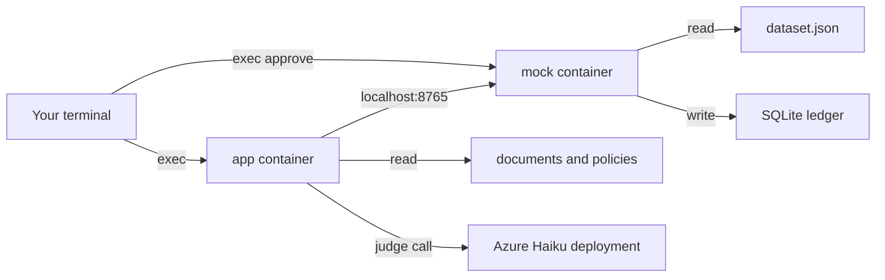

# Azure deploy: one image, files split by container

This is a rehearsal deploy. The assessed path stays on your machine until a facilitator confirms in writing that the mock may run in the cloud.

Nothing in this file logs in to Azure or builds an image. Run the commands yourself, in order. Stop and ask before changing a subscription, a region, or a secret.

## What was checked

The layout files were read on `mvp-v1` after `azure-deploy` was merged. `azure-deploy` was not deleted. Docker was not installed in that check, so none of the following were run: `docker build`, `docker compose up`, `docker compose exec`, `az login`, a container-app create, or the copilot flow inside a container (`run`, `run-all`, `agent-review`, `submit-review`, approve, `create-record`, evaluate).

File checks that did run:

- `Dockerfile`, `docker-compose.yml`, and `deploy/azure/containerapp.yaml` parse. The compose file is YAML with two services. The container-app file is YAML with `properties.managedEnvironmentId`, `configuration.registries`, `configuration.secrets`, and `template.containers` named `mock` and `app`.
- The image copies `pyproject.toml`, `uv.lock`, `README.md`, `src`, `tools`, `config`, and `prompts`. Those paths exist in the repo. `.dockerignore` excludes `data`, so case files are not in the build context.
- The mock command has no host flag. `tools/runtime.py` binds `127.0.0.1`. Compose gives the app `network_mode: service:mock` and `MOCK_BASE_URL=http://127.0.0.1:8765`. The app mounts `documents/` and `policies/` only. The mock mounts `dataset.json` only.
- `uv.lock` is copied and not given to the installer. The image runs `pip install .`. Whether that install succeeds was not run.
- `docker-compose.yml` sets `env_file: .env`. That file is not in git, and `.dockerignore` excludes it. A compose start with a missing `.env` was not run; the file reference is still a requirement of the compose file as written.
- Resource names in the steps below (`Momentum(sandboxes)`, `pod3-resource`, `westus3`, `card-disputes-rg`) were already in this note. This check did not sign in, so it did not confirm they exist.

Until a machine with Docker runs the compose block, treat every container command below as unread by an engine.

## What this deploy is

One image holds the copilot code and the mock program. It does not hold case files.

Azure Container Apps runs that image as two containers in one app. They share localhost, so the copilot calls the mock at `http://127.0.0.1:8765`.

| Container | What it runs | Files it can see |
|---|---|---|
| `mock` | `tools/runtime.py serve` on `127.0.0.1:8765` | `dataset.json` and the SQLite ledger |
| `app` | stays running so you can exec commands | `documents/` and `policies/` only |

The copilot never opens `dataset.json`. The mock never needs the markdown files. The API key is an Azure secret on the app container. It is not in the image.

The ledger and the drafts live on temporary disks. A new replica starts empty. That matches a training mock. Do not put the SQLite file on Azure Files. File shares break SQLite locking.

There is no public address. You enter the containers with `az containerapp exec`.



## Step 1. Use this branch

These files are on `mvp-v1`. They were merged from `azure-deploy`. That branch is still on the remote; do not delete it to deploy.

```sh
git switch mvp-v1
```

Do not commit `.env`, `submissions/`, or `reports/dev.json`.

## Step 2. Prove the split on your machine

This step needs Docker. It does not need Azure.

`docker-compose.yml` builds the image once. The mock mounts only [data/dev/dataset.json](../data/dev/dataset.json). The app mounts only `data/dev/documents` and `data/dev/policies`. The app joins the mock's network, so `127.0.0.1:8765` is the mock.

```sh
docker compose up -d --build
docker compose exec app python -c "import urllib.request; print(urllib.request.urlopen('http://127.0.0.1:8765/health').read())"
docker compose exec -e FEATURE_LLM_REVIEW=off app dispute-copilot run CARD-D01
```

The health line should include `"status": "ok"`. `run` writes a draft under the app container's `/submissions`, which is the `app-submissions` volume.

To see that the app folder has no fixture file:

```sh
docker compose exec app python -c "from pathlib import Path; print(Path('/data/dataset.json').exists())"
```

That prints `False`.

Stop the local pair when you are done:

```sh
docker compose down
```

## Step 3. Sign in and pick the resource group

The Foundry resource `pod3-resource` is only the Haiku deployment. The container app is a new resource in the same subscription.

```sh
az login
az account set --subscription "Momentum(sandboxes)"
az group create --name card-disputes-rg --location westus3
```

Use `DefaultResourceGroup-CIN` instead of a new group if you are not allowed to create one. Keep the region as `westus3` so it matches the Foundry project.

## Step 4. Create the registry and push the image

The registry stores the image. The two containers pull the same tag.

```sh
az acr create --name CHANGE_ME_REGISTRY --resource-group card-disputes-rg --sku Basic --admin-enabled false
az acr login --name CHANGE_ME_REGISTRY
docker build -t CHANGE_ME_REGISTRY.azurecr.io/card-disputes:latest .
docker push CHANGE_ME_REGISTRY.azurecr.io/card-disputes:latest
```

`CHANGE_ME_REGISTRY` must be unique across Azure, lowercase, 5 to 50 characters. Example: `pod3disputes`.

Confirm the image has no case files:

```sh
docker run --rm CHANGE_ME_REGISTRY.azurecr.io/card-disputes:latest python -c "from pathlib import Path; print(list(Path('/data').glob('*')))"
```

`/data` is empty because the files arrive only through mounts.

## Step 5. Create the Container Apps environment

The environment is the private network around the app. It is not the Foundry resource.

```sh
az containerapp env create \
  --name card-disputes-env \
  --resource-group card-disputes-rg \
  --location westus3
```

## Step 6. Upload the two file sets

Create a storage account and two file shares. One share is the mock folder. The other is the copilot folder.

```sh
az storage account create \
  --name CHANGE_ME_STORAGE \
  --resource-group card-disputes-rg \
  --location westus3 \
  --sku Standard_LRS \
  --kind StorageV2

az storage share create --name mock-data --account-name CHANGE_ME_STORAGE
az storage share create --name app-data --account-name CHANGE_ME_STORAGE

az storage file upload \
  --account-name CHANGE_ME_STORAGE \
  --share-name mock-data \
  --source data/dev/dataset.json \
  --path dataset.json

az storage file upload-batch \
  --account-name CHANGE_ME_STORAGE \
  --destination app-data/documents \
  --source data/dev/documents

az storage file upload-batch \
  --account-name CHANGE_ME_STORAGE \
  --destination app-data/policies \
  --source data/dev/policies
```

`CHANGE_ME_STORAGE` must be 3 to 24 lowercase letters and numbers, unique across Azure. Example: `pod3disputesdata`.

Register the shares on the environment:

```sh
STORAGE_KEY=$(az storage account keys list \
  --account-name CHANGE_ME_STORAGE \
  --resource-group card-disputes-rg \
  --query "[0].value" -o tsv)

az containerapp env storage set \
  --name card-disputes-env \
  --resource-group card-disputes-rg \
  --storage-name mockdata \
  --azure-file-account-name CHANGE_ME_STORAGE \
  --azure-file-account-key "$STORAGE_KEY" \
  --azure-file-share-name mock-data \
  --access-mode ReadOnly

az containerapp env storage set \
  --name card-disputes-env \
  --resource-group card-disputes-rg \
  --storage-name appdata \
  --azure-file-account-name CHANGE_ME_STORAGE \
  --azure-file-account-key "$STORAGE_KEY" \
  --azure-file-share-name app-data \
  --access-mode ReadOnly
```

Do not paste `$STORAGE_KEY` into a file or a chat.

## Step 7. Let the environment pull the image

```sh
ENV_ID=$(az containerapp env show \
  --name card-disputes-env \
  --resource-group card-disputes-rg \
  --query id -o tsv)

az identity create --name card-disputes-pull --resource-group card-disputes-rg
PULL_ID=$(az identity show --name card-disputes-pull --resource-group card-disputes-rg --query id -o tsv)
PULL_PRINCIPAL=$(az identity show --name card-disputes-pull --resource-group card-disputes-rg --query principalId -o tsv)

az role assignment create \
  --assignee-object-id "$PULL_PRINCIPAL" \
  --assignee-principal-type ServicePrincipal \
  --role AcrPull \
  --scope "$(az acr show --name CHANGE_ME_REGISTRY --query id -o tsv)"
```

Edit [deploy/azure/containerapp.yaml](../deploy/azure/containerapp.yaml):

- Replace `CHANGE_ME_ENVIRONMENT_ID` with the value of `$ENV_ID`.
- Replace every `CHANGE_ME_REGISTRY` with the registry name.
- Leave the secret value as the placeholder. Step 8 sets the real key with a command so it is not stored in git.

The template uses a system identity for the registry. If the create command rejects that, switch the registry block to the pull identity from this step and ask before changing the YAML.

## Step 8. Create the app and set the Haiku key

```sh
az containerapp create \
  --name card-disputes \
  --resource-group card-disputes-rg \
  --yaml deploy/azure/containerapp.yaml
```

Then set the key from your local `.env` without printing it:

```sh
set -a
source .env
set +a
az containerapp secret set \
  --name card-disputes \
  --resource-group card-disputes-rg \
  --secrets "llm-api-key=$LLM_API_KEY"
```

If the YAML create fails because the placeholder secret is invalid, delete the `secrets:` block from the YAML, create the app, then run `az containerapp secret set` and add the `LLM_API_KEY` secret ref in a second update. Do not paste the key into the YAML.

The app has no ingress. The mock listens on `127.0.0.1` inside the replica, so it is not reachable from the internet.

## Step 9. Check the cloud pair

```sh
az containerapp exec \
  --name card-disputes \
  --resource-group card-disputes-rg \
  --container app \
  --command "python -c \"import urllib.request; print(urllib.request.urlopen('http://127.0.0.1:8765/health').read())\""
```

A healthy mock returns `"status": "ok"`.

Confirm the split:

```sh
az containerapp exec \
  --name card-disputes \
  --resource-group card-disputes-rg \
  --container app \
  --command "python -c \"from pathlib import Path; print('fixture', Path('/data/dataset.json').exists()); print('docs', Path('/data/documents').is_dir())\""
```

`fixture` is `False`. `docs` is `True`.

Run one case with the model off, then one judge call:

```sh
az containerapp exec \
  --name card-disputes \
  --resource-group card-disputes-rg \
  --container app \
  --command "dispute-copilot run CARD-D04"
```

`FEATURE_LLM_REVIEW=block` is set on the app container, so a later check calls Haiku:

```sh
az containerapp exec \
  --name card-disputes \
  --resource-group card-disputes-rg \
  --container app \
  --command "dispute-copilot agent-review CARD-D04"
```

A real pass or block reason means the container reached the Haiku deployment. `The model reply was not usable.` means the key or the base URL was refused.

Submit, approve, and create stay two different containers:

```sh
az containerapp exec \
  --name card-disputes \
  --resource-group card-disputes-rg \
  --container app \
  --command "dispute-copilot submit-review CARD-D04"

az containerapp exec \
  --name card-disputes \
  --resource-group card-disputes-rg \
  --container mock \
  --command "python tools/runtime.py approve REVIEW_ID --reviewer dhyey --state /state/run.sqlite"

az containerapp exec \
  --name card-disputes \
  --resource-group card-disputes-rg \
  --container app \
  --command "dispute-copilot create-record CARD-D04"
```

Use the `review_id` from submit in the approve command. Approve runs in `mock` because that container owns the SQLite file.

## What was left out on purpose

- No public ingress and no load balancer.
- No second cloud.
- The Foundry resource is not called as its own service. The judge still uses the Haiku deployment URL.
- Restarting the replica clears the ledger and the drafts. Run `reset` only when you mean to:

```sh
az containerapp exec \
  --name card-disputes \
  --resource-group card-disputes-rg \
  --container mock \
  --command "python tools/runtime.py reset --confirm --state /state/run.sqlite"
```
