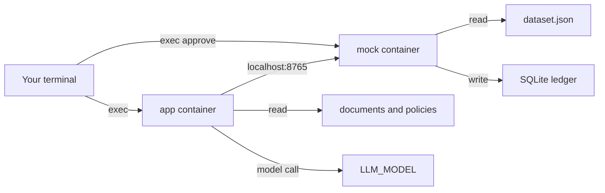

# Azure deploy: one image, files split by container

Azure Container Apps is the deployment that is running. The app never approves. The mock listens on `127.0.0.1` inside the replica. There is no public ingress and no public address.

This session could not sign in to `<subscription>`, so it did not query these resources. The names below are the ones supplied for that deployment. Do not put the subscription id or a model host in this file.

| Item | In use |
|---|---|
| Region | West US 3 (`westus3`) |
| Resource group | `card-disputes-rg` |
| Registry | `pod3disputes` |
| Image | `card-disputes:promptfix` (code only; no case files in the image) |
| Storage account | `pod3disputesdata` |
| Shares | `mock-data` (only `dataset.json`) and `app-data` (`documents/` and `policies/`) |
| Environment | `card-disputes-env` |
| App | `card-disputes`, one replica, no public ingress |
| Model | Model id from `LLM_MODEL` in `.env` (currently `claude-haiku-5-5`), secret `llm-api-key` (not in git). The host is Container App secret `azure-base-url`, read as `AZURE_BASE_URL` from `.env`. The template does not store the host. The checklist judge checks a finished draft when `FEATURE_LLM_REVIEW=block`. Approaches 2 and 3 may call the same model on an eligible case. It does not approve. `claude-haiku-5-5` has no price row in `config/rules/cost.yaml`. |
| Ranker | Optional. `JEV_BASE_URL`, `JEV_API_KEY`, and `JEV_MODEL`. An empty url or key skips it. The container template does not set these. Cost is unpriced. The threshold placeholder `0.70` is in `config/rules/classifier.yaml`, not a secret. |

## What was checked from this workspace

The layout files were read in this workspace. Docker was not installed here, and this session did not run `az login`. None of the following were run from here: `docker build`, `docker compose up`, `docker compose exec`, a container-app query, or the copilot flow inside a container (`run`, `run-all`, `agent-review`, `submit-review`, approve, `create-record`, evaluate).

File checks that did run:

- `Dockerfile`, `docker-compose.yml`, and `deploy/azure/containerapp.yaml` parse. The compose file is YAML with two services. The container-app file is YAML with `properties.managedEnvironmentId`, `configuration.registries`, `configuration.secrets`, and `template.containers` named `mock` and `app`.
- The image copies `pyproject.toml`, `uv.lock`, `README.md`, `src`, `tools`, `config`, and `prompts`. Those paths exist in the repo. `.dockerignore` excludes `data`, so case files are not in the build context.
- The mock command has no host flag. `tools/runtime.py` binds `127.0.0.1`. Compose gives the app `network_mode: service:mock` and `MOCK_BASE_URL=http://127.0.0.1:8765`. The app mounts `documents/` and `policies/` only. The mock mounts `dataset.json` only.
- `uv.lock` is copied and not given to the installer. The image runs `pip install .`. Whether that install succeeds was not run.
- `docker-compose.yml` sets `env_file: .env`. That file is not in git, and `.dockerignore` excludes it. A compose start with a missing `.env` was not run; the file reference is still a requirement of the compose file as written.

Local compose commands below were not run from this workspace. The Azure names are the running deployment as supplied, not a result of a query from here.

## What this deploy is

One image holds the copilot code and the mock program. It does not hold case files.

Azure Container Apps runs that image as two containers in one app. They share localhost, so the copilot calls the mock at `http://127.0.0.1:8765`.

| Container | What it runs | Files it can see |
|---|---|---|
| `mock` | `tools/runtime.py serve` on `127.0.0.1:8765` | `dataset.json` and the SQLite ledger |
| `app` | stays running so you can exec commands | `documents/` and `policies/` only |

The copilot never opens `dataset.json`. The mock never needs the markdown files. The API key is an Azure secret on the app container. It is not in the image.

The ledger and the drafts live on temporary disks. A new replica starts empty. That matches a training mock. Do not put the SQLite file on Azure Files. File shares break SQLite locking.

There is no public address. You enter the containers with `az containerapp exec`.



## Step 1. Use the repository copy

The layout files are `Dockerfile`, `docker-compose.yml`, and `deploy/azure/containerapp.yaml`. The image tag recorded for the running app is `card-disputes:promptfix`. This workspace did not build or push a replacement image, so that tag is not a claim that the replica is running the classification approaches.

Do not commit `.env`, `submissions/`, or `reports/dev.json`.

## Step 2. Prove the split on your machine

This step needs Docker. It does not need Azure.

`docker-compose.yml` builds the image once. The mock mounts only [data/dev/dataset.json](../data/dev/dataset.json). The app mounts only `data/dev/documents` and `data/dev/policies`. The app joins the mock's network, so `127.0.0.1:8765` is the mock.

```sh
docker compose up -d --build
docker compose exec app python -c "import urllib.request; print(urllib.request.urlopen('http://127.0.0.1:8765/health').read())"
docker compose exec -e FEATURE_LLM_REVIEW=off app dispute-copilot run CARD-D01
```

The health line should include `"status": "ok"`. `run` writes a draft under the app container's `/submissions`, which is the `app-submissions` volume.

To see that the app folder has no fixture file:

```sh
docker compose exec app python -c "from pathlib import Path; print(Path('/data/dataset.json').exists())"
```

That prints `False`.

Stop the local pair when you are done:

```sh
docker compose down
```

## Step 3. Sign in

The running resource group is `card-disputes-rg` in West US 3. The subscription id is not written here.

```sh
az login
az account set --subscription "<subscription>"
```

## Step 4. Create the registry and push the image

The registry stores the image. The two containers pull the same tag.

```sh
az acr create --name pod3disputes --resource-group card-disputes-rg --sku Basic --admin-enabled false
az acr login --name pod3disputes
docker build -t pod3disputes.azurecr.io/card-disputes:promptfix .
docker push pod3disputes.azurecr.io/card-disputes:promptfix
```

The registry in use is `pod3disputes`. The tag in use is `card-disputes:promptfix`. The image holds code only.

Confirm the image has no case files:

```sh
docker run --rm pod3disputes.azurecr.io/card-disputes:promptfix python -c "from pathlib import Path; print(list(Path('/data').glob('*')))"
```

`/data` is empty because the files arrive only through mounts.

## Step 5. Create the Container Apps environment

The environment in use is `card-disputes-env`. It is the network around the app. It is not the model host.

```sh
az containerapp env create \
  --name card-disputes-env \
  --resource-group card-disputes-rg \
  --location westus3
```

## Step 6. Upload the two file sets

Create a storage account and two file shares. One share is the mock folder. The other is the copilot folder.

```sh
az storage account create \
  --name pod3disputesdata \
  --resource-group card-disputes-rg \
  --location westus3 \
  --sku Standard_LRS \
  --kind StorageV2

az storage share create --name mock-data --account-name pod3disputesdata
az storage share create --name app-data --account-name pod3disputesdata

az storage file upload \
  --account-name pod3disputesdata \
  --share-name mock-data \
  --source data/dev/dataset.json \
  --path dataset.json

az storage file upload-batch \
  --account-name pod3disputesdata \
  --destination app-data/documents \
  --source data/dev/documents

az storage file upload-batch \
  --account-name pod3disputesdata \
  --destination app-data/policies \
  --source data/dev/policies
```

The storage account in use is `pod3disputesdata`. Share `mock-data` holds only `dataset.json`. Share `app-data` holds `documents/` and `policies/`. The mock mounts `mock-data` at `/data`. The app mounts `app-data` at `/data`. The app cannot see `dataset.json`. That split is intentional. SKU and access flags in the create commands were not confirmed from this workspace.

Register the shares on the environment:

```sh
STORAGE_KEY=$(az storage account keys list \
  --account-name pod3disputesdata \
  --resource-group card-disputes-rg \
  --query "[0].value" -o tsv)

az containerapp env storage set \
  --name card-disputes-env \
  --resource-group card-disputes-rg \
  --storage-name mockdata \
  --azure-file-account-name pod3disputesdata \
  --azure-file-account-key "$STORAGE_KEY" \
  --azure-file-share-name mock-data \
  --access-mode ReadOnly

az containerapp env storage set \
  --name card-disputes-env \
  --resource-group card-disputes-rg \
  --storage-name appdata \
  --azure-file-account-name pod3disputesdata \
  --azure-file-account-key "$STORAGE_KEY" \
  --azure-file-share-name app-data \
  --access-mode ReadOnly
```

Do not paste `$STORAGE_KEY` into a file or a chat.

## Step 7. Let the environment pull the image

```sh
ENV_ID=$(az containerapp env show \
  --name card-disputes-env \
  --resource-group card-disputes-rg \
  --query id -o tsv)

az identity create --name card-disputes-pull --resource-group card-disputes-rg
PULL_ID=$(az identity show --name card-disputes-pull --resource-group card-disputes-rg --query id -o tsv)
PULL_PRINCIPAL=$(az identity show --name card-disputes-pull --resource-group card-disputes-rg --query principalId -o tsv)

az role assignment create \
  --assignee-object-id "$PULL_PRINCIPAL" \
  --assignee-principal-type ServicePrincipal \
  --role AcrPull \
  --scope "$(az acr show --name pod3disputes --query id -o tsv)"
```

Edit [deploy/azure/containerapp.yaml](../deploy/azure/containerapp.yaml):

- Replace `CHANGE_ME_ENVIRONMENT_ID` with the value of `$ENV_ID`.
- Replace every `CHANGE_ME_REGISTRY` with `pod3disputes`.
- Leave the secret values as the placeholder. Step 8 sets the key and the host from `.env` so neither is stored in git. The secret names are `llm-api-key` and `azure-base-url`. The app reads the host as `AZURE_BASE_URL`.

The template uses a system identity for the registry. If the create command rejects that, switch the registry block to the pull identity from this step and ask before changing the YAML.

## Step 8. Create the app and set the judge key

```sh
az containerapp create \
  --name card-disputes \
  --resource-group card-disputes-rg \
  --yaml deploy/azure/containerapp.yaml
```

Then set the key and the host from your local `.env` without printing either value:

```sh
set -a
source .env
set +a
az containerapp secret set \
  --name card-disputes \
  --resource-group card-disputes-rg \
  --secrets "llm-api-key=$LLM_API_KEY" "azure-base-url=$AZURE_BASE_URL"
```

If the YAML create fails because a placeholder secret is invalid, delete the `secrets:` block from the YAML, create the app, then run `az containerapp secret set` and add the `LLM_API_KEY` and `AZURE_BASE_URL` secret refs in a second update. Do not paste the key or the host into the YAML. The image does not contain the host. Compose reads it from `.env` via `env_file`.

The app in use is `card-disputes` in environment `card-disputes-env`: one replica, no public ingress. The mock listens on `127.0.0.1:8765` inside the replica. The app container calls `http://127.0.0.1:8765`. The checklist judge model id is `LLM_MODEL` in `.env` (currently `claude-haiku-5-5`). Its key is the Container App secret `llm-api-key`. The host is the Container App secret `azure-base-url`, exposed as `AZURE_BASE_URL`. That call checks a finished draft. It does not approve. The same model id is what approaches 2 and 3 call on an eligible case. The replica template does not set the ranker variables. A run with no model call does not need `AZURE_BASE_URL`.

## Step 9. Check the cloud pair

```sh
az containerapp exec \
  --name card-disputes \
  --resource-group card-disputes-rg \
  --container app \
  --command "python -c \"import urllib.request; print(urllib.request.urlopen('http://127.0.0.1:8765/health').read())\""
```

A healthy mock returns `"status": "ok"`.

Confirm the split:

```sh
az containerapp exec \
  --name card-disputes \
  --resource-group card-disputes-rg \
  --container app \
  --command "python -c \"from pathlib import Path; print('fixture', Path('/data/dataset.json').exists()); print('docs', Path('/data/documents').is_dir())\""
```

`fixture` is `False`. `docs` is `True`.

Run one case with the model off, then one judge call:

```sh
az containerapp exec \
  --name card-disputes \
  --resource-group card-disputes-rg \
  --container app \
  --command "dispute-copilot run CARD-D04"
```

`FEATURE_LLM_REVIEW=block` is set on the app container in the template, so a later check calls the model named by `LLM_MODEL`:

```sh
az containerapp exec \
  --name card-disputes \
  --resource-group card-disputes-rg \
  --container app \
  --command "dispute-copilot agent-review CARD-D04"
```

A real pass or block reason means the container reached the configured model host. `The model reply was not usable.` means the key or that host was refused. A pass does not approve the case.

Submit runs in `app`. Approve runs in `mock`. Create runs in `app` and still stops unless the human approve has been recorded:

```sh
az containerapp exec \
  --name card-disputes \
  --resource-group card-disputes-rg \
  --container app \
  --command "dispute-copilot submit-review CARD-D04"

az containerapp exec \
  --name card-disputes \
  --resource-group card-disputes-rg \
  --container mock \
  --command "python tools/runtime.py approve <review_id> --reviewer <name> --state /state/run.sqlite"

az containerapp exec \
  --name card-disputes \
  --resource-group card-disputes-rg \
  --container app \
  --command "dispute-copilot create-record CARD-D04"
```

Use the `review_id` from submit in the approve command. Approve runs in `mock` because that container owns the SQLite file.

## Pull traces without opening ingress

Drafts and traces are cleared when the replica restarts. The app container sets `REPORTS_DIR=/submissions/reports`, next to the drafts on the temporary disk. The status page does not listen on a public address. Build the HTML inside the app container and copy the file out:

```sh
az containerapp exec \
  --name card-disputes \
  --resource-group card-disputes-rg \
  --container app \
  --command "dispute-copilot dashboard --export /submissions/reports/status.html"
```

That export also writes `/submissions/reports/compare.html` beside the status file. If that `az` build only opens a shell, run the same export at the prompt, then `cat /submissions/reports/status.html`, `cat /submissions/reports/compare.html`, and `cat /submissions/reports/logs/run.jsonl`. Open the HTML on your machine. Do not add an ingress rule for port 8754.

`LOG_STDOUT=1 dispute-copilot run-all --label azure` writes the same JSON lines to that process's stdout. The replica command is still `sleep infinity`, so Log Analytics shows that process, not an exec session. Use the file copy above until the copilot itself is the process whose stdout the platform collects. Leave `LOG_STDOUT` unset for the stdio context server.

## Classification settings the app reads

Approach 1 is the default and does not call a model. It does not read `AZURE_BASE_URL`. `CLASSIFIER_APPROACH` may be `1`, `2`, `3`, or `ab`. `--shadow` on `run` and `run-all` writes an audit for every approach and leaves the draft on the selected approach. `dispute-copilot compare` runs approaches 1, 2, and 3 on one fetched transaction list. A model call with an empty `AZURE_BASE_URL` fails with `AZURE_BASE_URL is empty`.

`JEV_BASE_URL`, `JEV_API_KEY`, and `JEV_MODEL` are optional. Leave the url and the key empty to skip Jev. An empty `JEV_MODEL` uses `jev-latest`. `CLEF_API_KEY`, `CLEF_ACCOUNT_ID`, and `CLEF_MODEL` are optional. Leave the key and the account id empty to skip Clef. An empty `CLEF_MODEL` uses `clef-flash`. Approach 3 asks Jev first, then Clef when Jev is missing or the call fails, then the configured model. An ambiguous Jev or Clef answer goes to manual review and does not call the configured model. A ranker class that matches the rules is kept. A disagreement asks the configured model, and that class stands only when it matches the rules or the ranker. When no ranker returns a class, the configured model is asked, or the rules class stays when that client is missing (`rules_only`, or `model_failed` when a ranker call failed). The ranker threshold is the placeholder `0.70` in `config/rules/classifier.yaml`. Jev cost is unpriced. Clef-flash list price is 0.038 USD per million input tokens. `deploy/azure/containerapp.yaml` does not set `JEV_*` or `CLEF_*`, and this workspace did not add those secrets on the replica.

A duplicate stands only when the fetched transactions contain two charges with the same merchant id, amount, and currency. Without that pair the class does not stand. Classification audits do not store the complaint. The review page is the only page that shows it. Reviewer login is phase 2.

`config/rules/cost.yaml` prices `claude-haiku-4-5` at 1.00 USD per million input tokens and 5.00 USD per million output tokens. `claude-haiku-5-5` has no row, so that id is recorded as `no price configured for claude-haiku-5-5` with no USD figure.

## What was left out on purpose

- No public ingress and no load balancer. The mock stays on loopback inside the replica.
- The model named by `LLM_MODEL` checks a finished draft when the checklist judge is on, and approaches 2 and 3 may call the same model on an eligible case. It does not approve. The app never approves. The key is `LLM_API_KEY` in `.env`. The host is `AZURE_BASE_URL` in `.env`, stored on the app as secret `azure-base-url`. Jev stays off until `JEV_BASE_URL` and `JEV_API_KEY` are set. Clef stays off until `CLEF_API_KEY` and `CLEF_ACCOUNT_ID` are set. Jev cost is unpriced. The value of the host is not written in this file.
- Restarting the replica clears the ledger at `/state` and the drafts at `/submissions`. Files on `mock-data` and `app-data` stay. Run `reset` only when you mean to:

```sh
az containerapp exec \
  --name card-disputes \
  --resource-group card-disputes-rg \
  --container mock \
  --command "python tools/runtime.py reset --confirm --state /state/run.sqlite"
```
